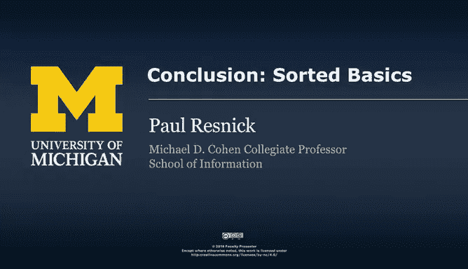

# 密歇根大学《Python3编程（课程1、2）》｜Python 3 Programming（Python for everyone进阶）（中英字幕） - P161：73_05_05_排序基础总结.zh_en - GPT中英字幕课程资源 - BV1CM411Z72u

Congratulations， Rah Rah， you've learned how to get Python to sort sequences for you。😊。

The sortded function handles all the details。 You just have to specify the desired sort order。

You should now be able to invoke the sorted function to sort any sequence。

 You should be able to specify low to high or high to low sorting using the reverse parameter。

 and you should be able to specify a property to sort by using a key function。It's joke time。

I am sure you've heard some rags to Riches stories about the guy who started out working in the company mail room and eventually became the CEO。

Well， this one has a little twist。It's Jerry's first day at the company。

 and he's assigned to the mail room。 he's given the task， sort the incoming mail。

And Jerry sorted the letters so fast that his motions were literally a blur。

His supervisor was very impressed。 At the end of the day， the supervisor approached Jerry， says。

I just want you to know that I'm very pleased with the job you did today。

 You're one of the fastest workers we've ever had。😊，Oh， thank you， Sir， said Jerry。It's beamaming。

 and tomorrow I'll try to do even better。Better。😊，How is that even possible。Jerry replied， to mor。

I'm going to read the addresses。We'll see you next time when we sort dictionaries and learn how to break ties。

