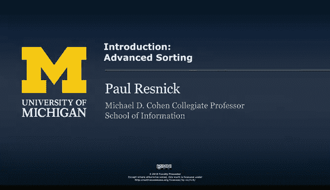

# 密歇根大学《Python3编程（课程1、2）》｜Python 3 Programming（Python for everyone进阶）（中英字幕） - P162：74_05_01_高级排序导论.zh_en - GPT中英字幕课程资源 - BV1CM411Z72u

Hi， glad to have you back for a little more in depth look at sorting。😊。

We're going to look at sorting dictionaries， which can be a little confusing。

 even though it follows the same mechanics that you learned in the previous lesson。

We're also going to look at how to break ties in the primary sort order with a secondary sort order。

At the end of this lesson， you should be able to sort a dictionary's keys based on their values or some property of their values。

And you should be able to break ties by having the key function return a tuple。Bye for now。

