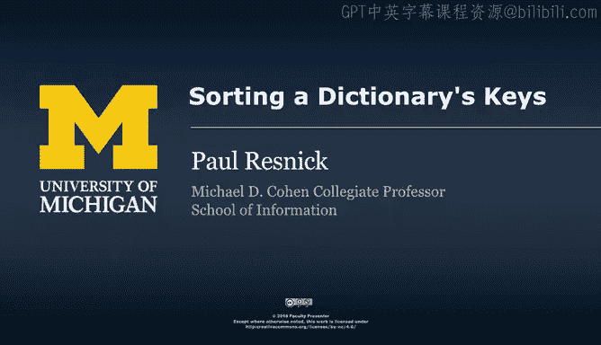
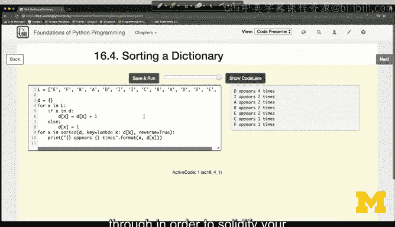

# 密歇根大学《Python3编程（课程1、2）》｜Python 3 Programming（Python for everyone进阶）（中英字幕） - P163：75_05_02_字典键排序技术.zh_en - GPT中英字幕课程资源 - BV1CM411Z72u

Welcome back。One sorting task that comes up frequently。

 but's a little tricky is sorting a dictionary。The way we sort a dictionary is to sort its keys。

After that， we can iterate through the keys and look up values as we need to。So remember this code。

You've seen something like it before， maybe with a slightly different list。

We've just got a list with a bunch of items。 Some of them repeat。

 and we're creating a dictionary that counts for every item。

 for every distinct possible value in the list。 How many times does it come up in the list。

So a comes up once， twice。So at the end， in our dictionary D。We're going to have。

The value 2 associated with the key A。And then on lines 9 and 10。

 we're just printing out the values from that list。So E appears twice。 F appears once。

 A appears two times， as I just manually counted， and so on。Notice that the。Keys， E， F， AB。

C and so on。 They appear not in any special order。And that's。Just the way dictionaries work。

 when you ask for the keys。You get all the keys back。

 but there's no promise made about what order they'll appear in。 Suppose I cared about the order。

 and I really wanted to say， no， a appears。One times。B appears twice， and so on。

The way to do that is going to be on line9 to sort the keys before doing the iteration。So。

 let's suppose。That instead of just asking for the keys。I pass those keys into the sortded function。

Now， I'm gonna get the results。In alphabetic order， A appears two times。 B appears two times。

And so on。Well， that's all well and good。How about if we wanted to sort based on the counts instead。

 So we really want D to get printed out first because it appeared the most times。And after that。

 we'll get the things that appeared only only twice。Now。

We can specify a property of these keys that we want to use for sorting。

And there's a little confusion that's going to go on here because we're using the word key in two different ways。

 We use the word key to refer to a key in a dictionary。Like in this dictionary， D。

 we have letter capital A is a key and capital B is a key and so on。

But then we have a second use of the word key， which is the parameter name。In the sordid function。

So if we want to say sort these keys based on some property of them。

 we say k equals and we pass in a function here。These are just two different。

Meanings of the word key。 And you got to keep them separated。

So remember the key function is going to take one list item as an input。In our case。

 we have a list of all the keys， AB，C， D， EF， and so on。

And so that's what we're going to have as one input。

And I am going to call my function the parameter for this function。 K。

 just to remind me that the thing that's getting passed into it is one key from the dictionary。

Like the letter A or the letter F。I'm choosing the parameter K to remind me of that。

And then we're going to return a property。Of that key and the property we want is。

 what is the value associated with that key in the dictionary D。So， if I have。The key C。

What I want to do is get the value1。And I want to use that for the sword order。For D， I want to use4。

The way I can do that。If I refer to D square bracket K， just look up for the current key。

What is its value in the dictionary。And I get。If the current key is C， I'll get 1。

 and if the current key is D， I'll get4。this is really all I need to do in order to re sort。

This output in the way that I want it。Let me just clear those markings for you。

So now we have D appearing at the end because we're going lowest to highest the items that occur at least frequently。

To the ones that occur most frequently， if I wanted to do it in the reverse order， I just do。

If I wanted to do it in the reverse order。I just use it。 reverse equals true， like we've done before。

Now D will get printed out first。So the things to remember here are we're not doing anything new with sorting。

 There's no new mechanics here。 We're just passing in a function for the key parameter。But we have。

Perhaps a little bit of a confusing function。This function is taking one key from the dictionary。

 as its input and returning。A property of that key， the look up of its value in the dictionary D。

So we have key as in a key from the dictionary。That's our letter K。

We've chosen to remind us that we're dealing with a。Dictionary key。And then， we have the。

Parameter name key。For the sortded function。One other thing I want to point out。Is that。

When we tell the sorted function to sort the keys， there is a shorthand we can use。You may recall。

 we've said before that any time a list is expected。

There's some place in the code where the Python interpreter is expecting a list。

 if you provide a dictionary。It will automatically grab all of the keys as the list。

 So this is equivalent。 We can either say， D dot keys。Or we can just say D。

 because we're passing them to sort it if we pass the dictionary。

It automatically figures out that we want to sort the keys。So， this is。

Sorting a dictionary's keys based on their values， there are several useful exercises at the bottom of the page in the textbook that I encourage you to work through in order to solidify your understanding。

We'll see you next time。