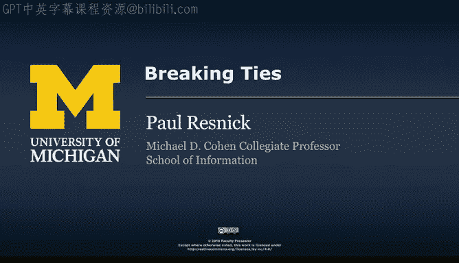
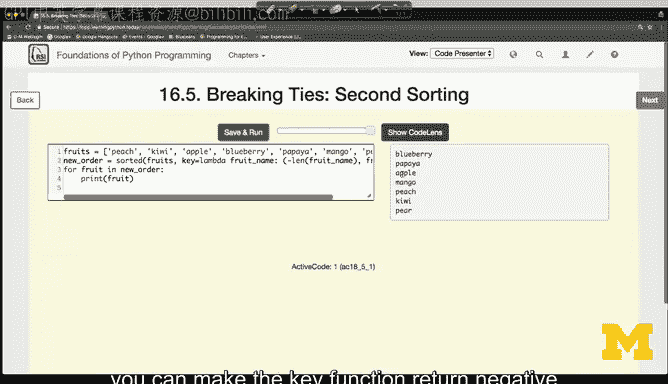

# 密歇根大学《Python3编程（课程1、2）》｜Python 3 Programming（Python for everyone进阶）（中英字幕） - P164：76_05_03_并列项处理策略.zh_en - GPT中英字幕课程资源 - BV1CM411Z72u

Welcome back。What if we really want to control the sort order？

Specifying how to break ties on the primary property we're using for sorting。

The answer is that we take advantage of Pythons built in sort order for tuples。

So take a look at this code。I have a list。Containing five tuples。Each tuple has three items in it。

The first tupo has。A 3 and 2。 The second tu has C 1 and 4， and so on。On line 6。

I am going to sort those tuples。 So we're still going to get a list of five tuples。

And then we're just going to print each of them with an iteration。

What order do you think they're going to come out in。

Is it just going to do them in the original order because it doesn't know how to sort tus。

 Is it going to put all of the A's first。So we'll get this one and then this one。

And then the B and then the two C's。Is it going to do some random order？What's it going to do？Well。

 let's see。What it's going to do is put the A's first and then the B's and then the C's。

So when you sort tus， you're really sorting by the first element in those tuples。But， there's more。

We have a built in tie breaking mechanism。With tuple sorting。Here。The first values were both a。

So it went on to the second value and two comes before three。There was only one B。

 so there was no tie breaking that needed to happen。But。Between the two seas。Those are equal。

 So it goes on to the second element。 If those are equal， it goes on to compare the third elements。

 and it would even do fourth and fifth as many as you had elements in the tus。So。

When it compares two temples。It first compares their first elements。If one of them is smaller。

 then that whole tuple is smaller。But if there equally goes on to compare the second elements of the tuples and then the third elements and so on。

So that's going to turn out to be useful for us when we try to control a sword order for breaking ties。

 even when we're not sorting things that are。That are templeples。Suppose we had。

Really duplicate items。So， we had another a。3，2。It's exactly the same as the first element。

In that case， it's just going to put both of them in there one after the other。

So we've got both of the A32s showing up。It's never going to collapse them if you have six elements to start with and you sort the list。

 you're always going to end up with six elements at the end， even if two of them are identical。

All right， so that's sorting tuples。We're going to take advantage of the Python sword order for tus in order to be able to specify。

 fine grain control on our sword orders for other things。

Using tuples to create a tie breaking mechanism。The way we're going to make this tie breaking mechanism is that we're going to make our key function。

 as always， take one item as input， and it's supposed to return a property of the item。

 But instead of returning one property of the item。

We're going to return a tuple containing two properties of the item。So here's an example。

 We've got a list of fruit names。And we're going to sort them。

And the property that we're going to use to sort them is defined by this lambmbda expression。

It takes as its input，1 fruit name。And it returns as its output， a property。 But in this case。

 it's two properties。As a temple， the first one is。The length of the fruit name。

 How long is the word and the other is the fruit name itself。So this is going to produce for peach。

Its a couple，5。Kma。Peach。For kiwi， it's going produce 4。 comea kiwi。

Remember this idea that the key function is sort of。Producing a post it note that's associated。

With the item。 So peach has associated with it。This tuple。

And  Kiwi has associated with it this temple。When sorted is going to decide what order they should go in。

It's sorting them based on these posted notes， these tuples。

So four kiwi is going to go before five peach because the tuple ordering says。

 look at the first element of the tuple first。However， when it comes along and sees four come a pair。

It's going to have a tie when it compares 4 with4， and it's going to then use alphabetic ordering。

As the secondary sword order to break the ties。So we'll get us our output。

We get the four letter fruits first， kiwi and pear。 and then the five letter。A fruits， apple。

 mango and peach。 And those are in。Alphabetic order， Apple before mango M before P。

 mango before peach。What if we want to have the long words first。

This is just our standard mechanism with the sorted function。

 We can add the reverse equals true parameter。And now we'll get blueberry。To show up first。

That's allll fine， except。It's completely reversed the sort order from what we had before。

So now we have peach before mango before Apple。 Those are all the five letter words。

And we now have them in reverse alphabetic order， in addition to reversing the long words to short words。

What if we wanted to。Have longest words first， but break ties。With alphabetic order。

 rather than reverse alphabetic order。This starts to get pretty tricky。

One solution that's available to us is a little trick instead of using reverse equals true to reverse our sort order。

Which will make it so that we reverse both the primary and the secondary property。

 I'm going to try to just reverse the primary property。

 And there's a trick I can use for numeric properties， like the length of the fruit name。

 If I just make all of them be negative values。So blueberry is now going to be minus9 and kiwi is going to be minus4。

-9 is less than -4。 And so I'm going to get the longer ones to come first， but I haven't。

Reversed everything。 So my secondary sword order is still going to be from lowest to highest。

 which will be alphabetic。So I still got blueberry first。

But I now have apple before mango before peach in alphabettic order。

That trick only works if we have a numeric property if you had。2 alphabetic properties。

 and you wanted to do reverse on one and not on the other。 It would be harder。

 And I don't have an easy solution for you。So summarizing。

If you want to specify a tie breaking property， have your key function， return a tuple。

Like key functions everywhere。 they always take one item from the sequences input。

 but now it's going return a tuple。Where the first element of the tuple is the primary property to sort by。

 the next element is the secondary property to sort by。

 and you could even have more elements in the tuple。

We also saw that if you just want to reverse the order for one of the properties， but not the others。

 instead of using reverse equals true， you can make the key function return the negative。

Of all the numbers。

See you next time。