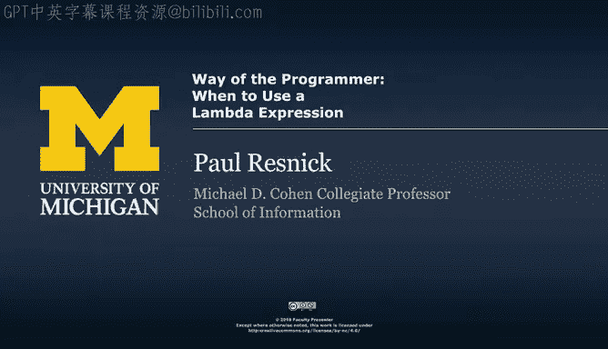
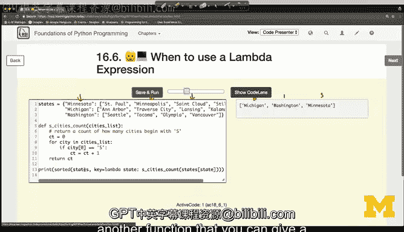

# 密歇根大学《Python3编程（课程1、2）》｜Python 3 Programming（Python for everyone进阶）（中英字幕） - P165：77_05_04_程序员之道：lambda表达式适用场景.zh_en - GPT中英字幕课程资源 - BV1CM411Z72u

Glad to have you back。Here's a little way of the programmer advised on when to use a Lada expression and when to use an aimed function for your key parameter when sorting。

Basically。My rule of thumb is if the lamb expression is。Short and simple。

So that it's pretty easy to understand what it's doing， use the lambmbda expression。

And as soon as it gets too complex。Refer to a name function instead and give it a good name that describes the property you're trying to sort by。

For example， here's one that's just at the outer limits of what I'd consider simple enough to put in a lambda expression。

We have a dictionary called States。It's got as its keys。The names of states in the United States。

 Minnesota， Michigan and Washington， and the value associated with each state， with each key。

Is a list。A list of city names。Saint Paul， Minneapolis， Saint Cloud。

 Still water for Minnesota Ann Arbor， Travis City and so on for Michigan。

Now we want to sort the keys based on some property of their values。

So we have a generic structure where we have a dictionary called states。

And we're going to sort its keys。 We just asked to sort the dictionary。

 but that always means we'll get to sort the keys。And our key function。Is going to take。Wen。

Item from that list。As an input， and it's going to look up some property。 In fact。

 it's going to look up。That state in the state's dictionary。But in this case。

 we're not just trying to get the whole list as the value associated with Minnesota。

We're trying to get some property of that list。 And in this case， we're。Taking square bracket at 0。

So we're taking square bracket at 0。 So that would get us。Saint Paul。

And we're passing it to the land function。 So that's going to give us。eight。😡，And for Michigan。

 we would take。The list that state's square bracket state gets us the whole list of cities。

We take square bracket0 from that， that'll get us the city of Ann Arbor and we'll pass that to the lend function。

 so we'll get1，2，3，4，5，6，7，8，9。And Arbor has nine letters。 and similarly， for Washington。

 we'll get the length of Seattle， which is。7 letters。So when we sort this。

 we should get a list of the states， Minnesota， Michigan and Washington。

 but we should get them in the order Washington first because it first city。Has a shorter name。

And sure enough。We get。Washington and then Minnesota and then Michigan。

So that's great when the property we wanted was the length of the first city name。And as I said。

 I think this is sort of just at the outer limits of what's understandable in a lambda expression。

This got to be kind and complicated。 We had。 It worked pretty well to understand it because states square bracket state is sort of a chunk。

 A pattern that we've seen before。 We're taking a dictionary key。

 and we're looking up its value in the dictionary。If you think of that as a little chunk as， oh。

 that's the value of the state in the dictionary， then we can just parse the square bracket of zero to say。

 oh， take the first element of the list。And pass that to the land function。

Anything much more complicated than this， I think would be pretty hard to read as a lambda expression。

Well， let's think about one of those harder things， Sose that we wanted to take a different property。

For each state， we want to find the number of cities。In its city list that begin with the letter S。

We want to sort in that order。So， okay。What does that property sound like。

 The number of states that begin with the letter S。Number of states。

 That sounds like it's going to be a count accumulation。And only those that begin with the letter S。

 that sounds like we're going to need to filter as we count。 So it's count and filter accumulation。

 It's not too hard to write it as a function。But it would be pretty hard to write just as a lambda expression。

So， I'm going to。Write a function。I'm going to call it S cities count。And it's gonna take。

As an input， a city's list。And what it's going to produce as an output is。His account。

Of how many cities。Begin with a capital S。Well， this is a count filter and accumulation。

 so I'm going to say count equals0。For city in C L。If。The first letter of city。Is S。Thenen。

Increment are counter by one。When we finish the iteration。

 C T will have the total number of cities that began with S。So we'll return CT。Now。

 how am I going to use that。The key function is going to take one state as input。

 And I wrote this city's count to do our accumulation as though it's taking a citiess list。

So I can't just say key equals as cities count。That's not going to work。Because。

The key function has to take one state as an input。

And my key function is taking a list of cities as an input。

So this is going to be a little bit of a hybrid。I'm going to。Take one state as an input。

 I'm going to look it up to get the city's list。So that's sort of our canonical way of sorting a dictionary by its values。

Is we。Look up that key。 Look up the key state in the state's dictionary。

 But that's going to give me a city's list。 And I'm going to pass that。To my new function。Let's see。

 when you write that much code， the chances of running without an error aren't very good。

 Let's see if I happened to get lucky。 Wow， I did。Okay。

 so we got Michigan first and then Washington and then Minnesota。

So hopefully if we go look at the cities's list， we'll see that Minnesota is the one that has a lot of cities beginning with S and sure enough it does。

Washington has。Saint Paul， for one， Saint Cloud for two and still water for three。So， it had three。

Washington had Seattle for just one， and Michigan had zero。So sure enough。

 we got these in order of the number of cities that begin with the letter s。

So let's review what we did here again。We made a helper function。

 a name function called Cities count that did our thing that was a little too complicated to put into the Lambda expression。

And we passed。Some property of our key， the list of cities in that state。

 we pass that as an input to this helper function S citiesities count。

Now it's actually possible to not use a lambda expression here at all and just refer to a named function。

But we would have to make our function then take as input， not the city's list。But the state name。

So I'm going to do a version of that。 I'm going to call it S cities。Cot。For state。

And it's going to take a state name as its input。In中。Make the city's list equal。

The look up of the state in the state's dictionary。And then， everything else can be。

The same as before。If I do that。I can say that。 my key function。Is just as cities count。For state。

That time， I wasn't so lucky。So。This is always instructor。

 Let's look at this error message it says syntax error EOF and multi line statement on line 19。Now。

 EOF might be a little confusing。It's an acronym E stands for end O of F is file， end of file。

 Basically， it means it got to the end of the program。

It was sort of in the middle of trying to parse something。And it's saying line 19。

 So I always like to go back and look at the first thing before that。 here's line 17。

 and sure enough。I am missing a closing parenthesis。 So it was kind of waiting around。

 expecting there to be another。Closing parenthesis and it didn't find it， and so it got an error。

Let's run now。And sure enough， that works exactly the same as the original。

Now I actually prefer the original over this second one， even though line 17 now looks very clean。

 we just say key equals this function name。But I find that the previous version。

 we can use our scrubber to go back to go back to it。 let's see。Yeah， this one。

Where we had key equals lambmbda state as cities count of states square bracket state。

 the lambmbda expression is more complicated here。But the lookup。

Of one key in the dictionary is just a very common idiom when we are sorting the keys from a dictionaries。

So that's a little advice on when to use Lambda expressions versus name functions。

My basic advice is if the land of expression is simple enough。Do it that way。

And when it gets too complicated to read or write， then it's time to use a name function to move some things out into another function that you can give a good name for。

We'll see you next time。

