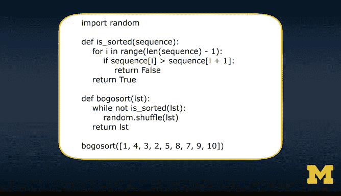

# 密歇根大学《Python3编程（课程1、2）》｜Python 3 Programming（Python for everyone进阶）（中英字幕） - P166：78_05_05_高级排序总结.zh_en - GPT中英字幕课程资源 - BV1CM411Z72u

Congratulations， now， you really know how to sort simple sorts， complex sorts， all sorts of sorts。😊。

You can sort dictionary keys based on some property of their values。

You can break ties by having the key function return a tuple。 You can use lambmb expressions。

 you can use name functions。 You are a pro at sorting。Now， in the intro to this week。

 I made a big deal out of saying we're not going to go into details of which sorting algorithm gets used and how long it takes it to run。

So instead of a straight up joke， let me give you a little programmer's humor。

 a sorting algorithm that runs really slowly。It's called Bogo sort， and it works by trial and error。

Take the items。 shuffle them。Just get random into some random order and check if they happen to be sorted。

If they are， we're done。Otherwise， try again， shuffle。 See if they're sorted。

 Keep going until you get a lucky shuffle。Remarkably。

 the code for this in Python is short In the random module。

 there's a built in function called shuffle。And I wrote the function to check if a list is in order in five lines and another4 for the trial and error while loop。

 here's the full code。Of course， because you do a random shuffle every time it takes a random amount of time to finish。

 But as you can imagine， this is not a fast way to do sorting。

 If you got a bunch of items and you just shuffle them。

 the chances that it's going to be sorted aren't very good。I just ran at once on a list of 10 items。

 and it took 68 seconds to complete。 I didn't dare to try it with 11 items。

By contrast。Python's built in sorted function was able to sort a million items in just over half a second。

Now you have a party trick。Ask your friends who've taken some computer science courses some time ago to try to remember the slowest sorting algorithm they studied。

They'll have fun recalling bubble sort an insertion sort and trying to decide which one is slower。

 And then you can regale them with bogo sort。😊，You'll be the life of the party。 Trust me。

See you next time。