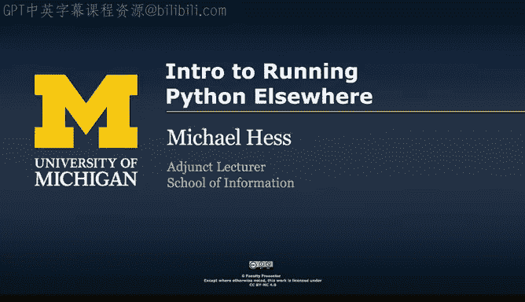

# 密歇根大学《Python3编程（课程1、2）》｜Python 3 Programming（Python for everyone进阶）（中英字幕） - P167：79_05_01_外部Python环境导论.zh_en - GPT中英字幕课程资源 - BV1CM411Z72u

Good afternoon， good evening， good morning I'd like to talk about running Python right now you are running Python in the Coursera Cloud and in a tool set called Roonestone。

And this is a great environment to learn Python in because we as the instructional team have total control over how your Python gets executed。

 what packages are available to you， what happens before and after your code runs。

 and in fact we can actually run your code and inspect the output and that's how you get graded and this is great for educational environments。

 but it's not great when you need to run Python for like a personal project or for work。

And so I've got some videos that are upcoming that you're going to see different places in which you can run Python。

 we'll talk about running Python locally， we'll talk about running it on a cloud provider。

 we'll talk about running it in hosted notebooks， we're going to go through the whole gamut of how you might run Python and how you might even create APIs with running Python in different locations Thank you。

