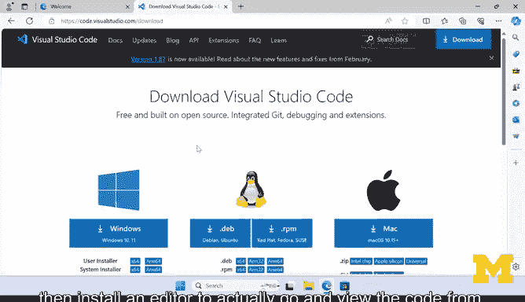
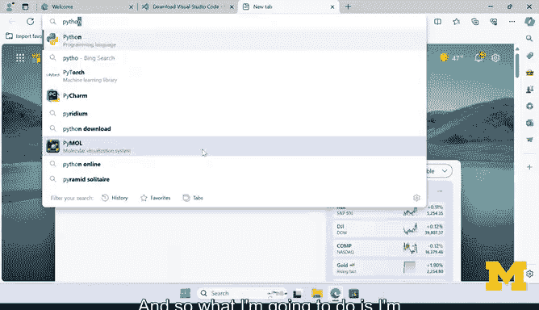
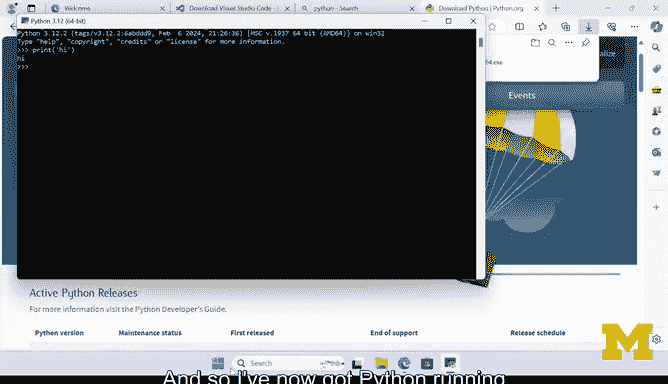
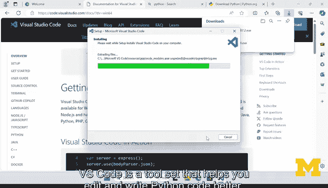

# 密歇根大学《Python3编程（课程1、2）》｜Python 3 Programming（Python for everyone进阶）（中英字幕） - P168：80_05_02_Windows本地Python与VS Code安装.zh_en - GPT中英字幕课程资源 - BV1CM411Z72u

Good afternoon， good morning， good evening， wherever you may be I'm back today to talk a little bit more about Python and running in different environments and so we're gonna start off by talking about running Python locally and today locally is a Windows machine so you might run Windows you might run Mac you might run Linux today we're gonna to talk about installing Python on your Windows computer and here today I have a Windows machine about an hour ago I did a fresh install of Windows 11 on this and so I'm going to walk through the steps that one might use to install Python and then install an editor to actually go and view the code from and so what I'm going to do is I'm going to start by Googling Python。

And we'll go ahead and oops， I did not mean to click there。

 but that'll work Here we are on Python's website。And I'm going to go ahead and download the latest version of Python。

 which at the time we are recording this video is Python 3122 depending on when you look at this。

 you may realize how old or young this video is， but for now we'll go ahead and download Python this process hasn't changed dramatically in I don't know since Python 3 came out which was several several years ago at this point and so we've downloaded Python and like any Windows program once it's finished downloading we will go ahead and install it and so we'll give that a minute to finish downloading we'll click on it and we'll say install now you can customize the way this works。

 but there's really no reason to unless you've got a complex setup or using like multiple Python versions of something of that nature Now anytime you install something locally on your machine sometimes you may run into issues and you may have to do some troubleshooting but Google is pretty helpful for debugging that but since this is a fresh Windows install this should go pretty seamlessly here。

And as you can see， Python has installed successfully， you can see that it setup was successful。

 that's great。 And one of the things we should be able to do now is go and actually run Python So if I go here。

😊，And I just type in Python。And you'll see that Python comes up and I can press enter。

 and now I'm inside of what's called a Python interpreter now。

You've all been used to writing code and Jupiter notebooks or maybe in Runone Stone and then running the code。

 this isn't a place where you can write a script， it's kind of like a little bit of like the internalts of Python。

 but you can write Python commands here。And execute them and so I've now got Python running locally on this Windows machine and you know I'm going to hold this up for the camera。

 this is just a laptop with an HDMI cable plugged in it so it's very much a basic Windows computer configured for me to do this with。

I want to， now that we've got Python installed， I want to， I want to go and。

Change topics a little bit and say， how would you actually write code locally on your computer？

And typically the way we think about doing this is using an IDE or an integrated development environment。

And IDEs are really good ways to be Python developers。

 they kind of help you and give you hints along the way there's really two of them that I'd recommend。

 one of them is called VS code or visualual Studio code and the other one is called PyAm and I'm going to start with visual Studio code。

And I'll go ahead and download visualual Studio code， and I'm on an x64 based machine。

 and we can see that it's downloading and so we'll give this a minute to finish downloading。

Okay we can see that visual Studio code is finished downloading and I'm now going run the installer so we'll press open fileile and this will take it a second to load the actual installer itself and we will go ahead and yes we accept the agreement obviously you should read the agreement before you just blindly accept it but we'll go ahead and press next next next I'm going to actually have it created desktop icon just so it's easier to get into next and install and this will take a minute to go through and do the installation of VS code VS code is a tool set that helps you edit and write Python code better。

Thank you。😊。