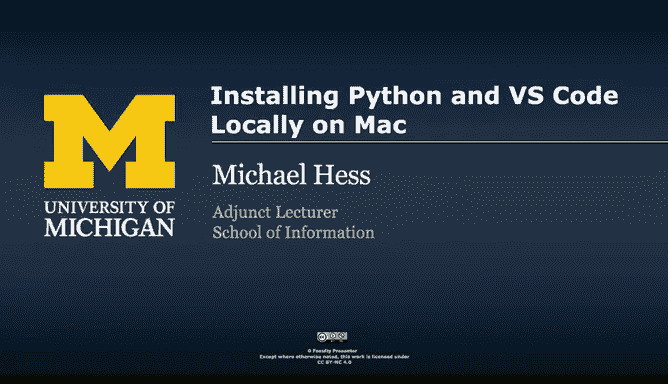
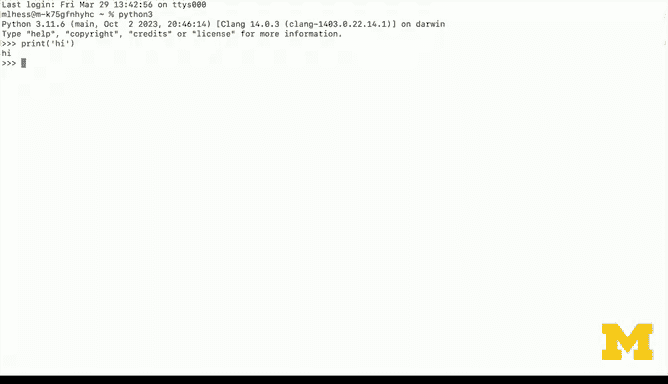
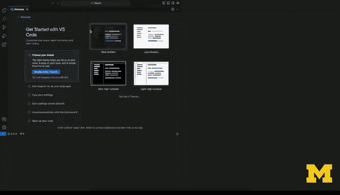

# 密歇根大学《Python3编程（课程1、2）》｜Python 3 Programming（Python for everyone进阶）（中英字幕） - P169：81_05_03_Mac本地Python与VS Code安装.zh_en - GPT中英字幕课程资源 - BV1CM411Z72u

Good afternoon， good morning， good evening， wherever you may be today I want to talk about how to install and run Python on a Mac here I've got a Mac machine that I've got plugged in this is I'm using this solely for this demo today and one of the nice things about Mac I' he sees Mac have Python installed already and so I can come here I can type terminal。

😊，Let me make this bigger so everybody can see it a little bit easier and I can type Python 3 and I'm inside the Python interpreter now you wouldn't write a script inside the Python interpreter。

 but this is the underlying Python program on your computer and you can type Python code in here。

And it will run that Python code I want to talk a little bit about not just running Python because it's pretty easy to install Python it's installed on your Mac。

 but I want to talk about ways to actually write code on your Mac and one of the tools sets for doing that is known as a IDdeE or an integrated development environment and if you really want to write Python code on your PC or on your Mac I would highly recommend you use one of these tool sets and so I'm going to go ahead and download this tool set called visual Studio code there's multiple IDs that you can use on your Mac。

 the two big ones are visual studio code and Pycharm we'll go ahead and download visual Studio code this will take it a second to download。

And we can see that it's done downloading。Go ahead and open this and we'll go ahead and go through the installer for visual Studio code。

Now that I've downloaded visual Studio code， you can see that I've got this dot zip file that came from the internet。

 I'll double click on this。And it's going to extract the application known as visualual Studio code。

 and I can drag this into my apps folder or if I just want to run it from where it is。

 I can run it from where it is。And we'll give this a second to open up。

And because we did download it from the internet， it's going to ask us the safety question， yes。

 I'm sure I want to run this。And this is what visual Studio code looks like。

Thank you。