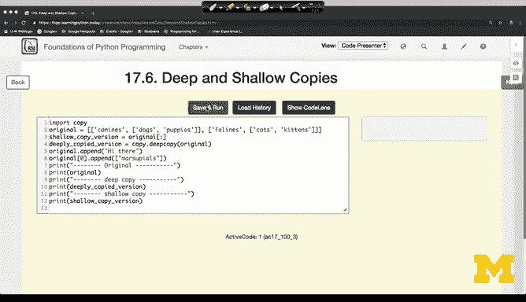

# 密歇根大学《Python3编程（课程3、4、5）》｜Python 3 Programming（Python for everyone进阶）（中英字幕） - P16：15_02_05_深拷贝.zh_en - GPT中英字幕课程资源 - BV1gj41177yd

Welcome back。Previously， I showed you that a shallow copy can lead to some confusions because the same inner list is included in multiple outer lists。

What would we do if we wanted to make a copy that was completely independent of the original list so that no change anywhere。

 even to an inner list would change the copied version。That's what's called a deep copy。

We can do it with nested iteration， accumulating a copy of each inner list。

So let's take a look at this code。I have the same original list。From before， it has two inter lists。

 The first one， dogs and puppies， the second one， cats and kittens。

I'm going to use our old friend the accumulation pattern。

 I start by making copied outer list B an empty list。 So this is our。Accumulator variable。I iterate。

Through the sequence original， my loop variable or iterator variable， I'm calling inner list。

And then I'm doing this nested iteration。And I'm doing a nested accumulation here。

 so I make another accumulator variable copied in her list， and it's set to be empty。

I iterate through the items in inner list。Here， my second iterator variable is called item。

And I append it。 append item。To the copied dinner list。

 So copyied dinner list starts as an empty list， and we keep adding additional items to it。

When we're done with the inner list。Coopied dinner list has all of the same elements that it had。

 And so we then take copied inter list， and we append it to the outer list。

Let's run that and see what happens。At the end of lines 3 through 7， we have。

Copiied outer list as this deep copy。 if we print it。

It looks like it has the same contents as original。Because this is a deep copy。

Even if I append canines to the end of the first inner list in the original list。

 as I'm doing on line 9。It's not going to have any impact on the deep copy on the copied outer list。

So， we print original。And it does the same thing that happened。In our previous example。But when I。

Print the copied outer list。 There's no canines here。The reason is that I have made a deep copy。

So let's just make the reference diagram that'll go with this。 We have。Original。It's pointing to。

Its list of two things。The one is the。Dogs and puppies。The other other is the cats。And kittens。

When we make。The copied outer list。We end up again with a list of two items。

But the first item is now。Not pointing to。Dogs and puppies。It's pointing to a copy of it。

With the same contents。But it's a different list。So then on line 9， when I append something here。

As an extra item。With the canines in it。It does not have any effect。

On the inner list from copied outer list。Doesn't change anything in the deep copy。

 So we have successfully managed to make copyied outer list be a deep copy that is completely independent。

From the original list， even if I change something deep inside the original list。

 it has no impact on the copied outer list。Now， you might have noticed。

Lines 4 through 7 are a little bit more complicated than they need to。

 I reminded you previously that we can use the slice operator。

 and we can do that here to make a copy of the inner list。So， instead of。Doing a manual accumulation。

 we can make the copied inner list。 just be inner list。Square bracket。Kowen。

And get rid of all of this。And this maybe makes the code a little easier to read if you remember that the slice operator with a colon makes a copy of the list。

So this has exactly the same effect as the code that we did before。Nested iteration。

 where we copy each of the inner lists works fine for making deep copies。

 If we know how many levels of nesting we have and we have a parallel structure everywhere with the same levels of nesting。

But what about this one。There are three levels in some places， but not everywhere。We've got。

An outer list， which has， as its first element。This inner list。

But this inner list has a string canines as its first element。

 but a third level of list as its second element。So how would you make a deep copy of this one？

This is a case where a technique called recursion would allow us to write fairly elegant code。

 but we're not going to teach recursion in this specialization。

 Turns out you can get pretty far in writing applications and data analysis programs without learning recursion。

 because in the most common cases where it's useful。

 there's a built in function available to you that will do the recursion behind the scenes。

This is one of those cases。There's a built in function called deep copy in a module called copy。So。

 I've imported。A module called copy。And inside the copy module， there is a deep copy function。

And it just takes a sequence as its value。And it produces a deep copy。

Where as many levels of nesting as there are， it goes in and always copies things。

 it never shares an inner list between the original and the deep copy。So， I have。My original version。

I have a shallow copied version。And I have a deeply copied version。And if I were to print those out。

 they would all look the same。But now， I'm going to。Append。To the original。

An extra string at the very end。 So it's going to have another item at the end。

And then I'm also on line 6， going to the first。Inner list。 And I'm appending。

The list marsupials to it。At this point， we're going to have original deep copy and shallow copy。

 all have different values。 And let's see what those are。

So you can see now that original。Has canines。Dogs， puppies。And an extra element marsupials。

 That happened because on line 6， we appended the list marsupials。To the end of its first inner list。

The shallow copy。Because it only did the one level of copying also was changed。 It got marsupials。

 as well。But in the deep copy。No marsupials。The other difference we can see is that the original and the shallow copy diverge because the original。

Gets high there， at the end。So we appended to the top level list。And there。

 the original is different from the shallow copy。 So high there got appended to original。

 did not get appended to shallow copy。I encourage you to really work through this in detail。

 make a reference diagram， go through it in code lens and make sure you understand why these things are coming out with three different printouts at the end。

If you can follow it， you'll be able to reason your way through lots of things where you get puzzling answers and you'll be able to debug your code。

So to summarize， a deep copy of a list not only makes a copy of the outer list。

 but also makes copies of all the inner lists and their inner lists all the way down。

A deep copy is completely decoupled from the original。

You can make a deep copy with your own code if the structure is simple enough or use the built in deep copy function in the copy module。

See you next time。

