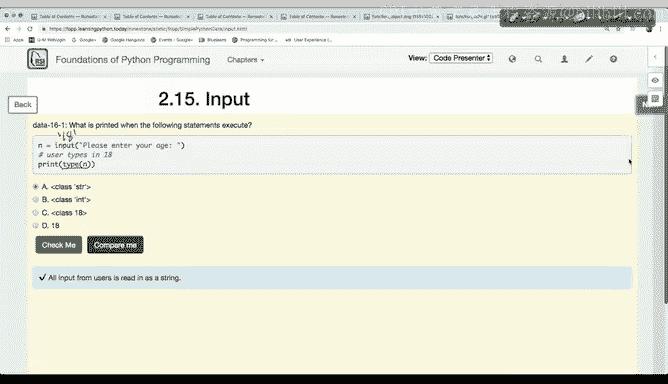

# 密歇根大学《Python3编程（课程1、2）》｜Python 3 Programming（Python for everyone进阶）（中英字幕） - P16：16_01_12_输入处理.zh_en - GPT中英字幕课程资源 - BV1CM411Z72u

Welcome back。 So Python gets a lot more interesting once we learn how to write code that doesn't actually execute or an output the same thing every single time that we run it。

 Now， the first way that we'll learn how to add some variability into what our code executes is by getting input from the user so we'll be able to have different outputs from our code。

 even with the same program by asking the user for some input and then doing something with that input。

And the way that we'll do that is with the naturally named input function。

 So input asks the user to enter something。 So， for example， in this code on line one。

We ask the user to input their name by calling the input function and the input function accepts a prompt as its argument。

 and so here we prompt the user， please enter your name。Now。

 the value of this expression of input is going to be whatever the user entered。

 so if the user enters Steve， then the value of this expression is going to be the string， Steve。

The value of input is always going to be a string no matter what user enters。

 so if the user for whatever reason enters 500。Then the value of this expression would be the string 500。

And now N gets assigned either Steve 500 or whatever string these are entered。

 and so when we print out hellello N， then we print out hello in whatever these are entered。

 so let's run this code and see what we get。So when I hit save and run。

 you'll see that I have this prompt here。And it says， please enter your name。

 And that's the exact prompt that we passed into input。So if I type in， Steve。As's my name。

hen you'll see that my code then print out hello Steve。

If I save and on my code and I enter something different。 So let's say that I entered Paul。

Then my code is going to output hellello， Paul。I can enter absolutely anything that I want in here。

 so I can enter 99999。And my code is going to print out。 Hello，9，9，9，9，9。So。Again。

 input always gives back a string， but let's suppose that we wanted a number instead of a string。

 Well， the way that we would do that is by casting or calling one of the functions to convert strings to a number。

 So for example， let's suppose that we wanted to write some code that was going to convert a number of seconds into a number of hours and a number of minutes。

 and we want to also compute the remainder when we actually divide to get the number of hours and minutes。

So。Here we prompt the user。 Please enter the number of seconds that you want to convert。

And then we put that into this variable STR seconds。

 the next thing that we do is we cast that variable STR seconds because again input always gives us back a string。

 we cast that to be an integer and we assign that to be total seconds。

We then compute the number of hours。By taking total seconds and then doing division without remainder by 3600 to convert seconds。

In two hours。And then we find out how many seconds are still remaining。

By taking the remainder of total seconds when it's divided by 3600。

Then we take those seconds that didn't divide evenly into the number of hours and convert them into two minutes by again taking the remainder。

I'm sorry。 By again， dividing without remainder by 60。

And then we figure out how many seconds are still remaining at the end of this by taking the remainder when we divide seconds still remaining by 60。

 and in the end we get the number of hours， minutes。

 and seconds for whatever number of seconds the user input。So if I save and run my code。

And then let's suppose that I just want to convert 60 seconds。Then I'll see that this is 0 hours。

1 minute in 0 seconds。If I convert 6000。Seconds。Then I'll see that this is one hour in 40 minutes。

If I convert。999 seconds。 Then I'll see that 16 minutes and 39 seconds， etc ceter。 So again。

 the point of this is we can use whatever the user entered as an integer by converting it to an integer by calling the int function or if we wanted to make it a floating point。

 we might call the floating point function。Now， you might ask what if the user enters something other than an integer。

 so if we're asked to enter the number of seconds that I want to convert and I type in。Let's see。

A name and I run， then you'll see that Python wasn't able to convert Steve into an integer and so we get a runtime error。

Now， let's look at a multiple choice question。So this asks what gets printed when the following statements execute。

 so let's suppose that we ask the user please enter your age and then the user enters 18。

So here n gets assigned to the string 18， because remember input。Always gives us back a string。

 it doesn't matter what the user actually entered， even if they enter 18。

 then n gets assigned to the string 18。And when we print out the type of n。

 then we're going to get that N is a string。That's off for now until next time。

