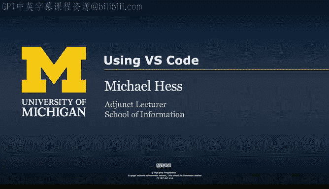
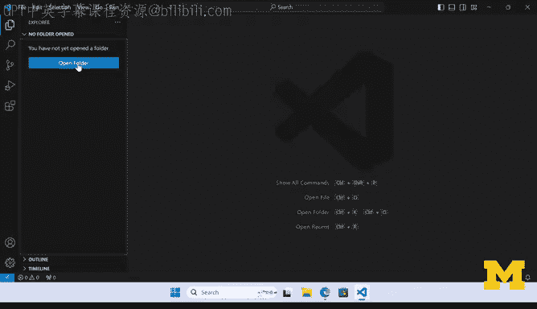
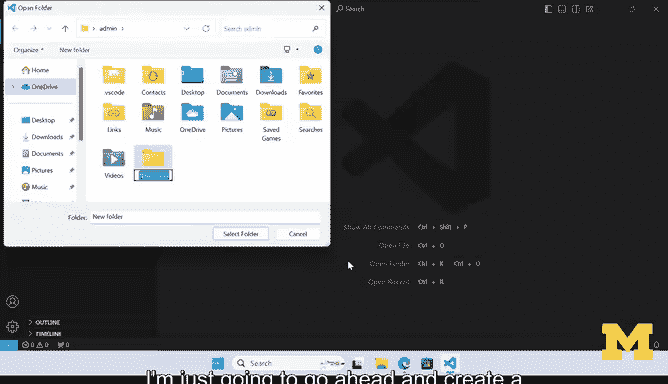
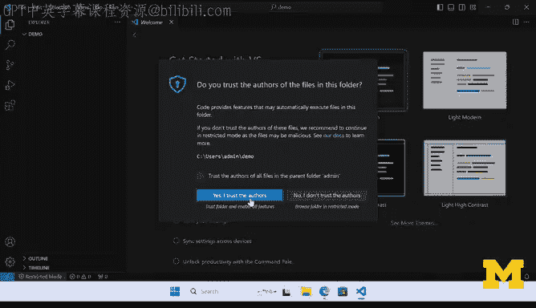
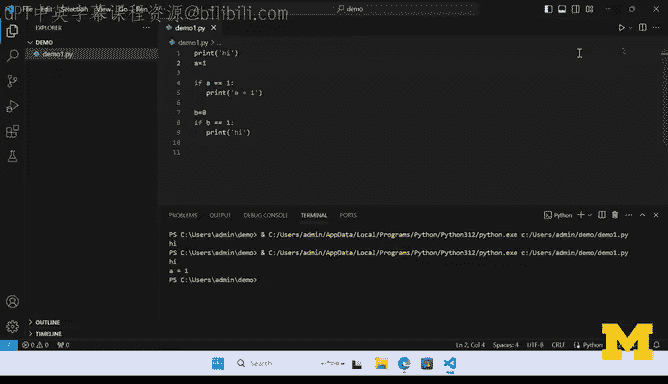

# 密歇根大学《Python3编程（课程1、2）》｜Python 3 Programming（Python for everyone进阶）（中英字幕） - P170：82_05_04_VS Code使用指南.zh_en - GPT中英字幕课程资源 - BV1CM411Z72u

Well， now we have VS code installed and we can kind of get an idea of how VS code works and some of the advantages of using VS code to edit and write your Python scripts with。

So this is a fresh install of VS code， you saw me go through the installation here and like most software packages when you install them it's coming up and asking。

 hey what what a you know what you want light mode or dark mode。

 high contrast mode or low contrast mode， I'm going to go ahead and close the welcome screen。

And I'm going to go ahead and click on the little file Exper over here。

And basically to start with VS code， you have to define where your project exists。

 and so we'll say open folder。

And I'm just going to go ahead and create a new folder in here。And just say demo。

 and I'll select the demo folder。

And you can see in here that you're going to get a questioning of do you trust the authors of this folder。

 if you're downloading code from the internet， you might be hesitant to say yes here。

 but since I'm you know I just created this empty folder， I am the author of it。

 I will trust this folder。

And you can see over here I've got an explorer of like demo and I've got some other things in here and there's a nice icon here to create a new file and so I'll just create demo 1。

 pi。And it's going to come up the first time you do a VS code install and say hey。

 I think you're trying to do Python work VS code supports lots of different programming languages and so you install the different support for each programming language as you go and so this is Python so yeah so yeah I want to install the Python library for VS code this requires that Python already be installed on your computer but we did that earlier and it'll take it a minute to install this and now we can see that it's installed and VS code works with a bunch of different extension so there's lots of different tool sets you can install to help you develop your code。

 this is the Python extension that helps us write Python code。

I'm now in the demo1 file after I've installed this extension。

 and you'll notice that as I start to type print to say print hellello world or print high。

The editor is actually helping me write the code it's saying， hey。

 do you want to print and I'll say yes， I want to print and I can say hi it's also telling me what I can do like what print does as it goes。

 it's basically like my my little like whisper as I go through and write this code if I do like an if statement if a equals one。

Print。A equals one and you'll notice that there's a bunch of red lines on my page as I write this Python is telling me I have syntax errors。

 Can you spot the syntax errors。There's actually two of them。

First one is this should actually be a double equal sign。And this should be indented。And technically。

 I never defined a， so let me define a equals0， and you'll now see that all those errors went away。

If I recreate that error， if I do like b equals one。Print tie。If I don't actually fix the error。

 but I just use my mouse to like highlight the error message itself， it's going to come and say hey。

 B hasn't been defined and print isn't also defined。

 it's not well it's defined but it's not inside the block you know you've got an if statement。

 the next thing you need to do is indent so that Python knows you're talking inside the if statement。

And I still have a syntax error here。And it's got a weird message there。

 but it's basically upset that it's not a double equal sign。

Using an IDE to help you write and develop your Python code is a skill in itself that's worth learning and I strongly recommend you download a VS code and use it to help write your Python code it makes you a better programmer it helps you find errors before you run your code Spea of running your code。

You'll notice that there is a plus button up here The plus button actually lets me execute my Python file so if I press this plus button。

 it's going to take it a second， but you're going to see that it actually ran my Python code and if I come in here and I set a equal to1 and I press the play button again you can see that it is now executing my code so we installed Python executable itself we installed VS code we installed the Python extension for VS code and we spent a little bit of time learning about how VS code as an IDE is a tool that helps you write better Python code Thank you。

