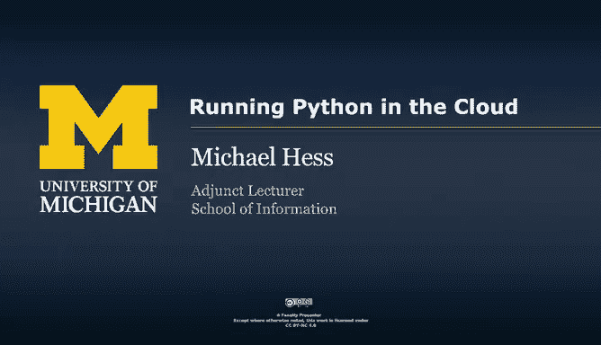
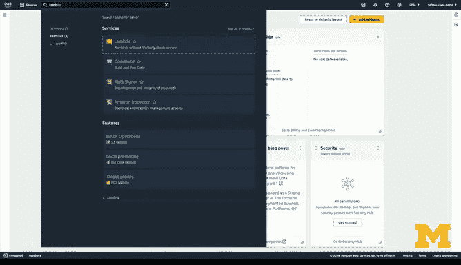
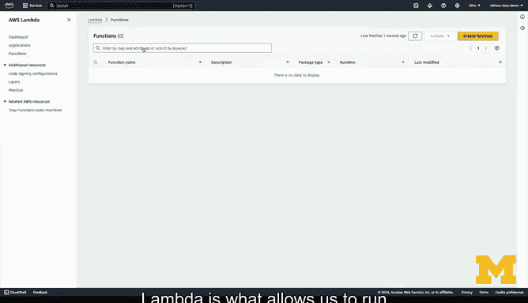
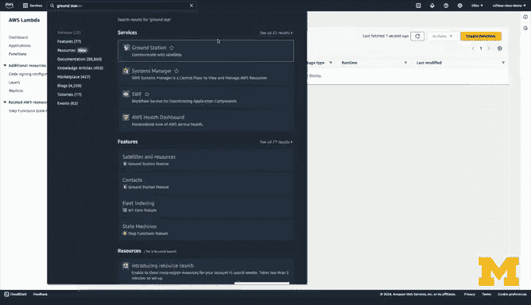
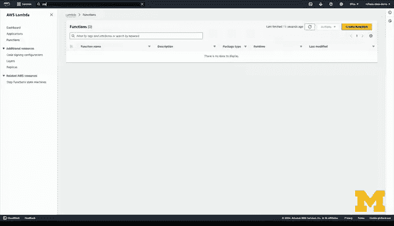
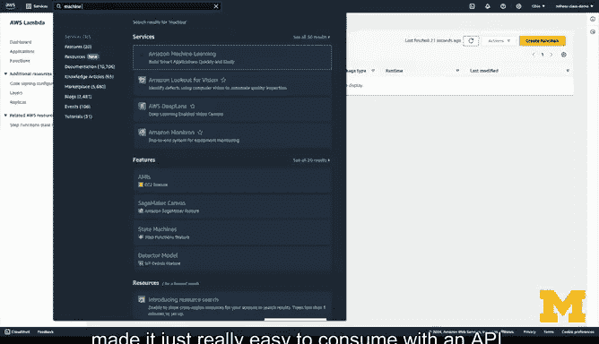
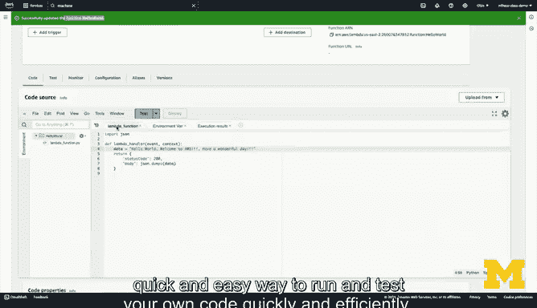

# 密歇根大学《Python3编程（课程1、2）》｜Python 3 Programming（Python for everyone进阶）（中英字幕） - P171：83_05_05_云端Python运行环境.zh_en - GPT中英字幕课程资源 - BV1CM411Z72u

Good afternoon， good evening， good morning I want to talk about running Python in the cloud and you know I think we should spend a little bit of time。

 not a lot of time， a little bit of time talking about what the cloud is and the cloud is effectively other people's servers and there's some management that goes into them but you could buy a physical server and run Python on that。

But running things in the cloud is typically cheaper， not always。

 but if it's done right it cheaper and it's easier， it's especially easier to get started。

 This is Amazon Web services。 I've currently logged in with a demo account that I'm using for this here。

 It's not my actual Amazon account。 My current spend on this， as you can see is nothing。

 my actual Amazon account， the current spend is a lot higher than nothing。

 and I want to just do a quick demonstration of like the hellello world in the cloud。 Now to do this。

 we have to choose the cloud service we want to use and different cloud vendors have different services available。

😊，And what sets these cloud vendors apart isn't necessarily like the base services they offer。

 they all offer the same base services， it's the services they add on top of those base services So in Amazon。

 you know we're going to be using a service called Lambda。

And Lambda is what allows us to run code in the cloud quickly and easily。

 but like Amazon also has some really cool services like groundStation groundStation。

 as it indicates lets you communicate with satellites there's also a ton of machine learning services built into Amazon where it's taken a lot of the complicated work related to machine learning and made it just really easy to consume with an API。

But back to my original demonstration here， Lambda Lambda lets us run a function in the cloud Now to use Lambda correctly。

 you have to kind of rethink your code， you're used to having maybe one large Python file with lots of functions in it。

It's not really how Lada works， this is a single function， maybe two functions。

 but really it's one purpose。And we'll come here and we'll say， hey， Amazon， let's create a function。

 we have to give our function a name。And we have to choose the runtime and the runtime here is the backend service that we're running for this and so you know we're choosing Python。

 we're going to be running on Python 312 for this demo。

 but you can see there's a large number of currently supported items and older versions of different languages that you can run。

 so we'll choose Python。And we'll say create function。

Now this is going to take it a second and as you may remember from the lecture we've had on functions already。

 functions take input and they return output and this really isn't any different here we have a function it's called Lambda handler。

😊，And it gets two items that come in。In this case， event and context。

There's a comment here to do something， and then at the end we actually return a dictionary that has a status code and a body。

And so we can come here and we can say。And I'll just go ahead and change what this is returning and just make this return data。

And I've now built my function in here， it's going to return a JSOt encoded string。

And what I may want to do is deploy this to Amazon servers and this is， you know。

 this sounds like it's going to be complicated， I'm going to do is press the deploy button。

And you can see that it has finished and successfully deployed that function Now。

 if I want to test this function， I can come here and say test and this is gets a little bit more complicated。

 but to start with since all I want to do is run this I can just write the event test It's actually going to send this JSON inside of the function it gets passed as a parameter。

 but we're not doing anything with that， we just want to see if this works so we'll say test。

And you can see in here that we get a body response back of Hello World， welcome to AWS。

 and just to show that this is working， I'll come here and I'll say hellello world， welcome to AWS。

Have a wonderful day。Yeah。We'll deploy that change， we can see that it's deployed successfully。

 we'll say test。And we can now see that it is updated successfully。

 Now it's a little hard to debug in this environment。

 writing code in heres can be a little complicated， but overall。

 this is a really quick and easy way to run and test your own code quickly and efficiently。 Now。

 Lambda is one of these tool sets that has lots of options available to it。

 And we are barely scratching the surface here。 but it is definitely something that if you need to be able to run code quickly and efficiently in the cloud should be in your toolkit。

😊。

Thank you。