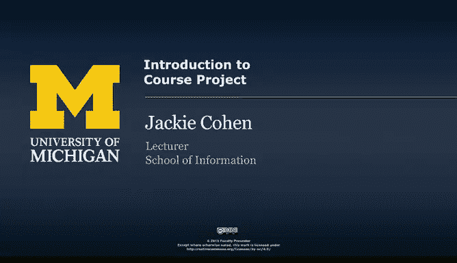
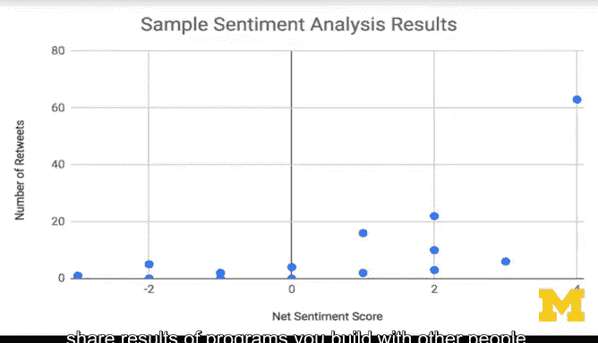

# 密歇根大学《Python3编程（课程1、2）》｜Python 3 Programming（Python for everyone进阶）（中英字幕） - P172：84_05_01_最终课程项目导论.zh_en - GPT中英字幕课程资源 - BV1CM411Z72u

Hello and welcome to Cose 2 and your end of course project In this project。

 you'll be building a program in a few steps to perform what's called a sentiment analysis。

Programs like these are widely used in a bunch of different companies and different situations。

 and in this case you'll be working with Twitter data， although it's fake Twitter data。

You will eventually make a CSV file and use that to produce a graph of your results。

 which is a super useful way to visualize data and share results of programs you build with other people。

Then you'd be able to build a program like this one to use real Twitter data。

 which we can't use in this particular case。In order to build this analysis in your eventual CSV file。

 we're going to take you through a series of steps to build different functions in order for you to put together this complete program。

As you proceed through the program， you should focus on individual steps one by one and make sure that you understand the instructions for each step before you move forward to writing the code。

You should always focus on one step at a time， because thinking about multiple steps in your program can often get overwhelming and can confuse you about what code needs to happen first and what should happen later。

 so make sure you focus on individual instructions for one step at a time。

Build your plan and translate that into code。As you work through the project。

As you think about each step that you have to work through。

 you should think carefully about what you know about functions。 What is the input for each function。

 What is its return value and what does each function have to do after the input and before it returns its final output。

As you work on each function， you'll be able to put them together to build the full project。

Remember also that in each step， you may need to copy some work you have done earlier into the next step to come up with a chart like this。

You'll want to make sure that as you work on each concept。

 you isolate what you have to do without focusing on earlier pieces and focus on the examples from the course that will be useful to you for the project。

 for example， function definition， advanced functions and dealing with files。

 since you're creating a file in order to visualize your data here。

I also think that this project is a particularly exciting way to think about how you can apply these concepts to things you might want to do in real life。

 so to speak， understanding different things about how programs can apply to you。 so good luck。

And have fun。