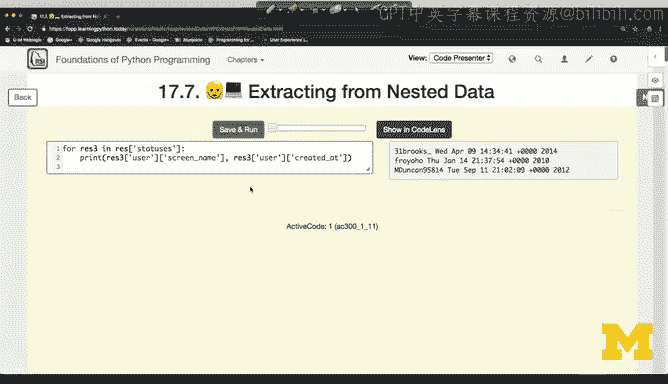

# 密歇根大学《Python3编程（课程3、4、5）》｜Python 3 Programming（Python for everyone进阶）（中英字幕） - P17：16_02_06_从嵌套数据中提取.zh_en - GPT中英字幕课程资源 - BV1gj41177yd

Welcome back for this way of the programmer segment on how to approach a big complicated nested data structure。

The answer is to take it one step at a time。I gave you a little preview of my approach previously。

 which I call。Understand， extract， repeat。To illustrate this。

 we'll walk through extracting information from data formatted in a way that's returned by the Twitter API。

This nested dictionary results from querying Twitter， asking for three tweets。

 matchingching University of Michigan。As you'll see。

 it's quite a daunting data structure even when printed with nice indentation。

Here we'll just take a little tour through it， you can see just to get the information about three tweets。

 there's a lot of stuff and there's a lot of indentation。Now how many levels of nest do we have here。

 maybe five or six？So this can be pretty daunting， but we're going to take it one step at a time。

And the mantra is understand extract repeat， so first we will understand it。So to understand it。

You might want to just print out the first few characters of it。 I'm using that Json Dumps。

To pretty print it。And I'm printing only the first hundred characters here so that doesn't take up too much space。

 and we can see at least from this that it's a dictionary。

 and that one of its keys is called search metadata。

 If you don't want to depend on looking at it and seeing the curly brace here I've printed out type of res。

And it is a dictionary。嗯。Whenever I have a dictionary。

The first thing to do in order to understand that dictionary is to ask for what are the keys in this case。

 there are only two keys， there's one that's search metadata and there's other statuses。

When I printed out the first 100 characters you could see search metadata。

 but you couldn't see statuses because that was way more than 100 characters in before that second key was going to show up because it was first going to show all of the NSAada that's part of the value of the search metadata key。

Once we've done our first level of understanding， we're going to descend one level we will extract。

And I want to show you another tool that can be pretty helpful for getting sort of an overview of what the whole data structure is going to be。

 which is sort of an outliner view of the whole nested data structure。

If I dump this data into JSON format， I can copy it to an external site that lets me sort of look at it in outline view。

So I'm going to get rid of these other print statements。

And I'm just going to print out the whole thing in JSON format。Yeah。

Instead of printing out just the first10 characters， I'm going to print out the whole thing。

And now I'm going to copy the whole contents。Which is quite。😔，A long thing。

This is all data just for three tweets。Believe it or not？Okay。And finally， I've got it all。

I'm going to copy it。We're now visiting a site called JONeditorOnline。org。And on the left side。

 they let you paste in a string that's in the JSON format。

I've copied that big long string and I'm now pasting it。All 600 and some lines of it。

And I can click on this arrow here， and it's now going to。Give me an outliner view of it。

 remember there were two keys， search metadata and statuses。

Telling me that search metadata is a dictionary with nine keys。One of them is called Count。

 completed in Max I Easterster， and so on。Under statuses， it's got a square bracket 3。

 which is telling me that it's a list。With three items in it。And I can see that the first element。

In that list is a dictionary with 24 items， 24 keys in it。

And I can keep descending down there my goal is actually going to be to get the authors of the tweets。

 so I'm going to guess that that's in the user。K。And sure enough， there's a screen name or a name。

And so if I'm very careful about this， I could just write a very complicated expression to go in。

Four levels of nesting and grab a screen name of 31 Brooks。

But I'm going to do this one step at a time， I've gotten myself oriented。

And I might come back here to help me stay oriented， but then I'm going to work with the code。

 and I'm going to build up my code one step at a time where at each step I understand what I have at the current level of nesting。

And then I extract to get something。One more level of nesting in。As of July 2023。

 the site Json editoritor Online dot org works slightly differently than it did when this video was first recorded。

 Let me show you how you'd get the same thing to day as I did before。

 I've copied in the big Json string into the left pane。Now， I click copy。

To move it over to the right paine， theres now some new things that you can do around transforming。

 but I'm not going to show you those things。 On the right side， it looks like exactly the same thing。

but if you click on tree， you'll get the view that you saw previously where you can click into the outline and see something about just those parts of the tweets that you want to look at。

So let's go back to our code。I figured out。That there were two keys and that the information that I wanted to extract the author names。

Or in the second of those， they were in the value associated with the statuses。

So I've just done something to extract。The value associated with the status is key。

So this is my first extract， I didn't understand and then an extract， and then I'm going to repeat。

So Ive extracted something at level two， and now I want to print some stuff out to help me understand what I've got。

And so I'm printing out the word level2 and I'm checking what is the type， it's a list。

 well if it's a list， the first thing that I always want to do is check its length and it has three items。

Now， from what we looked at in the JSN online editor。

 we also would have gotten that same information so this is。

 you can tell that we've sort of descended to that level of the data。

And since I know that this was a query that returned three tweets。

 I'm going to guess that each of the items in this list is representing one tweet from Twitter。

So I've now understood at this level， it's a list with three items， and so I'm now ready to extract。

 so I could either extract a single item or I could iterate through all the items。

What I'm going to want to do is extract all of the authors。So I'm going to iterate。

For each thing in Res 2。I'm going to do something with it， so that's why I'm iterating here on line8。

But。As I'm developing my code， I don't want to have to have lots of stuff showing up in the output window。

 so I actually want to deal initially with just one item at a time。

 and that's why I've done what I've done here on line 8。

I am building up a template for my code that I'm going to iterate。But in fact。

 I'm only taking a slice containing one item。From the result at level  two。

So I'm only actually going to execute lines9 and 10 one time。So at level three。We're printing out。

That we've got some information about a tweet。And then I'm just getting the first 30 characters of whatever the thing is。

I dumped it to be Jason and asked for the first 30 characters， it looks like it's a dictionary。

So to help in the understand phase， I'm printing out the type of RAS3。

And its type is that it's a dictionary。And because it's a dictionary。

 I like to print out the keys in this case， there's quite a few keys。

And I got to look through these and try to guess which of these is going to have the author of the tweet。

And it's。The use key。So therefore I'm going to extract the user key。

Now I'm going to extract the user key。From the Res3 dictionary。

 and that's going to be my level  four result。We've extracted。Into the variable reS4。

 and now it's time to make a few print statements to figure out what's in ReS4。

Turns out that what's in Res 4 is a dictionary。And it has。Even more keys。

 but we're going to have to look in here and decide maybe we want to extract screen name。

So our next extract operation is going to be to take。Screen name from Res 4。嗯。Here I've got Res4。

 and I'm extracting the screen name， I also decided to find out the time when the tweet was created。

And I've commented out a bunch of the other print statements so that。

We're not going to have quite as busy of a printout。So now we are printing out。

31 Brooks and the time。At which that tweet was created。So at this point。

 if I get rid of some of the print statements that maybe that are commented out and are distracting in the code。

 I would start to have something that's reasonably compact that prints out the screen name and the creation time for the first tweet。

My next step， once I've sort of got enough of the code to do this。

 is that now I'm ready to generalize and say， hey， I don't want just the one item。

I'd really like to get all of them。So here the change is that instead of only getting one item。

From Res to， we're going to get all of them。对。And I get 31 Brooks。

 but I also get F Yoho and M Duncan。Because there were three different tweets。

Now once I've gotten this far。Now I really have built up my code one step at a time。

 I can now simplify the code。And we could actually do something as simple as this。Where。

We have combined some things into more complex expressions。

So instead of making a new variable name for each level that we descend。

 we're just going to say res square bracket statuses and we're going to iterate through that our loop variable becomes res3。

And with each。Of those， reS3 is still a pretty complicated dictionary。

 but we can do ReS3 Square bracket user Square bracket screen name to get the screen name。

 and we can do Square bracket user Square bracket created at to get the time that it was published。

So I can run this， I get the same results as the more complicated code。

Now you could try just writing this code。Theses two lines of code。Like this from the very beginning。

 but if it doesn't work out， it would be really hard to debug。

 so I really recommend building it up one step at a time where you just descend one level at a time into the data。

So in summary， my suggestion is that if you need to extract something from a complicated。

 deeply nested structure， develop your code one layer at a time， at each step。

 print out what you have， either the keys of the dictionary or the first few characters in the printed representation of the first item。

 then extract a little more。At the end， you can remove all the print statements and collapse some of the code into more complex expressions that give you something compact like we see。

On the screen now。

See you next time。