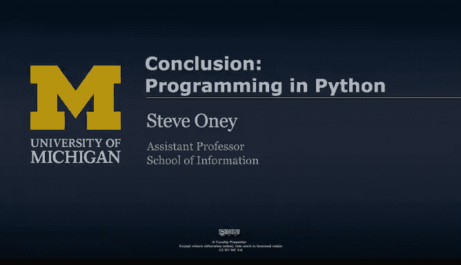

# 密歇根大学《Python3编程（课程1、2）》｜Python 3 Programming（Python for everyone进阶）（中英字幕） - P17：17_01_13_Python编程总结.zh_en - GPT中英字幕课程资源 - BV1CM411Z72u

Great job so far。 You're building a solid foundation for learning Python and we're going to keep building on this foundation by learning more constructs and Python syntax to build a wide variety of programs as a reward or maybe punishment for how far you've come。

 Here's a joke you might know that on many computers and phones and websites。

 including the textbook for this course， you can choose between light mode and dark mode。

But dark mode is really popular amongst programmers who want to write error or bug free code。Wai。😊。

Because light attracts bugs。See you next lesson。