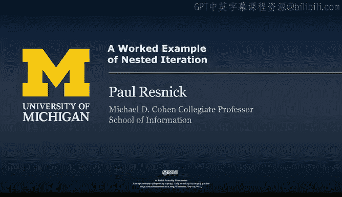
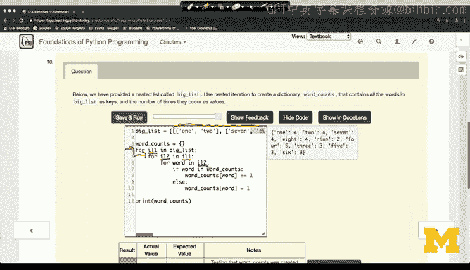

# 密歇根大学《Python3编程（课程3、4、5）》｜Python 3 Programming（Python for everyone进阶）（中英字幕） - P18：17_02_07_嵌套迭代实例分析.zh_en - GPT中英字幕课程资源 - BV1gj41177yd

Welcome back。I'm going to work a problem that involves traversing an nest of data structure and accumulating a value。

I've got here a variable called big list。 As you can see， it has some nested lists。

 some inner list inside of the big list。 In fact， it's got three levels of nesting that we can see right away。

Because we've got the three square brackets here。So it's going to create。A list。

It has some elements in it that first element of that list is itself going to be a list。

It has some elements in it， And the first element of that。Has a list containing one。And2。

So in order to traverse this and。Pull out a word like one or7 or9， I'm going to have to。

Go three levels into this so that some combination of three square brackets and three，4 loops。

 In this case， I really want to go through every single word because I'm supposed to create a dictionary word counts that contains all the words and big list as keys So I'm going to have as a key。

The word one。And as a value。however many times it appears anywhere deep in this。Nested le。And。😔，2。

However， many times it shows up。So that's the dictionary I'm supposed to create。To do that。

 I'm going have to。Find all of the words anywhere in the big list。 So let's get started on this。

 as always。I like to。Make a little template。I'm supposed to create a dictionary word counts。

I'm going to accumulate that dictionary。 so I'm going to start with an empty one。And at the end。

I'm going to print word counts。Just so I can check on my work。

I'm going to clear out all of the markings that I have here。And I can try running this。 Of course。

 it's not going to give me the right answer， but at least it's going。Get me started。

And you can see that I've failed the test because my actual value was not what was expected， but。

We have a good start。M going to make my code window narrower so that it doesn't overlap with the output window。

All right， so we can see that what we've output is just the dictionary。That's empty。

 We need to traverse through big list。And since we're going to have multiple levels here。

 I'm going to use a little mnemmonic where I say for inner list。Level1。In big list。

I L1 is going to be bound to one of the inner lists。Initially， it's going to be bound to。

The one that begins here and keeps going。Off the screen。So that's an inter list。

 I'm going to have to descend into that as well。So I'm going to say for each second level list。

In the first level list。I'm going to do something。 and because I need to descend a third level。

 I think I'm going to need three four loops here。Can I see that。

I needed a one instead of a two there。Now， I think that this is the right thing。

 but I always like to check。My work， so I'm just going to see if this gets me the thing that I'm looking for。

And sure enough， that prints out all the words。And I'm realizing now that I really shouldn't have called my iterator variable at level3。

 IL3， I really should have called it word。Because that's going to help me remember。

What kind of thing I have there？I changed my variable name from IL3 to word。

 and I still got exactly the same output Now instead of printing out all these words。

 this is where I want to use them to update the word counts dictionary。

SoInstead of printing the word， I'm going to check if the word is already in word counts。

 and this is a pattern we've seen quite a bit before。If we've already seen the word。

 then we want to update its count we want incremented by one。If we haven't seen this word before。

Then we have to put it into the dictionary。For the very first time。

And its initial value ought to be1 because we've now seen that word one time。

 So if we've seen it before， we increment its count， if we haven't seen it before。

 we set its count to one。And I think that should。Get us what we want。

So associated with the word one is the count of four。

 that means it's happening four times somewhere in here。

And you can see it is showing up more than once somewhere in there。

So that's how to work your way up to a solution for a problem。

 Remember that if the data you want to extract is nested three levels deep。

 you're going to need to descend three levels with your code。 either square brackets or four loops。

 In this case， we have three indented four loops， one inside the other。And。😔。

We have the first level of descent， the second level。

And notice that the iterator variable for the first time becomes。The sequence for the second one。

And the iterator variable at the second level becomes the sequence at the third level。And so on。

Hopefully you'll be able to do some of the other exercises on this exercises page at the end of the chapter。

 and you'll be able to do some of these on your own。Good luck。

See you next time。