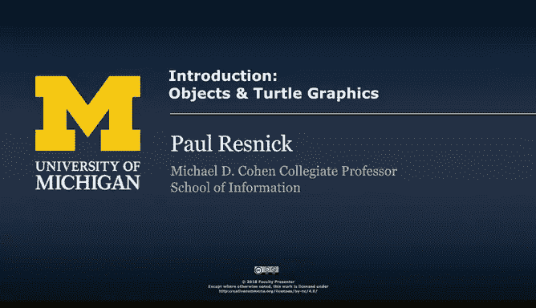

# 密歇根大学《Python3编程（课程1、2）》｜Python 3 Programming（Python for everyone进阶）（中英字幕） - P18：18_01_01_对象与海龟绘图导论.zh_en - GPT中英字幕课程资源 - BV1CM411Z72u

There's lots of minutia to master when you just get started programming。

 and it can be kind of tedious and not so rewarding。In today's lesson。

 we're going to give you a chance to be creative。Do something little fun。

 You're going to write programs that will instruct an on screen turtle to draw a picture。😊。

Now I have with me some bobblehead turtles， handcrafted in Mexico。诶。

To give us a little inspiration in our live classes sometimes I use them as prizes for especially good pictures。

So you're going to be writing programs that will instruct your on screen turtle to draw a picture。

But there's also a hidden agenda in today's lesson， which is to introduce some Python capabilities。

 particular object notation， methods that act on objects。

 and how to repeat a set of commands many times。At the end of this lesson。

 you should be able to write a multiline program a program with many lines of code。

 you should be able to distinguish between instances， attributes and methods。

 you should be able to invoke methods and set attributes using the dot notation。

And you should be able to use a loop。A forlo to execute commands repeatedly。

And stick around at the end for a turtle joke。See， at the end。

