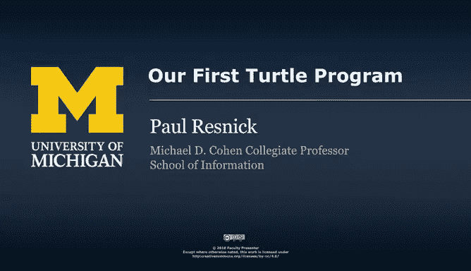
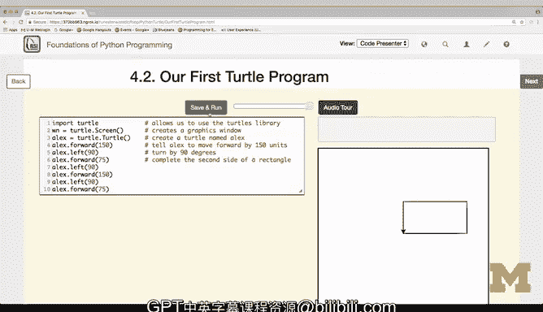

# 密歇根大学《Python3编程（课程1、2）》｜Python 3 Programming（Python for everyone进阶）（中英字幕） - P19：19_01_02_首个海龟程序.zh_en - GPT中英字幕课程资源 - BV1CM411Z72u

Let's learn how to draw some pictures。 Our metaphor here is that theres a virtual turtle。

 starts out in the middle of the screen。In the turtle's tail， there's a pen。

So when the turtle moves around。It leaves a drawing on the screen。in this code。

 we've created a turtle named Alex。 And we're telling it to move forward and turn left and go forward again。

 Let's see。But its picture looks like。So in this case， our virtual turtle。

He is really represented by jest。An arrow doesn't even look like a turtle。But he started over here。

Move forward by1 and50 pixels。That's what happened on this line of code。

Told him to start here and go forward by a hundred and 50 pixels。He then sort of turned， left。

By 90 degrees。That's what the line 5 told him to do。 And then he moved forward。By 75。

Let's go through in a little more detail what each of these lines of code does。 The first line。

Just says to。Make our turtle commands be available。The second line says， make a screen。

So that's what line2 does， and then any turtle things that we have in the rest of the program will happen on that screen。

Line 3。Makes a turtle。That's what creates our little turtle guy。

 And it gives him it assigns that turtle， that turtle object to the variable called。Alex。Online 4。

We are invoking a method， the forward method。So this is our hidden agenda in this lesson is to teach you about objects in this dot notation。

 So Alex is the name of the turtle。If you have an object and then a dot。

It will look up attributes or methods of that object。 So Alex Do forward says。

 find the forward method。Whi is just like the functions that you've seen before， it takes an action。

In this case， it says take the forward action。On Alex。And we pass in a value 1 hundred and 50。

 That says how much Alex should move forward。So， we have。Object， dot， method。

 and then in parentheses we pass a value。Though on line  five。

 we're telling Alex to turn left by 90 degrees。Line 6 has move forward by 75 degrees。

 And because Alex has a pen in his tail， we get to see。The lines。That show where he went。

So little vocabulary we've gotten here。 We've gotten the idea of an instance。

 Alex is an instance of the turtle class。WN is an instance of the screen class。So Turtle is a class。

 Alex is an instance of that class。Screen is a class。 W N is an instance of that class。

And we've gotten the idea of a method。Like forward or left。And in addition to these things。

We can also set and read attributes in this turtle drawing。 We don't really need to do it。

 But I want to show you how setting attributes works for object instances。 So Alex is an instance。

And if I want to set any attribute， let's say。Alex's salary。

 because he should really be paid a lot for doing all of this drawing work for us。

And we'll set his salary， let's say， too。$50000。If I do that。Alex will store in its salary attribute。

 the value 50000。And I can then refer to it just like we would other variables。

 though Alex refers to that instance， and we can print out his salary。As before。

 when we print things， they're going to show up in our output window。

So this is going to redraw that whole thing。And at the end of it。It's gonna print out。The 50000。

 that's because we printed it here。We're not going to do much with these attributes of instances for a while until much later in this course sequence。

 but we wanted to give you a hint of it before we went too far with Python。

I want to make a little more interesting picture。 Let's see if we can finish。Making a rectangle here。

So instead of doing this stuff with Alex's salary， let me get rid of that。

And let me have Alex do a little bit more。 I'm going to have him turn to the left。By 90 degrees。

 again。And what that should do is turn him。That way， so that when he goes forward。

 he'll be going in that direction。Now， how far should I make him go if I want it to be the same distance as this one was。

Well， that one came。From here， so I have to have him go by forward by 150。

Let's see what happens when we run that。 It's always a good idea。

To run things when you write some code。Great， that seems to have worked。

Let's have him turn and finish the rectangle。This time I have to go just 75， the shorter length。

Sure enough， we got a rectangle there。

