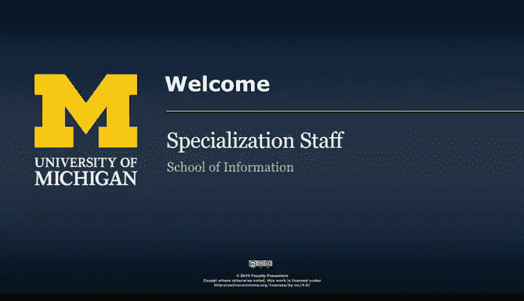
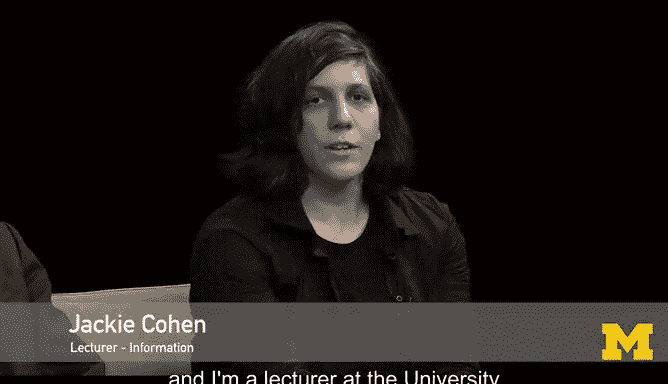
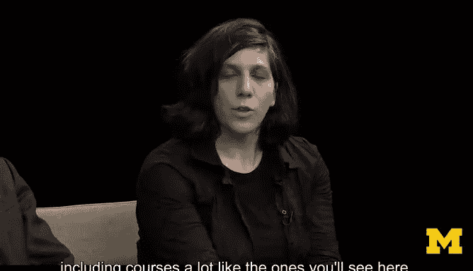
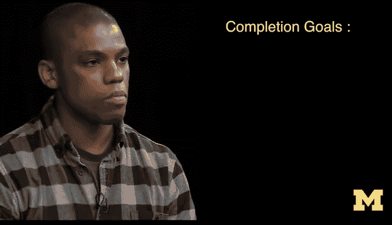
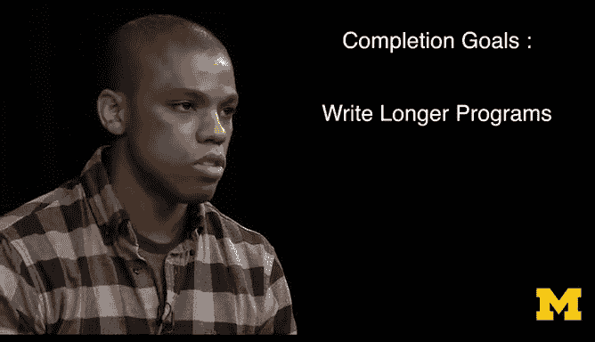
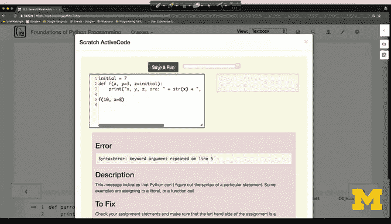
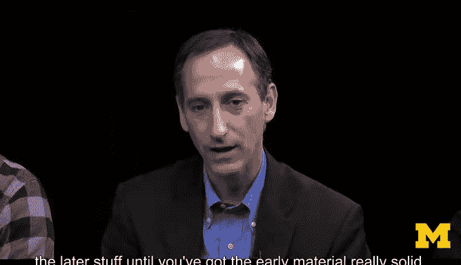
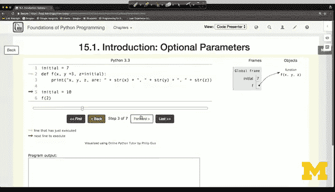
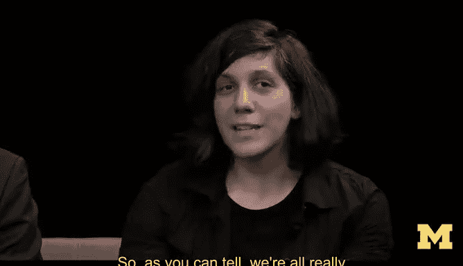

# 密歇根大学《Python3编程（课程1、2）》｜Python 3 Programming（Python for everyone进阶）（中英字幕） - P1：01_01_01_专项课程导论.zh_en - GPT中英字幕课程资源 - BV1CM411Z72u

Hi， I'm Steveonni， I'm an assistant professor here in the School of Information at the University of Michigan。

 so I teach some of the introductory programming classes in the School of Information and I'm really excited to have you join us because I really think programming is going to increasingly be a fundamentally important literacy and a way of dealing with the increasing amounts of data that we get and deal with in our everyday lives。

In my private life， I play soccer， like Professor Resnk， I'm an Avid bikeker as well。

 and you'll be seeing me in courses one， two， and four。

Most of my research deals with making programming tools more usable， in other words。

 making programming tools that are designed around the ways that people think and the ways that we actually program as well。

Hi。I'm Paul Resnick。 I'm a professor and associate Dean for research at the University of Michigan School of Information。

As As Dean， I don't get to teach that much。But I really enjoy teaching the material that I'll be teaching you in this specialization。

 and I'm glad to have a chance to share it with you。You'll see me in courses one and two。

 almost all of course three and a little bit in course four。I'm a fan of nerdy pun humor。

 also known as dad jokes， and so I'll be sharing a few of those with you at the end of some of the lessons。

In my research I'm probably best known for what's now known as recommender systems。

 I first published on this back in the early '90s， things like at Amazon where it says people who bought this book also bought these other books。

And more recently， I've been working on online communities and then on educational technologies。

In my personal life， I like to play tennis and ride a bike， I've ridden very slowly。

A couple of the iconic climbs of the tour de France four years ago up Monontu and a couple of years ago up to Col de Tom Marlay in the Pyrenees。

 I don't travel nearly as much as Dr。 Chuck。But I do look forward to trying to adopt his practice of holding live office hours in places when I do get to travel。

 so maybe I'll get a chance to see you。See you in the lessons。Hi。

 my name is Jackie Cohen and I'm a lecturer at the University of Michigan School of Information I teach a lot of programming courses。

 including courses a lot like the ones you'll see here。

 and I also build and design and support a lot of course resources all of this means that I've seen a lot of different students complete a lot of different programming projects and what I'll be doing here is orienting you to the endof course projects and giving you some hints and tips about what might be useful and exciting while working on them I hope you enjoy them because I think they're really fun and they'll give you a lot of tools for working with programming in your everyday life。

Hi， I'm Chris Brooks， I'm faculty here at the University of Michigan。

In this specialization I'll be teaching the last course。

 in that course you're going to take image manipulation libraries and large image sets and use Python to change it into useful information。

My research focuses on educational technology and I teach a lot of data science courses。

 including some on this platform， and I'm very interested in how learners like you approach technology。

 interact with technology and use it to enable your learning。

 I'm looking forward to seeing you in that last course。Hello。

 my name is Charles Severance and you may have seen me before in the Python for everybody's specialization which is some of you took that and then came to this class I'm really enjoying what I'm doing in this class and that I'm not actually teaching any of the core material but I'm doing what we call the way the programmer and that is sort of I get to play a little bit and not actually teach you anything but show you something cool and that gave me a lot of freedom to show things that I consider fun my research area as some of you may know is educational technology。

 the platform that you're using is something I'm very curious about how we can improve it。

 how we can make it better and I have lots of hobbies but my most recent hobby is Ras racing on road courses so if you look you might find a picture of me in a race car。

Hi I'm Lauren Murphy， I took the on campusampus version of this course a couple years ago and ended up working as an instructional aide to help other students learn the material I since returned to help out with this course building up the quizzes and assessments and projects that you'll be doing I'm very excited that you'll have the opportunity to learn the same material and I hope that you have a good time。

And in this specialization for Python3 programming。

 you'll learn how to become a competent Python programmer by learning the fundamentals of the language in detail。

 you'll learn how to navigate complex data structures and accumulate results from them。

 and you'll learn how to convert data into a format that can be used by other programs at the end of the specialization you'll be able to write Python programs of a few hundred lines。

 you'll be able to use and integrate Python modules into your code。

 you'll be able to use external tools like APIs by reading their documentation as well。

We start from the beginning and we don't assume any prior knowledge but we do go deep into the fundamentals of Python to be sure that you understand every aspect of code so you want to say something about what's our Runonestone interactive environment and yeah so the Runonestone interactive textbook allows you to interleave learning materials with active code assessments that will allow you to actually write code and we find that writing code is really important because even though you can learn how a concept works in theory so you might know how some particular feature of Python works。

 it's really important to actually write code to gain more of a working understanding and to know how to actually apply those concepts in practice。

So there's also the way of the programmer segments。

 so most of the course is about how to use Python and learning about Python features。

 the way of the programmer segment is more about how programmers can and should work programming is a little bit more of an art than a science there's lots of correct ways to do things but there are best practices so there are things like how to write programme incrementally in the way of the programmer segments you'll also learn about how to write good automated test cases。

That's going to come in course4 Until then we are going to write those test cases for you Lauren has created a whole lot of assessments where not only can you run the code in the browser。

 but it'll tell you whether you got it right or not and you get that immediate feedback and you can try it as many times as you want。

In fact， we've。We've set out the assessments so that you have to get it right。

You get everything right， 100% in order to pass the assessment。

 and the reason for that is we really want you to build mastery so that you don't go on to the later stuff until you've got the early material really solid。

You'll also notice that in all of the projects that you do。

 you'll find ways of translating the concepts that you learn in the courses and throughout the specialization into your real life。

 for example， different ways of building programs that might be fun in your job or your school or your work or whatever it is that you do。

So one of the things that I really like as I've watched you all put this together is and Python for everybody。

And you kind of already said this in Python for everybody。I really focus on the program。

 if you get the program， it's like you win， you get the gold Star。

And we didn't have the time or the luxury to really understand what was going on inside the program。

 we're just like we got the program done and we got to move on to the next thing but with some of the stuff that you have in Runestone。

 you get to say what's really going on inside of the program and how does this really work and that's part of the mastery is so that if you can't as a programmer？

Kind of put yourself inside the program and understand how the program is actually functioning。

 it is difficult to write more sophisticated programs。

 and so that's where even though this technically is a beginning course。

 I think it's really important for people to take more than one beginning course because you have to go over the same material over and over with in a sense deeper understanding each time you go through it。

Yeah we have this great code lens tool I think you're referring to。

 lets you visualize what's happening in the execution of the program one line at a time and you can go forwards and back and see what actually was the value of that variable and when did my list change what its contents were and so it gives you a way of thinking about it？

It's really great for debugging so that you don' you don't have to just do trial and error of let me change something in the code you can really think through what is a program so another thing that the students always ask me at the end of my courses。

What next and I think that it's kind of cool that you've built into this specialization kind of a step into what they're going to do after this Chris yeah so one of the things that we've added to this course at the very end is a project course and that's really to focus people on how to take other APIs that might be out there or packages and use them and do something novel with them outside of just learning and it gets to this repeated practice comment that you made and for that we're actually doing it within the Jupiter environment so just like you need repeated practice with APIs and with Python fundamentals there's so many different places that you can write Python code and runestones one of them and the tools you use in Python for everyone or one of those Jupiter is one that's quite common and we teach that in the data science specialization that students could follow this with and there's other environments too and so we're trying to really show。

of diversity of learning environments and production environments for Python programminging is not one environment right it's not like you have this one thing you type of stuff in and that's all the programming when you're out in the real world each job often has different kinds of environments and practice is so important in the context of programming and I think Lauren has written some great examples of practice problems for you to work on throughout the course as well and we have this great practice tool that you'll get to see where it representss to you for review some questions that you've already seen in the past and it keeps presenting them to you more frequently if you're having trouble less frequently if you're showing mastery of them and it's a way to really reinforce what you've got so。

Look for that practice tool， it also has these fun fireworks that'll show when you've done all of your practice problems for the day。

So as you can tell， we're all really excited to share this material with you and we hope you have a lot of fun and wish you a lot of luck。

Here at the University of Michigan， our school colors are maize and blue。

 you might think of them as yellow and blue， but we call it maize and blue。

If I travel anywhere and I have a Michigan logo thing on someone will come up to me in the airport and say。

 go blue。So on three， one， two， three， go。