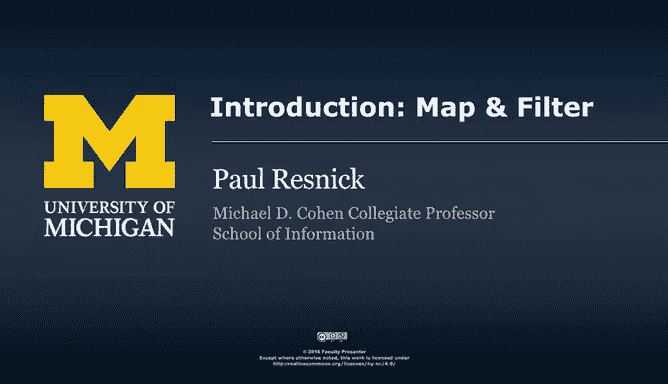

# 密歇根大学《Python3编程（课程3、4、5）》｜Python 3 Programming（Python for everyone进阶）（中英字幕） - P20：19_03_01_map与filter简介.zh_en - GPT中英字幕课程资源 - BV1gj41177yd

Welcome back。We have seen a lot of the accumulation pattern already， in this specialization。

You have a list， and you go through the items one by one， updating an accumulator variable。

 at the end， the accumulator variable as your result。

Two particular kinds of accumulation are so common that Python includes special language features for expressing them。

One is a map operation。It transforms each item in the original and accumulates the transformed item into a new list of the same length。

The other is a filter operation， it selects a subset of the items from the original list。This week。

 you'll learn to think abstractly about these two accumulation operations。In this lesson。

 you'll learn to use the builtt in Python functions map and filter。

 and then in the next lesson you'll learn about Python list comprehensions。

 which provide a nice syntax for doing a combination of map and filter operations。

At the end of this lesson， you should be able to read and write code using the map and filter functions。

 In particular， you should be able to write the functions that are passed in as arguments to the map and filter function。

Bye for now， we'll see you at the end。