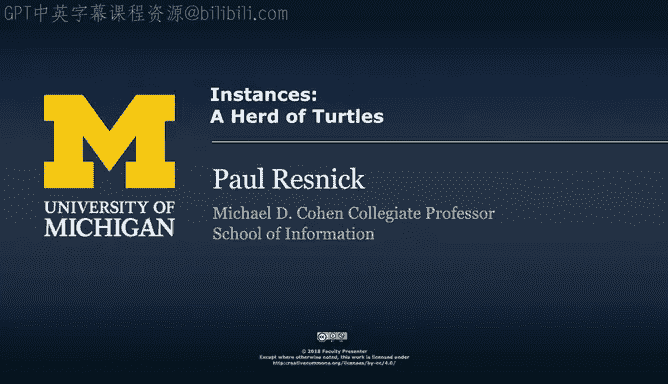
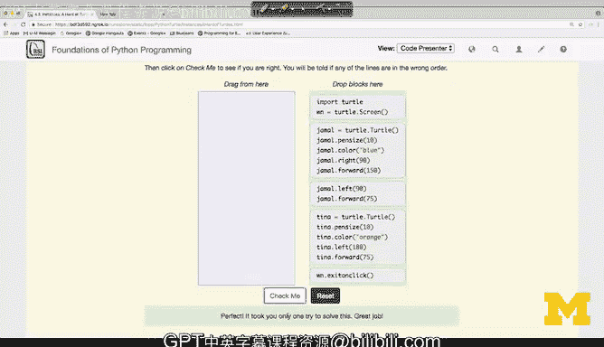

# 密歇根大学《Python3编程（课程1、2）》｜Python 3 Programming（Python for everyone进阶）（中英字幕） - P20：20_01_03_实例：海龟群组.zh_en - GPT中英字幕课程资源 - BV1CM411Z72u

Welcome back。We can have more than one instance of a class。

 and each one will have its own attributes， its own internal state。In this code。

We'll create two turtles， Alex and Tess。 Tess is going to draw a triangle with a thick black pen。

 Alex will draw a square， with a pink pen。So let's go through the code。First， we'll run it。

That's test drawing there。And now Alex is drag。So let's go through the code。As before。

We need to import the turtle module。And create the screen。

That creates the place for us to do the drawings in this case。

We get that instance bound to the variable WN， and we're calling the BG color method on it to make it be。

Light green， as you're seeing here。We create a turtle test。And we set its pen size to be5。

 That's what makes tests have this wider pen instead of just a narrow pen。 that's the default。

We create a second turtle called Alex。And we set Alex's color to be hot pink。

After that we have a whole segment where we have the movement commands for tests。

 that's where she does her drawing。And then below that。We have some。Movement commands for Alex。

And finally， there's this little。Wn。 exitit on click that just says that when somebody clicks。

On the window。It disappears。Let me make a couple comments about the coding style here。

One thing to notice is that we've。Changzhi。😔，The code using some white space。

That just makes it easier to read。That segment。And I just marked lines 12 to 17 is what causes test to maker triangle。

And then。There's a break with a blank line on line 18。

 and then lines 19 and 20 have her make her extra line that goes off to the left at the end of the drawing。

And there's another blank space。And we get from lines 22 to 29， Alex's movements。

We don't have to do this chunking in order to make the picture come out， right？

We do this chunking because it makes it easier for people to read the programs。

 you can sort of look at it and say， oh， there's a chunk of code from 22 to 29。

 and that's drawing the square。There is a chunk of code from 12 to 17， and that's drawing a triangle。

One final thing to notice， I'm going to rerun this so that you'll get to see it again。

You might notice。Thated。On line 17， Te turns to the left by 120 degrees， then on line 19。

 she turns to the right by 180 degrees。We're following a little convention that lines 12 to 17 are drawing a triangle。

And putting Tess back into the same orientation that she started in。

It just makes it easier for a programmer to think about it if the net impact of all of the。

Movements is to leave Tess back in her original position in the same orientation。Similarly。

 on line 29。You'll see that after we've completed the square， we make Alex。

Turn to the left for 90 degrees， even though we're not going to make a move again。 And that's， again。

 just trying to get him back into the same orientation he was in before。

This would be especially useful if we were going to take the whole block of code。And reuse it。

 and that's something that we'll see later in the course where we defined functions。

 we could make a function to draw a square and wherever he starts。

The turtle would create that square and leave the turtle in the same spot that he was in before。

So let's go on。And do one of the Parson's problems。At the bottom of this page。

You'll find more than one parson's problem。 I'm just going to go through one of them。

Here we're going to create a program that has one turtle Jamal。Draw that capital L in blue。

 and then Tina is going to draw that orange line。So this is a mixed up code problem。

We have all of the code that we need to have Jamal draw his blue L and Tina draw her orange。

 but your job is to drag the parts over and drop them off in the right order。

The first thing to remember about this is that you。

 the very first thing in any turtle program is you have to import the turtle module so that we can have all of those turtle commands available。

And you have to create。An instance of the screen so that there's a place for the turtles to draw。

In the instructions， it said that all the stuff with Jamal should happen first。

So those things are going to come before the TA stuff。But we do have a little decision to make。

 Should we make the left and the forward。Commands first， or should we have this larger block first。

And the clue here is that。You can't have Jamal turn left before you create Jamal。

So we need to have this block first because it has the line of code Jamal equals turtle。

 turtle that creates the instance Jamal。Tina's stuff happens after Jamal。

Ohoops got to get that a little lower。And， finally。

We have our exit on click so that when the user clicks on the drawing， it disappears。

Let's check it and make sure I got it right。Perfect。

Alright。 See you next time。