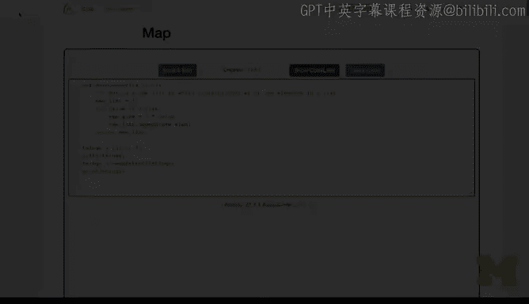
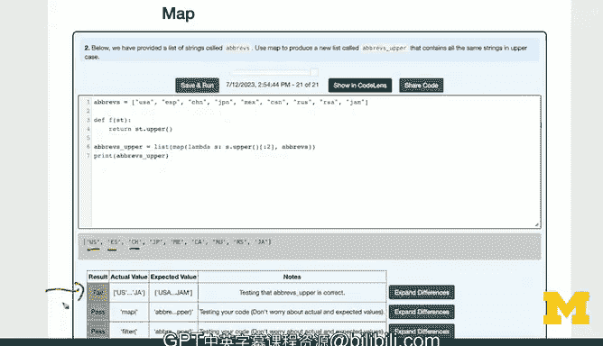

# 密歇根大学《Python3编程（课程3、4、5）》｜Python 3 Programming（Python for everyone进阶）（中英字幕） - P21：20_03_02_map函数.zh_en - GPT中英字幕课程资源 - BV1gj41177yd

Welcome back。The map function makes a new list where each item in the original list is transformed in some way。

For example， suppose we want to transform each item by doubling it。

 so we make a new list that has doubles of all the values in the original list。

We've done that kind of thing before with the manual accumulation。

 as you see in this active code window。New list。Is going to be our accumulator。

 we a bind it to an empty list to start with。We iterate through a list。

That's our loop variable and our iterator variable is going to be called value。

We transform each time we take each element。Value， and we multiply it by two。

 that gives us our new element， and we append that new element into new list。When we get to the end。

We have new list has accumulated the doubles of everything。

Now I've put this whole thing inside of a function。To find a function double stuff。

 it takes one input parameter a list。And we return。That new list at the end。

Let's see what happens when we run it。I'm going to pass in。A list of three things，2，5 and9。

And then I'm going to， at the end， print out what's happened when I've run double stuff on that list。

The first line of output is just the original。And what we get back is a new list。

 same number of items， each item is the double of the original two becomes 4， 5 becomes 10。

9 becomes 18。This manual accumulation where we transform each of the items is something that programmers want to do a lot。

And because of that， Python has provided a function that lets us express this in a more compact way that's easier to read。

It makes it clearer what's going on。 That function is called map。Map is a function。

 it takes a sequence as its second input， and it takes a function as its first input。

Take a look at line 5。So the sequence that we're passing in is the second input is a list。

And the function that we're passing in is triple。I have defined triple up here on line1。

It's a function that takes a value。As input and it returns three times that value as its output。

I'm going to call this first input to the map function。Which is itself going to be a function。

 I'm going to call that。The transformer function。The transformer function in this case。

 triple is going to be applied to each item in the sequence behind the scenes。

 and the results will be accumulated， also behind the scenes。Into a new list。

This is analogous to how the sortded function worked。 If you remember， with the sorted function。

 we passed another function as an input。😊，We pass it as the key parameter and behind the scenes。

 when the sortded function was running， it would invoke the key function on each item。

The results of invoking that key function were then used to determine the sort order。Here。

The Python interpreter invokes the transformer function behind the scenes when the map function is running。

 One invocation for each item， and the resulting values are accumulated into a list。Actually。

 it's not quite a real list。 It's an iterator， like the results of dot values and dot items for dictionaries。

Most places you can use a list， you can also use an iterator。

 but if we actually want to print it out and make it look like a list。

 we have to transform the iterator into an actual list。 That's what I've done on line 6。

So new sequence isn't really a list。 I pass it to the list function that makes it be a real list。

So let's just see what happens when that runs。 There's more stuff happening on lines 8 through 10 and。

Printing out using that function， I'm going to explain that in a minute。

 but I've just commented it out here so that they don't confuse us in the output。When I run this。

 I start with 2，5 and 9， and I'm going to get back。6，15 and 27。The two got tripled to be 6。

 The five became 15， and the 9 became 27。But notice we never specified a for loop。

We never explicitly invoke the triple function。 We just。Pasked it in to the map。

 but we never invoked it。 That's all behind the scenes inside the execution of the map function。

Map just lets us say， hey， apply this transformer function to every single item in the sequence。

Map expects a transformer function we can have a named function like triple。But we can also have。

A lambda expression， just like we did when we were passing a function to the sortrdid function。

On line 9 were passing as the transformer function， the value of a lambda expression in Agonna。

And comment that now。这。So here I'm still calling map， I'm still calling it on some sequence。

But instead of naming a function， I'm defining the function right here with the lambda。Lambda Bau。

So value will be the input and the output will be four times value。If I run this one。

 I think you can guess what's going to happen， I'm going to get two times 4。

 five times 4 and9 times4。I have to uncomment it， and I'll get。Those things quadrupled， 8， 20 and 36。

그。Let's work an example together where you have to write some code that uses map。In this case。

 we're asking you to transform each of the items。In a breezes。Arees a list。

 each of the items it areaves is the abbreviation for a country。USA for the United States。

 ESP for Esspia， Spain， and so on。We're supposed to produce an output that looks like a capitalized version。

Our output' is going to be something like capital USA。Capital ESP。Capital CHN。And so on。

We could do it with our manual accumulation， but our challenge here is to figure out how we can use the map function。

As always， I like to start with a template that reminds myself。Reminds me of what I'm going to do。

And it also helped me keep track of my progress。So it breathes up， that's what I'm trying to create。

I'm going to get it by calling map。And it's gonna。Be called on something and something else。

I really confused。The color coding。 So let's just call it something and something。And I remember。

 okay， map it's going to。And doing something to a sequence。

 And I'm applying a transformer to each of the elements。 Which thing is the transformer。

And which thing is the sequence？Kint of remember。That the second thing is the sequence。In this case。

 we're going to take each of the strings in areavs and we're going to to transform it in some way。

 So the first thing is going to be our transformer。And that's actually the hard part。

Remember that the transformer has to be a function。The function has to take。One string is input。

So I'm going to define some functions。fact， I'm going to call it transform。

And it's going to take one thing as an input。 It's going to take one。Abbreviation string。

 It does not take the whole list。 It takes one string。And we're going to return。

Something that's made out of that string。Now at this point。

 I kind of have to remember that Python has a built in function。That will take something like。

Lowercase， ESP and turn it into uppercase。嗯。And it turns out that。

That built in thing is just to call the dot upper。Method， if I didn't remember that。

I'd have to look it up somehow or do a search。Now I've got to do one more thing here。

 which is I have to tell Maap to use this transform function。So the name of my function is。Transform。

IAnd'm， it's going to be applied to each of the items in a briefs。

 And there's nothing magic about that name。 I I'm saying that what it's supposed to do is it's supposed to be a transformer。

 but it could have any name I could call it F if I wanted to。So let's print that out。And run it。

 and then I'll get my。Lst I was expecting USA capitalized， CSP capitalized and so on。But， not quite。

What I actually get。Is not that list I was expecting， but this thing that prints out as map object。

I've also failed one of the automated tests which checks that the expected value is that list with Capital USA and so on。

So the problem here is that map doesn't actually return a list， it returns this list like object。

 an iterator。If I want to turn it into a real list。I got to pass the results into。The list function。

Now when I print it out， I'll get what I was expecting。USA and so on。But I've still failed my test。

 The reason I failed the test is that the test is looking at。

This areavs upper variable in making sure that it has the right value can tell that because in instructions。

 it tells us。What we're supposed to assign to。 So if I want to make this pass the test， I've got a。

Do that transformation of the iterator into a real list。Here。And now I pass the test。 Of course。

 if I've transformed it there， I don't need to also transform it down here。I can do it again。

 but it's not necessary。Now that's one way I could have done it。But， instead of。

Passing the name of a function F。To map。I could， instead。Define a function right there。

In the spot where I was referring to app so instead of。Instead of referring to a function。

 I can define a function using a lambda expression。

The lambda expression is going to do the same thing that that name function was doing。

It's defining a function that takes some string as input。And produces as output。

The uppercase version of it。And of course again， there's nothing magic about ST is my variable name。

 I could have called it S。This will still work if I run this。

 I get exactly the same output and I'm still passing the test。Now suppose I wanted to。

 instead of getting three letters。I wanted to just have US and ES and CH。

I can just make a small change to this function。What it's going to produce is the uppercase version。

But only the first two letters of it。And now you can see。I'm just getting US ESCH。

 of course I failed to test now because it's still looking for the full USA。

You can have a lot of fun doing things like this。 You just have to change your transformer function a little。

😊，And all of the items are transformed in the new way。

That's an example of how I think about using the map function。

 I recommend always starting with a template and fill in the easy parts first until you've just isolated the hard part。

 The easy part is usually the sequence that you' are going to transform。

 and the hard parts can be the transformer function。

That function that you're going to pass in either by name。

 like the function F here or using a Lada expression。

 that transformer function takes one item from the sequences input。

And has to return the transformed version of that。Because the。

 that transform or function is the hardest part。 I usually sort of save that as the last thing to fill in in my template。

I'll see you next time。

