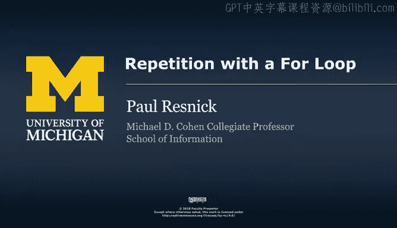
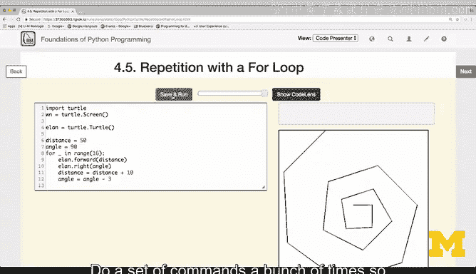

# 密歇根大学《Python3编程（课程1、2）》｜Python 3 Programming（Python for everyone进阶）（中英字幕） - P21：21_01_04_for循环实现重复.zh_en - GPT中英字幕课程资源 - BV1CM411Z72u

Suppose we have a line of code， or。A bunch of lines of code that we'd like to make run more than once。

You could just write those lines of code and copy and paste them so that you add them again。

But that would start to give you long programs that were hard to understand。

So Python gives us a special command。That says， do some lines of code。Multiple times。

It's called the for loop。Iteration。We begin。With a special word。4。Then we have some variable name。

 or in this case， since we're not really using it， we just have underscore。

And we have a special word in。And in this case， we say。Do it three times。And then， we have a colon。

All of the lines of code that are indented。Farther in， in this case， by a few spaces。

All of those lines of code are a block。And that block of code will be executed。Three times。

 in this case。It's always a good idea。To work on your understanding of code before you run it。

To try to predict what it'll do。In this case， you might imagine that it's going to print。

In our output window， this will execute first。 And then it'll say this will execute three times。

 This line will execute three times。 This line will execute three times。

And then this line will also execute three times。 this line will also execute three times。

But in fact， it doesn't do that。It doesn't print this line three times。

 And then this one three times。 What it does is it executes line 4 and then line 5。

 and then 4 and then 5 and then 4 and then 5。 So the whole block is executed。

 and then the whole block is executed again， and the whole block is executed a third time。

Let's see how that works。So you can see in our output window。The whole block executes once。

And the whole block executes a second time。The whole block executes a third time。

 Let's go look at the next example。In this next example。

 we're going to be able to draw a more interesting turtle program by having a set of commands get executed a bunch of times。

 In this case， we're creating a turtle named Elon， and we're going to make Elon do some commands 10 times。

For I。For underscore in range of 10， do this block from lines  a through 10。 Do that 10 times。

So Elon's going to go forward by 50 and then turn right 90。

Remember from the previous chapter what distance equals distance plus 10 does。

We had the variable distance。And it was initially bound to the value，50。We look up。50 plus 10。

That equals 60， and we replace the 50 with 60。The next time that we execute line 10。

 we're going to replace it with 70。And you can see that that distance variable is used here to determine how far Elon will move。

So each time Elon moves forward， he's going to go forward a little bit farther。

50 pixels the first time than 60 and 70。So before I run this。

 you might want to pause the recording and see if you can envision in your mind what is this？

Going to look like when I run it。Here we go。 Let's see。So it's getting a little bit longer each time。

And that means instead of just making a square， it ends up making a spiral。

So how many times does it do this block， It does it 10 times because it says range of 10 there。

Now what if I made the angle increase every time too？Suppose， instead of。Turning right。By 90 degrees。

 I turned right by whatever the current value of the angle was。And it started at 90。If I do this。

 I get it just exactly the same picture that I have right now。

But suppose that I change the angle every time。Maybe I'll make it a little bit smaller。So again。

 you might want to pause the video and see if you can predict。What this is going to look like。

Here we go。The angles getting a little smaller， each time。

And so we end up with this even more interesting spiral。Now。

 if I wanted the spiral to go even farther。I could increase this range。

This means he's going to go forward and turn more times。He's a little off the screen there。

 And now he's back。And maybe he's gone forever now。

So that's making the turtle do a set of commands a bunch of times so that we can have a relatively short program。

 but have it do a lot of drawing on the screen。

