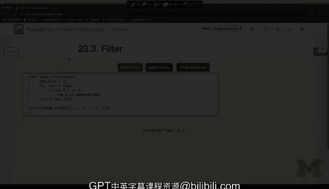
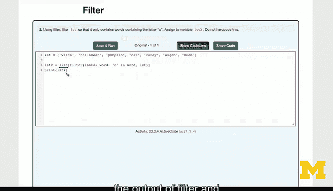

# 密歇根大学《Python3编程（课程3、4、5）》｜Python 3 Programming（Python for everyone进阶）（中英字幕） - P22：21_03_03_filter函数.zh_en - GPT中英字幕课程资源 - BV1gj41177yd

Welcome back。

Another common processing pattern we've seen before is to filter a sequence。

 You start with some items， and you end up with fewer of them。For example。

 here we're doing an accumulation that filters for only the even numbers in a sequence of numbers。

So we've defined a function Keep evens， and then we're invoking it on line 8 by passing it in a list。

And we get back just the numbers 4，6 and 0。 So three got filtered out and7 got filtered out。

And one got filtered out。Let's look at the code， this is a style of code you've seen before with manual accumulation。

So we'll create an accumulator variable。I'm calling it new list and it starts as an empty list。

Eventually， we're going to return that。Accumulator， but first， we're going。

Do an accumulation where we append some things onto it。

 So we iterate through the sequence nus that's。The list of numbers that are passed into this function。

We have a loop variable or iterator variable， we're calling it numb。And then， this is。

An important part， I'm going to call this the filtration expression。And you have to remember that。

The percent operator is just returning the the remainder when you divide by something。

 So if I say 9%2。I'm going to get back one。And if I say 10%2。They're going to get back zero。

So all the even numbers are going to have a remainder of zero。

 so this filtration expression is checking。Is the number even？Is the remainder equal to zero？

If the current number is even， then we append it， otherwise we don't do anything and we just leave it out。

So this filters out anything that doesn't pass the filtration expression。

Now this is the way we would have done this operation before learning this lesson。

 now we're going to see that Python provides a function that will do all of this accumulation in a much more compact way。

So the abstraction that Python provides is called the filter function。

Here's code that does the same thing we saw before， but now it's going to use the filter function。

You can see on line too。That we call the function filter。 It's taking two arguments。

The first parameter that we pass in is that whole expression。

 the second parameter that we're passing in is the sequence。

So just like with the map function where we。WePass in a sequence， and we pass in a function。

 We're doing that a similar thing here。 I'm going to call the function。The filtration function。

Because it's filtering the contents。This lambda expression is producing。A function。That function。

Takes as an input。A number。And it's producing an output either。True。😔，Or false。

So unlike with map where the function was a transformer that was taking the input and transforming it into something else。

Here， we're not transforming the input。 We're just making a binary decision about it。 Is it true。

 meaning。Keep it in。Or as it false， meaning filter it out。

So the next thing to notice is what's actually in this lambda expression。

We're saying lambda nu colon 9% 2 equals 0， this  nu%2 equal equals0。

That's our same filtration expression that we saw before when we were doing the manual accumulation。

The filter function returns a list like object， an iterator。

 just like the keys method for dictionaries and the map function。

So I'm wrapping that in a call to the list function to make it into a real list rather than just a list like object。

So if I run this， I'm going to get the same output that I did。4，6 and0。

 we've only kept the even numbers we got rid of the odd ones。

All of the ins of this filtration function are happening behind the scenes。

 It's automatically calling this function once on each of the numbers in the list。

Let's try an example where we have to construct an indication of the filter function。

Her instructions。Tell us that we're supposed to take our original。Variable list。

And it's got a sequence that is assigned to it， and we're going to create a new variable list too that's going to have only some of the words from the original list。

 only those words that contain the letter O。So as always。

 I like to get started on a problem like this by creating a template for what I'm going to do。

I'm supposed to create a new variable list too。And it's going to be the result of invoking filter。

Using some filtration function。On the original list。Of course， if I run this， it's going to fail。

Because some filtration function is not good Python here， I got to fix that。

So what is it that I want to do？I want to have a function。That function。Has to take as an input。

One of those words。Like pumpkin。Or wagon。And for wagon， we wanted it to return true。And for pumpkin。

 which doesn't have an O， we want it to return。False。

So I'm going to create a lambda expression that is going to do that for me。That is going to。

Evaluate to being that function， I'm going to say lambmbda word。

 it's going to take one word as input。And it's supposed to return true if the letter O is in the word。

And here you have to remember that we have the convenient in operator。I just have to say。Is O。

In the word。And that lambda expression。Creates the function that I was just trying to describe down here。

Let's try running it， see if I got it right。And sure enough， I did。

The version of Runed Stone that was used for this video automatically converted the iterator。

 returned by filter into a list。To make the code work in Runestone today day or to make it work with a full Python interpreter。

You would need to pass the results to list in order to convert the iterator into a list。

 like in the code shown here。Where I've taken the output of filter and passed it into the list function。

That's the filter function。 It's an abstract way of describing a common programming pattern。

 one where you iterate through a list and accumulate a potentially shorter list with some of the items filtered out。

You pass in a filtration function that gets called behind the scenes one item at a time。

 The filtration function returns true If that item should be kept and false if it should be filtered out。

See you next time。