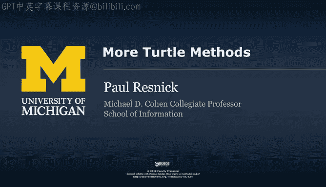
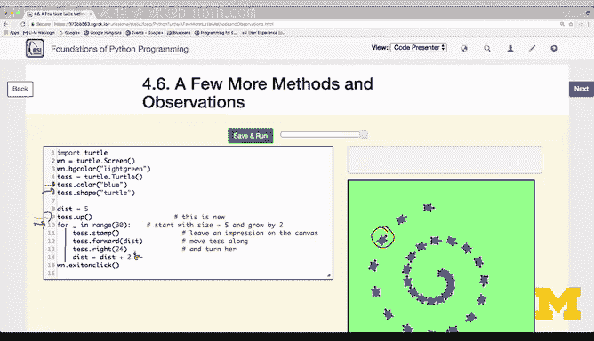

# 密歇根大学《Python3编程（课程1、2）》｜Python 3 Programming（Python for everyone进阶）（中英字幕） - P22：22_01_05_更多海龟绘图方法.zh_en - GPT中英字幕课程资源 - BV1CM411Z72u

Let's see a few more。Interesting things we can do with turtles。Got another little spiral。

In this case。We're not seeing the whole line。Tess is moving around and only leaving her imprint occasionally。

So how did that happen？First。As before， we've seen things where Tess is getting a color。

 in this case， blue。We also changed our shape。So instead of being that little abstract triangle representing your turtle。

Now， test really looks like a turtle。On line 9， we introduce a new method called up。

 What that does is lift the pen off the paper so that when Tess moves。

 she doesn't leave a line behind her。As before， we have a for loop。So，30 times。

 we're going to execute。That whole block of code。On line 11， we have a new method called stamp。

 which。Basically， stamps test shape。At the current location， where Tess is。

And the rest of the things are things that you've seen before。He's moving forward。

 The distance is increasing a little bit。Each time， that's what makes it a spiral。

In this page in the textbook， there are some more mixed up code problems。

 Parson's problems and I really encourage you to take a look at those because they will help you reinforce what order these things have to happen in and the fact that you have to indent the block of code under the line that says4。

See you next time。