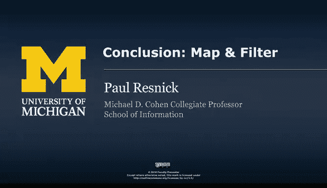

# 密歇根大学《Python3编程（课程3、4、5）》｜Python 3 Programming（Python for everyone进阶）（中英字幕） - P23：22_03_04_map与filter总结.zh_en - GPT中英字幕课程资源 - BV1gj41177yd

Welcome back， everybody。You've now learned about the map and filter functions which perform particularly common accumulation patterns。

With map， you pass in a transformer function which takes one item and transforms it into its new value。

With filter， you pass in a filtration function which takes an item and returns a booley and true if the item should be included。

Fall that the item should be filtered out。Here's an apocryphal story about a filter that Socrates applied to gossip。

In ancient Greece， as you may know， Socrates was widely lauded for his wisdom。 One day。

 the great philosopher came upon an acquaintance who ran up to him excitedly and said， Socrates。

 do you know what I just heard about one of your students， Plato。😊，Wait a moment， Socrates replied。

Before you tell me， I'd like you to pass a little test。 I call it the triple filter test。

What triple filter。That's right， Socrates continued。Before you talk to me about what Plato did。

Let's take a moment to filter what you're going to say。The first filter is truth。

Have you made absolutely sure that what you're about to tell me is true。Lambda x X is true。No。

 the man said， actually， I just heard about it and。All right。 All right， said Socrates。

 So you don't really know whether it's true or not。Let's try the second filter。

 the filter of goodness。It's what you're about to tell me about Plato， is that something good？

Name to X。 X is good。No， on the contrary。So Socrates continued。

 You want to tell me something bad about Plato， even though you're not certain it's true。

The man shrugged a little embarrassed。 Socrates continued。Well， let's try the third filter。

 the filter of usefulness is what you want to tell me about Plato going to be useful to me。

Lambda x X is useful。No， not really。Well， concluded Socrates。

 If what you want to tell me is neither true nor good nor even useful， why tell it to me at all。

The man was defeated， and ashamed。This is the reason why Socrates was a great philosopher and held in such high esteem。

It also explains why Socrates never found out that Plato was sleeping with his wife。

I'll see you next time。