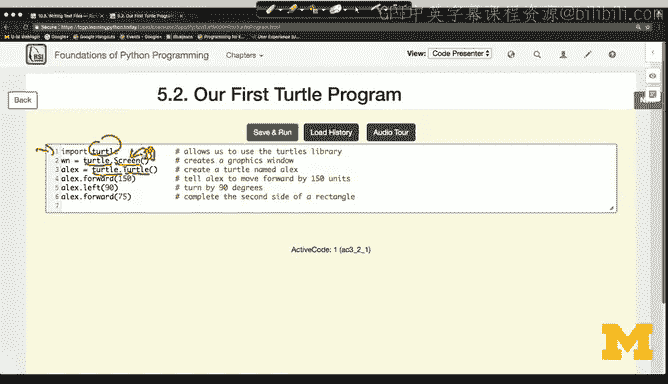
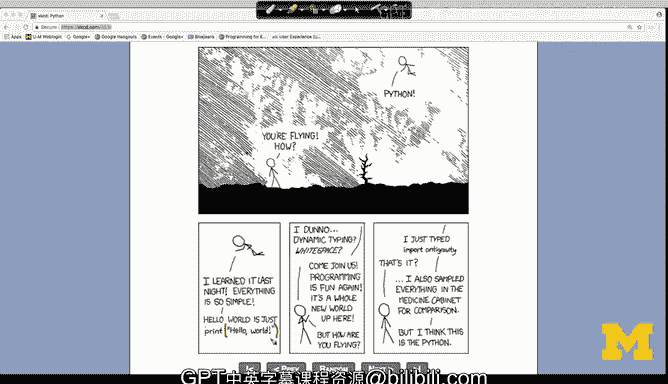

# 密歇根大学《Python3编程（课程1、2）》｜Python 3 Programming（Python for everyone进阶）（中英字幕） - P23：23_01_06_模块导入.zh_en - GPT中英字幕课程资源 - BV1CM411Z72u

Welcome back。In all our turtle examples， I kind of glossed over the import statement。

In this specialization， we're trying to minimize the amount of magic。

 We want you to be able to read code and reason about it。

So this video provides some details about that import statement。

There are lots of functions and methods available to you in Python that other people have already written。

And we can just invoke them。 We don't have to write them ourselves。

Some of those functions are built into the core of Python。Like the L function。You can just invoke it。

 and it's always there。Lots of other functions are not built into the core of Python。

 but are readily available。 They're part of a standard library of modules。

A module is a code file that defines some functions that can be used by other programs。

Before you can invoke a function that's from a standard library module。

 you need to tell the Python interpreter to make it available。

 and that's what the import statement does。Turtle is one of those standard library modules。

 but we'll come back to that in a minute。 Let's look at a simpler module， first。

There's a module called random。And you just have to import it in order to make all of its functions available。

One of its functions is called Rand range。You can see this on line 6。

So we've imported the random module and then on line 6， we ask for RA range， which says。

 give me an integer between one。Up to， but not including 7。 So1，2，3，4，5 or6。

There's another function called random。And I'll talk in a minute about this weird thing of random。

 not random。We have this random function that returns a floating point number between zero and1。

In this case， we got。72。 And then we get a di roll， a 1，2，3，4，5， or 6 from the R range function。

If I do it again。I may get different values。Get 。039 and3。

 running at a third time look get yet again， different values。

There are two possible syntaxes for importing and referring to stuff for modules。

The first makes the stuff available， but doesn't give it any special alias。

 That's what this version that I'm showing in the current code does。 A mind1。

 we make everything from the random module available。 But every time we want to refer to it。

We have to say， random dot。Random dot。ItDoesn't give us any alias。

So I say random dot and then the name of the function that's defined within the random module。

 like R range。Or random。Notice that this is another use。Of the dot notation。

Before we've seen something like tests。Dot forward。Where Tess was a turtle object and got forward。

 and we would say， how many pixels to go forward。Forward is a method that can be applied to test the turtle object。

Here we're saying random dot R range。It's a little bit analogous。

We're getting something from the random module。 and that something is the R range function。

But it's not exactly the same。 randomand as a module。

 not the kind of Python object we've been seeing so far。

The way to tell the difference between these two different uses of the dot notation is just by the context。

If we said import random， as we did on line1， then random dot something。

 we'll find the something object inside that module。Anyway。

 that explains the funny random dot random on line 3。Random is the name of the module。

That gets us the first random。And inside that module。

 there is a definition of a function also called random。And that gives us the second random。

Similarly， random dot R range， R is the name of the module。

 Rand range is a function inside that module。One thing we can't say。Is Rand range。Dot random。

That is going to fail。就是对 that。The second approach to importing stuff from other modules puts the functions directly into our local name space so we don't have to keep referring to the module they came from。

Let me show you how that works。Instead of saying， import random。We're going to say from random。

Import。Rand range。And we can also import the random function while we're at it。Now。

 when we refer to them， we no longer have to say what module they came from。

 Those names become available。In our local namespace。And this will work just like the other one did。

And we got a new value there when we ran it again。Either of these two different ways works， either。

The commented out version that I have on line 1， import random。

Or the other version on line 2 from random import， ran range and random。

But you have to refer to the things a little differently。Depending on which one you did。

So if we say from random， import RA range， then we'll just refer to random。If we did the other one。

 we'll have to say random not random， on line4。With that understanding of module importing。

 let's take a look back at how we imported the turtle module。Let's look at lines 1 through 3 here。

 on line 1。We say importm turtle， make everything from the turtle module available to us。

And then on lines  two and 3， we're doing that turtle dot thing。We are， too。We do turtle dot screen。

And we haven't explicitly talked about classes yet。

 And you won't talk about that until much later in the specialization。

 But this is creating a new instance of a class。 The class capital screen is defined in the turtle module。

Similarly， the class turtle is defined。 it's like we're invoking a function。

 but it's a function that。Creates a new turtle object。Online too is creating a new screen object。So。

 this is just。An example of the same syntax we were seeing with import random。Previous。

 we're importing the turtle module， and then we're referring to something screen that is defined inside of the turtle module。

By the way， we only have a few of the standard library modules that would normally be available in Python。

 Only a few of those are available in this Runestone textbook environment。We have the random module。

 the turtle module， and the math module。But there are a lot more that are part of the standard distribution。

 If you just install Python on your own machine， they can do lots of stuff for you。

 So you don't have to write very much code yourself。 You just have to find the right module。

And then even beyond the standard library， there's lots of other modules that you can install if you've installed Python on your local machine。

By the way， if you haven't seen X K C D before， there's lots of great geeky humor there。

 And I highly recommend it。 Here's one of my favorites。😊。

A friend is talking to his other friend who's up in the sky， says you're flying。

 How his friend says Python， which I hope you're also experiencing。

 You're using Python and you're flying high。He says， I learned it last night。

 everything is so simple。 Hello world is just print Hello world。Of course。

 in the newer version of Python we have these days， we would have to have parentheses。

But still very simple。 and his friend says， I don't know about Python。

 I've heard it's got these weird things like dynamic typing and white space matters。

And his friend who's up in the sky says， come join us。 Programgramming is fun again。

 It's a whole new world up here。😊，But how are you flying。Well I just typed import anti gravity。

That's it。 Well， I also sampled everything in the medicine cabinet for comparison。

 but I'm pretty sure it's the Python。Zou。Python has lots of great modules， just import them。

I don't know about the anti gravityity module， though。

We'll see you next time。