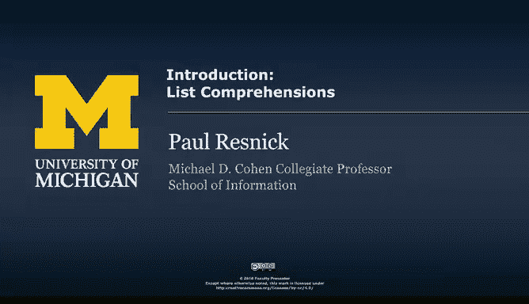

# 密歇根大学《Python3编程（课程3、4、5）》｜Python 3 Programming（Python for everyone进阶）（中英字幕） - P24：23_03_01_列表推导式简介.zh_en - GPT中英字幕课程资源 - BV1gj41177yd

Hi everyone。I have to apologize because the previous lesson force you to learn some pretty conceptually challenging stuff。

 passing a transformer function to the map function and passing a filtration function to the filter function。

And it turns out that you won't actually use them。Python programmers rarely do。

 It was just a pedagogical tool to give you a way to really think through the map and filter programming patterns。

In Python， there's actually a simpler syntax for doing the map and filter patterns。

 and even for combining them， it's called list comprehensions。

And now that you understand what they're for， I think you're going to love them。

The syntax can be a little confusing because it reuses elements of the for loop syntax。

But with an understanding of what list comprehensions do。Based on the map and filter lesson。

 I think you'll find that it's pretty intuitive。List comprehensions are how Python programmers typically write code that does transformation and filtration。

At the end of this lesson， you should be able to read and write list comprehensions。

And you should be able to describe a list comprehension in terms of the transformation and filtration operations that it's performing。

So let's go see how they work。See， at the end。