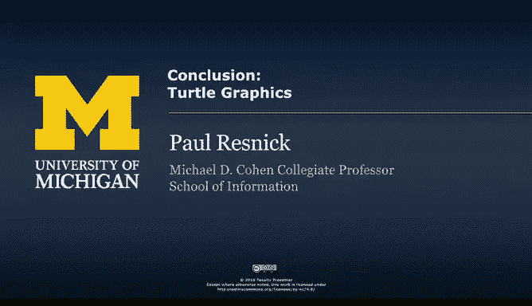

# 密歇根大学《Python3编程（课程1、2）》｜Python 3 Programming（Python for everyone进阶）（中英字幕） - P24：24_01_07_海龟绘图总结.zh_en - GPT中英字幕课程资源 - BV1CM411Z72u

As a reward for sticking around this far， here's a little joke。A snail was out on the beach。

 taking a walk， and he looked back。He saw three turtles behind him， wearing leather jackets。

Made him a little worried。So he picked up his pace。And he's inching along about four hours later。

 he turns around again， and。Sure enough， they're still following them， and they're getting closer。

He's getting very worried， and he moves forward。 Hes going two hours later。

He sneaks another look back。 They're still following him。 And they're really close。

 So he starts sprinting as fast as he can。But an hour later， the turtles caught him and mugged him。

Took his money， his car keys。Took him all away till the next morning before he managed to get the to the parking lot to a payphone。

 He calls the police。 He says， I got mowed by three turtles wearing leather jackets。

And you get down here as fast as you can because they're going to get away。The officer asked， Sir。

 can you describe the turtles in a little more detail。No， I can't。 It all happened too fast。

Happy drawing。I'll see you for the next lesson。