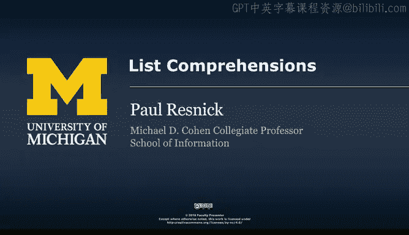
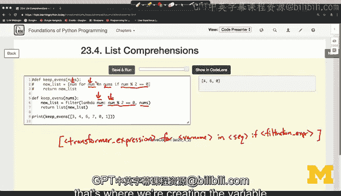

# 密歇根大学《Python3编程（课程3、4、5）》｜Python 3 Programming（Python for everyone进阶）（中英字幕） - P25：24_03_02_列表推导式.zh_en - GPT中英字幕课程资源 - BV1gj41177yd

Welcome back。A list comprehension is a convenient syntax for doing map and filter operations。

 one that I think you'll find is a little more intuitive than the map and filter functions。

So here's a simple example that does a map operation transforming every item by doubling it。

We started with the list， 2，5，9。Two got doubled to be4，5 became 10， and 9 became 18。

So let's pull apart the syntax on line3。That constitutes the list comprehension。We have。

 first of all， square brackets。So that should be familiar to you。

 we use square brackets to create a list。But what we're putting inside it is not the actual objects。

 but a Python expression that's going to evaluate that's going to produce all of the contents of the list。

So the next thing to notice。Is for value in things。That's how we did four loops before。

But there are some things that are a little different。

 So the part that's the same is we have the word for， and we have the word in。

Between we have a variable name， that's going to be our loop variable or our iterator variable。

And after the word in， we have some sequence， in this case， the variable things， whose value。

Heres the list 259。The things that are different are that we don't have a colon at the end。No Col。

And we don't have an indented block of code underneath。Instead。What we have。

Is some code before the word for。And I'm going to call this the transformer expression。

So we have a general format for this that is square brackets。A transformer expression。Then the word4。

Will have some variable name。The word in。And then， some sequence。And we'll have a。

Closing square bracket。I left a little space for something that's going to come later。

So compare this to the version that we had using map。I'm just going to erase a few things here。

Instead of saying your list equals that lift comprehension， we could have said your list。

Equals the results of calling map。Where we had。Some function。

 a transformer function that would take a value。Return value times two。

And we would apply that transformer function to things。

You can see a lot of correspondences between these two approaches to doing it。

 let's just make sure test my code， yeah it still works and manage to do the same thing。

We have this value times too。That was the transformer expression in our list comprehension。

 But we also had that transformer expression as part of the Lambda expression that produced our transformer function when we were using map。

We can also use a list comprehension to do filtering。As in this example。

We're defining a function that filters keeping only the even numbers。We did that previously。

 with the filter function。In this list comprehension， we have an extra clause at the end。

 the if clause。So after we had the four variable name and sequence， we have the word if。

And then we have a filtration expression。So in this case， only keep the number。

If it's even only if it has a0 remainder when we divide it by 2。

Note that when we're doing the filter operation， we don't really want to transform the items that we keep。

So we have this somewhat funny。Wording here， numbum for numb in nus。Well， you can parse that。

 and then it won't seem so crazy。 Nums is our list。

 That's the list that was passed into the function。This nu。

Between the word4 and in is our iterator variable。And this is our transformer expression。

 except we don't want to transform the number。 We just want the number， as it was。And so we say numb。

 rather than nu star2 or some other transformation， we just say numb for numb and nus。

And the real action is happening in the if clause where we're filtering out those things that are a even。

So that's why I left this space here。Because the full version。

Of a list comprehension can have an if clause。There can be a filtration expression that goes afterwards。

As we did before， let's compare this version of keep evens to a version of keep evens。

That doesn't use a list comprehension that instead uses the filter function。

 and you'll be able to see some correspondences between them。First。

 I'm going to erase a few of these marks。Let's make an alternative definition of keep Es。

I'm going to filter。My original nos。And I'm going to give it a filtration function。 now。

 that's going to be lambmbda。Of none。No。Percent2 equal0。I'm going to apply that filter to nus。

And this is a new definition of keep evens。 This one will have the same effect as the as the original one did。

Let's check to make sure。I didn't quite get it right because I forgot to return。My new list。Now。

 really， because in a true Python environment。The filter operation doesn't return a true list。

 It returns this list like object。 We can get away with it in Runestone， but it's a better habit。

To convert it into a list if we really want it to be a list。So now let's do a little comparison。

Of the two versions。In the version using a list comprehension。We had。The filtration expression。

 after the word if。Here， we had that same filtration expression as part of the lambmbda function。

In both cases， I chose to name my variable nu。And we are applying the filter。In both cases。

 to the same sequence。So there's a lot of things that match up syntactically。 In either case。

 you want to be able to read this and make sure that you understand what each of the words is referring to The word numb comes in here twice。

 and you have to realize that the first time you have the word numb。 That's defining a variable。

 That's the parameter for this anonymous lambda function。The second time you have the word。

 it's referring to to the item itself， that variable will have a value when we invoke the function and so we're。

Defining the variable the first time。 And we're looking up the variable the second time。By contrast。

 in the list comprehension。The first time we have the variable name， we are looking it up。

 and the second time we have that same variable name between the word 4 and the word in。

 that's where we're creating the variable name nu。That's all for now。

