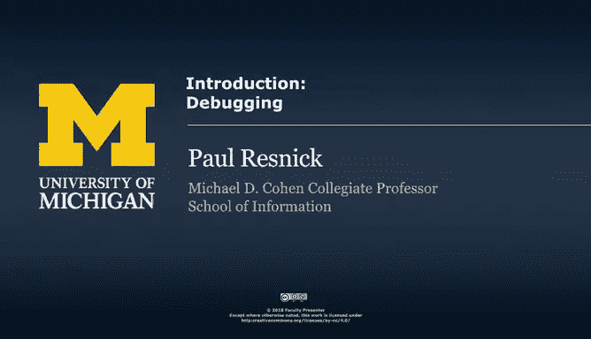

# 密歇根大学《Python3编程（课程1、2）》｜Python 3 Programming（Python for everyone进阶）（中英字幕） - P25：25_01_01_调试导论.zh_en - GPT中英字幕课程资源 - BV1CM411Z72u

Most weeks， our last lesson is going to be titled The Way of the programmer。

These segments are not about how Python works， but about how you should work。

Style tips for your codes， strategies for solving programming problems， habits。

Mindsets that'll make it so that you can have fun， even though it's hard work and sometimes frustrating。

This week， we'll focus on debugging。Your programs are not going to always work the first time。

 In fact， they rarely will。 You have to debug them。

And debugging your code is a little bit like being at a detective in a crime movie where you are also the criminal。

 because you wrote the code。So our learning objectives for this lesson， the end of it。

 you should be able to distinguish between three types of errors， syntax errors。

 runtime errors and semantic errors。You should develop a habit。That when you get an error。

 you'll look at the error messages。And start， you you should start to build a skill of interpreting those error messages。

You will internalize a mantra of get something working and keep it working。

 Don't write big swaths of code before you test it。

And you'll be able to recognize some common errors and how to fix them。

