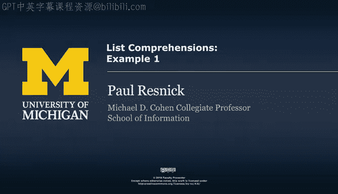
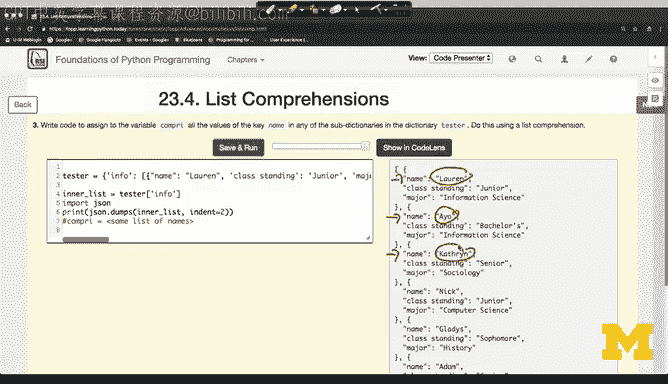

# 密歇根大学《Python3编程（课程3、4、5）》｜Python 3 Programming（Python for everyone进阶）（中英字幕） - P26：25_03_03_列表推导式示例1.zh_en - GPT中英字幕课程资源 - BV1gj41177yd

Let's do an exercise together。A challenge here is we're given a dictionary tester that has some nested data inside of it and we'll get a little practice with extracting from nested data。

Our job is to accumulate。All of the names， all the values associated with the key name from any of the。

Inside dictionaries。So one of those names is going to be Lauren。Another name is going to be I O。

And we should end up at the end with a list of Lauren。An I O。And maybe some others。Now， as always。

I like to get started by reminding myself of what I'm supposed to produce。

I can't run this yet because that's obviously not going to be the correct answer I've got some work to do。

When I have this nested data structure， I like to do the understand， extract， repeat process。

So you can see that those names。Are not at top level。

 There is a top level dictionary that has the key info whose value is a list。

And then I'm going to have some dictionaries inside of that list。

And the dictionaries that I want are all associated with this value info。

So my first level of extraction is going to be， I'm going to call it inner list equals tester square bracket info。

So I've done my first extraction， but it's always a good idea to check whether I got it right。

 so I'm going to print that inner list。IllP it。And I got bad input on line6 because it's not。

Good Python。 So I'm going to comment that out。 It's still there to remind me that that's what I'm supposed to produce at the end。

And there we go， we got a whole bunch of stuff。I'm going to get rid of my markings here。

And it is a list with some dictionaries in it。You can see Lauren is here and there's IO。

If I wanted to make this a little easier to read， I might use my JsonN do Dumpest to pretty print it。

I'm going to import Json， and I'm going to say interlist。 dumpas。Sorry。It's Json。dumpas。OfIn list。

And I give it the indent parameter。There we go。 That's a little easier to read。

 I've got a list of dictionaries， the first dictionary。Has named Colin Lauren。

 the second dictionary has named Colin Io。Name Col Catherine， and so on。

So I've done my first extraction。And now I'm going to iterate through each of those dictionaries。

 now ready to do my list comprehension that is going to iterate through those dictionaries and just grab the names。

 It's going to grab Lauren and I。And， Katherine。

And it's going to be a list comprehension。I'm going to just make our little template here。

 There's a transformer expression。For some variable name in a sequence， if。Filtration expression。

Now I'm going to fill in some of those things。What is the sequence that I'm going to iterate through。

Well， it's this inner list。That's the thing that has the list of dictionaries。

Each of the items in that inner list is a dictionary。 So I'm going to choose to call it D。

D for dictionary。And now I just have the filtration expression and the transformer expression that I need to fill in。

In our case， we've been asked to get all of the names。We don't really have a filter。

 You could imagine a filter that says， only get me the students in sociology or only get me the students in information science。

 and then I would need。The F clause。But I really don't need that。 if clause here， I could say。Yifshu。

And that would get me all the students， or I can just get rid of the if clause entirely。

So now I just need the transformer expression。If I have a dictionary， D。And D is bound， let's say。

To this dictionary。That has the keys name， class standing and major。

And I want to get just Iio out of D。How would I do that？Well。I would just say D square bracket name。

let's print。Conre at the end of this。And let's stop printing that。Whole big list。

And let's see what we've managed to get。Get rid of my marking so we can see it better Sure enough we got a list of Lauren and Io and Catherine and Nick and so on。

 and you can see that we've nicely passed all of the built in tests that we're checking to make sure that we created the right list。

So that's how there is to list comprehensions。So just remember the basic template for a list comprehension。

 you have square brackets。You have a transformer expression。Thenhan the word4。A variable name。

The word in。Some expression that evaluates to a sequence， and then optionally。

A filtration expression。And closese the square brackets。We'll see you next time。

