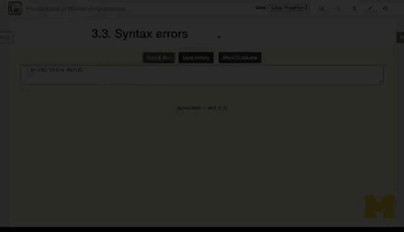
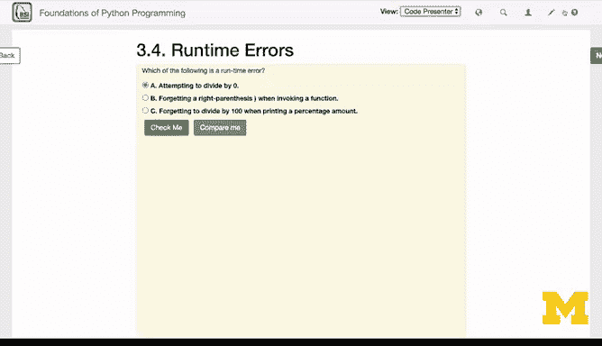
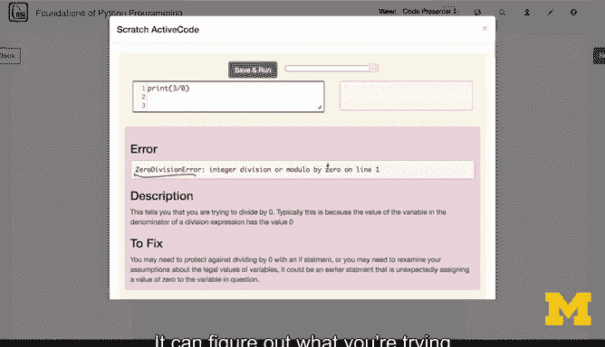
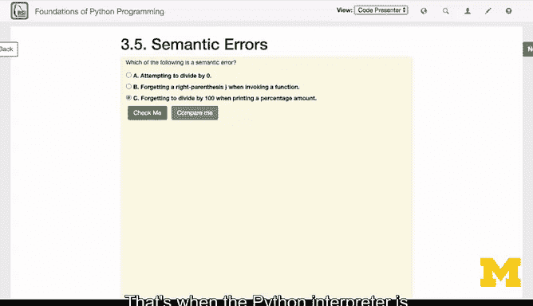
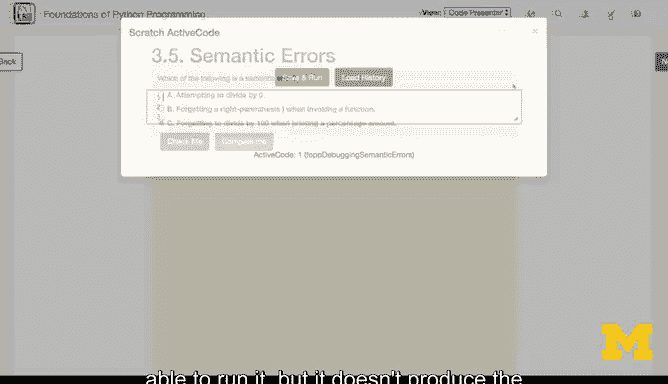
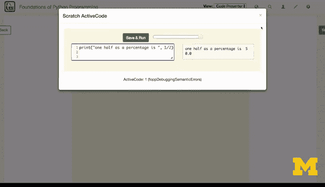
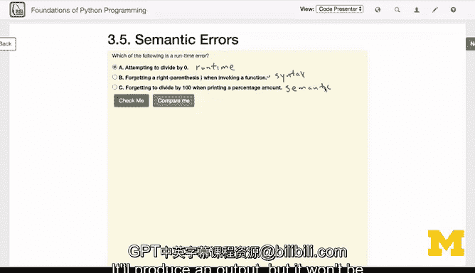

# 密歇根大学《Python3编程（课程1、2）》｜Python 3 Programming（Python for everyone进阶）（中英字幕） - P26：26_01_02_语法、运行时与语义错误.zh_en - GPT中英字幕课程资源 - BV1CM411Z72u

The first kind of error is called a syntax error。Just like in English。

 where we have syntax is an important part of grammar。

 A syntax error in Python means that the statements just aren't well formed。 The interpreter can't。

Psit。In this case， we have the word print， and we have the open parentheses。

And then something to print。 But we're missing the closing parentheses。

And the Python interpreter tries to keep looking。Farther on， as well。

 there's no closed parentheses here， but maybe it'll be here or down here。

And he keeps going to look for it。 It can't find it。 And it just says this is an error。

 I don't know what the programmer had in mind here。 doesn't try to guess。

 It says this is a syntax error。 So let's see what that looks like。We actually get an error message。

 and it tells us。Syntax error。And then it tells us something about what's going on。 It says EOF。

 That's an acronym， E O，F and of file。Of course， we don't really have a file。

 we just have a little window， but。It thinks of the contents of that window as being a file。

That has commands in it， it got to the end of that file。

It was in the middle of a multi lined statement。 The statement started on line 1。

 and it was waiting for that statement to end with that closed parentheses。

 and it never got to the end。 It got to line 3。The end of the file。

Without ever seeing a close prehesis。Now。In the textbook， when you're executing Python。

 we've actually。Tried to translate some of the error messages that you would get in a normal Python interpreter and make them easier to understand for someone who's just getting started programming。

So believe it or not， this is actually already a little bit more human friendly than you might get normally。

And we've tried to give you a little description and some suggestions of what you should do to fix it。

 In this case， the things that are suggesting aren't quite what we need。 What we really needed was。

A closed parenthesis。The other thing to notice here is that it's telling us line 3。

There isn't even a line3， but certainly the place where we ought to add the parenthesis is on line1。

 not on line3 is just that the problem started on line 1。

 and the interpreter wasn't really sure it was a problem until it got to the end of the file line 3 without getting the closed parenthsesis。

So， if I put。Is here， now it'll run just fine。An alternative。I could have put it here。

And that also would be fine。Normally there will be no reason to do that。

 itll be much easier to read if you put it there。Now here I'm going to get another error。

It says a bad input on line three because I have this extra closed parenthesis。

So these are all syntax errors that make it impossible for the interpreter to figure out what the program was supposed to do。

A second type of error are runtime errors。These occur when the interpreter is able to parse the program。

 but during the running of the program， some illegal operation happens， for example。

Let me do one of those。 Suppose I print3 divided by 0。What is3 divided by 0。Infinity， maybe。

It's just not it's not a legal operation， doesn't make sense to divide by zero。

 and if I try to do that， I get this zero division error。

Where it says the integer division or modo by zero on line1。So that's an example of a runtime error。

 it can figure out what you're trying to do， but it's not a legal operation。

The third type of error is called a semantic error。

That's when the Python interpreter is able to parse the code。

It's actually able to run it， but it doesn't produce the thing that the programmer intended。

So， for example， suppose。I try to。Print something that explains。

A conversion of a fraction to a percentage。 but I do it a little bit wrong。So I say one half。

As a percentage is。And then I say one over two。I'd like it to say 50%。

But it's really going to say 05。0。5。What I should have done here。

Is multiplied by 100 to turn it into a percentage。So one half as a percentage is 50%。

I apologize for the line break there， but you can figure out what it means 50%。

So when I left off the hundred， and I just said。And I just said one over two。

That was a semantic error。It was a programmer's error that produced the wrong thing。

 but the program was able to run all the way to completion， it just didn't do what I wanted it to do。

Those who are three types of errors。

Syntax。Runtime and semantic in this multiple choice question。

 which you'll get a version of on each of the pages for the three different error types。

 we've got one example of each。Attempting to divide by zero。That's a runtime error。

Forgetting a right parentheesis， it's going to make it impossible for the interpreter to parse your code。

 that's a syntax error。And forgetting to divide by 100 when you're printing a percentage amount。

 that's going to be a semantic error。It'll get all the way through the program。

 it'll produce an output， but it won't be quite the output that you wanted。

