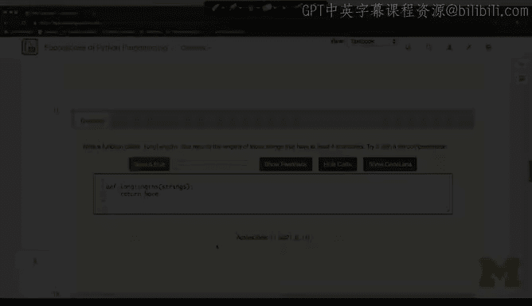
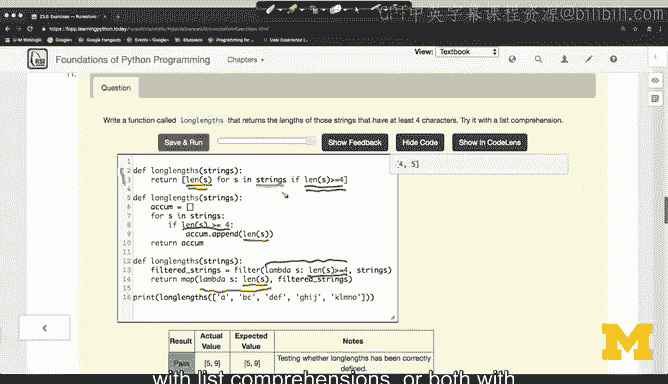

# 密歇根大学《Python3编程（课程3、4、5）》｜Python 3 Programming（Python for everyone进阶）（中英字幕） - P27：26_03_04_列表推导式示例2.zh_en - GPT中英字幕课程资源 - BV1gj41177yd

Welcome back。Practice is really helpful for reinforcing how to do map and filter operations。

 whether you do them with manual accumulation or the map and filter functions or with list comprehensions。

Let's work our way through defining a function long lengths。

 using all three ways of doing the map and filter operations。

Long length is going to take as input a list of strings。And it should return a list of numbers。

 The lengths of only those strings that have at least four characters。

So there's a filtering operation。Any string that's too short， we don't want to do anything with it。

 we don't get any output for it。And there's also a transformation。Operation， we're mapping where're。

Taking the strings and turning them into numbers that represent the length of those strings。

So the first thing I would do is。First， make an invocation of these functions that I'll be able to tell once I implement it。

 whether it's working correctly。So I'm going to pass it some list of strings。

For which I know what the correct output ought to be。And I'm going to print that out。

And what list do I want to give it， Well， let's give it。 Let's say a list of some short strings。

It's a three character string。Let's give it a four character string。And a five character string。I JK。

L M and O。What I'm expecting to get back is a list of four and 5。 the strings that were too short。 A。

 B， C， D， E， F， Those strings are all too short， so I shouldn't get any output for them。

 and then I should get four for the G H I J and 5 for the K L M N O。 if I run it。Of course。

 I'm going to get。The value none， I'm not even going to get a list。Even if I make it a list。

I'm not getting the right thing。So I got a little work to do。I'm going to write a list comprehension。

Instead of returning this empty list。I'm going to do some transform expression。For。

Each string in strings。D。Some filtration expression is true。So if I have。The string s is。

Bound to GHIJ。What I would want to return。Is the length of S。

But I only want to do it if that length is at least4。So that's my filtration expression。

Now if I run this， hopefully I'm going to get four and five back， I did get four and five back。

 and in fact the built in tests which called long length with some other lists of strings。

 I passed those tests as well。So that is one correct answer， but I also want to do this same one。

Using manual accumulation and using map and filter。Let's try it using a manual accumulation。

I'm going to start my accumulator。Variable having an empty list， and at the end。

 I'm going to return it。In between， I'm going to iterate through the strings。

 and I'm deliberately using some of the same variableable names just so we can sort of see how the syntax maps between them。

For each S in strings if。The length of S is at least four。Then， I will append。

Something to my accumulator。If the length isn't long enough， I will ignore it。

So that gets me the actual strings， G H I J and KLM& O。

 rather than the transformed version of those strings。 So instead of appending S。

 I have to append La of S。The third way that we can do this。Is using math and filter。

So I'm going to return。The result of。mapping。My transformer。Onto the set of strings。I do that。

I will get。The lengths of all of the strings。So that's not quite right yet。And by the way。

 lambmbda S L of S is really just the land function。So I could map L。Onto strings。

And we get the same thing， but I don't want to do it on all of the strings。 I want to do it on。

The filtered strings。Is the result of。Filtering。The strings using a filtration function。

So that gets me the filtered strings。I can pass those to the map function。

And I only got the one because I did the wrong filtration expression should be whenever the length is greater than or equal to4。

Let's see how some of the same expressions show up in these different ways。

Of implementing the map and filter。In our list comprehension。We have a transformer expression。L of S。

And we also have a filtration expression。L ofs greaterd than equal to4。Yin。😔，Our manual accumulation。

We have a transformer expression that the Lenos。Haowi。

Pass S through the L function to get its length。 And we do that before we append it into our accumulator variable。

We also have。Our filtration expression， then of as greater than or equal to 4。Similarly。

 if we look at how we do this with map and filter， clearly the filtration expression should show up when we invoke the filter function and the transformer expression should show up when we use map。

So we have the filtration function。L of S greater than or equal to 4， but we've made it be part of。

Li。Filtration function。And with map， we actually don't have the full La of ass。Expression。

But if I do it with this sort of more complicated， where I write out the whole lambda expression。

Lambda S。Cohen。L of S。If do that version。Then I do get。The corresponding expression Le of as and it。

Being part of。Our transformer function。So the places where we have to specify exactly how we're transforming。

 exactly how we're filtering。Which sequence we're doing the transformations and the filtering on。

All of those things， they have to show up no matter which way we express it。

What's different is that we are plugging those expressions in in different ways that make it easier or harder to read and write these。

 And I think the pythonic way is clearly the first one that uses the list comprehensions。

 And this is what I would encourage you to use most。 because you can look at it。

 and in one expression in one line of code on line 3， you can read it off。

You can see where the transformer expression is， you can see。Where the filtration expression is。

And you can easily see。Which sequence it is that we're doing these operations on？

I encourage you to try some other exercises on this exercises page to get more practice。

 It walks you through doing some of the same operations。😊。

Doing both with map and with less comprehensions， or both with filter and with list comprehensions。

I'll see you next time。