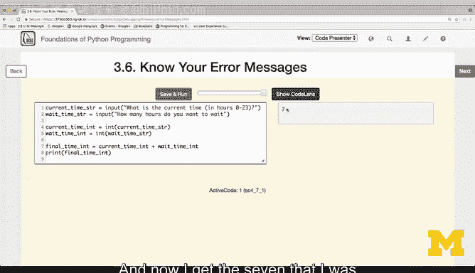

# 密歇根大学《Python3编程（课程1、2）》｜Python 3 Programming（Python for everyone进阶）（中英字幕） - P27：27_01_03_理解错误信息.zh_en - GPT中英字幕课程资源 - BV1CM411Z72u

It's really valuable when you get an error。To look at the error message， it can tell you a lot。

 First， the first thing you notice is that there's that pink box and you got an error。

And then you may be tempted to just go look at your code and try to figure out what's wrong。

It's really worth investing the time to look at the error message。 It'll tell you a line number。

 which will be a good clue。 And if you start to learn to decode the specific messages。

 they will also be really helpful。 So let's go through an example here。

Here's a program that's going to ask for a couple of inputs。It's going to ask。

What time we want to start。How long we want to wait。And at the end， it's supposed to print。

 So if I enter 3 o'clock。3 is our start time。 Then I want to wait four hours。

 It should tell us that that's 7 o'clock。Let's see what actually happens。

What's the current time in hours， let's say three。How many hours do you wantan to wait。4。

 and it should print out 7。But instead， we get that pink error box。Let's go see what it's telling us。

 it says。First of all， that line 5 is a good place to look。

It says the type of problem that we have is a name error。And in particular。

 wait time int is not defined。So let's go look at line five。This means that it actually executed。

1 through 4， everything was going fine until it got to line 5。

Whenever you see an assignment statement like we have on line five。What happens is we first。

Evaluate the right hand side the stuff after the equal sign。

 and then we'll assign it to the variable。Waiit。Time。😔，Int。So it's going to get a value。

 but it only gets that value after we manage to evaluate the right side。

So the right side says to look up。The current value of wait time int。But。It is not defined。

So by the time we get to line 5， wait time int has not previously been set。

And when you try to look it up on line 5， we get this error， so that should give us a clue。

Now we have to go back to what we were trying to do and figure out what's going on and say， oh。

 wait a minute。We were trying to take this input that we got。There was going to be a string。

 That was maybe four hours。But this isn't the name of the variable。Wt time， STR。Is the variable。

So if I do that。I have a better chance of it working。Let's see if that does。I start at3。

They say that I want to wait four hours。And now， I get the7。That I was expecting to get。

See you next time。