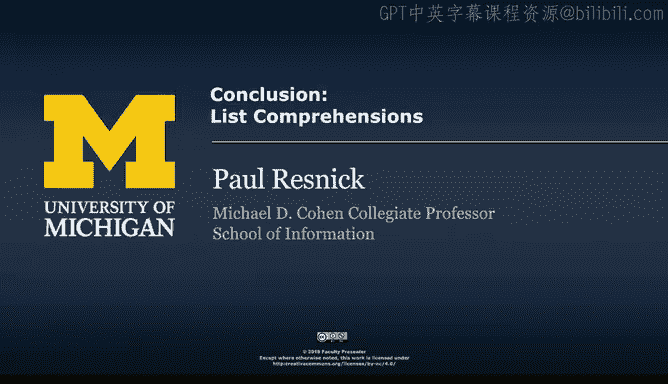

# 密歇根大学《Python3编程（课程3、4、5）》｜Python 3 Programming（Python for everyone进阶）（中英字幕） - P28：27_03_05_列表推导式总结.zh_en - GPT中英字幕课程资源 - BV1gj41177yd

Welcome back， everybody。You should now be able to read and write list comprehensions。

You should be able to describe the operations that a list comprehensionionss performing in terms of transformation and filtration。

And if you had to， you should be able to translate a list comprehension into equivalent invocations of the map and filter functions。

Here's a whole list of puns for you。 I hope you'll comprehend them all。

What does a clock do when it's hungry。It goes back4 seconds。Wantna hear a pizza joke。Never mind。

 It's too cheesy。I was up late last night reading a book about anti gravity。

 I just couldn't put it down。That's a lot of puns。I actually once did a whole theatrical performance of puns。

 It was a play on words。😊，See you next time。