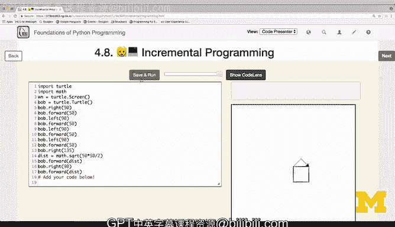

# 密歇根大学《Python3编程（课程1、2）》｜Python 3 Programming（Python for everyone进阶）（中英字幕） - P28：28_01_04_增量式编程.zh_en - GPT中英字幕课程资源 - BV1CM411Z72u

You can reduce your headaches as a programmer。By writing your programs incrementally。

Get something working and keep it working。 That's gonna to be our mantra。

Or start small and keep it working。Here's a program where we're trying to draw a house。

Rectangle with the triangle on the top。And we've done the first part for you。Get something working。

But I'm now going to try to add to it in a way that says。Draw more and more of the house。

 And when we make mistakes to catch them before there is too much code。

So we've started with something that's working。Bob is going down and turning left。

Let's complete that square。That should be pretty easy to do。Just make him turn left again。

And go forward。You might be tempted to do more lines of code than that， but I really recommend。

Testing。After you write every little bit of code。So let's turn them again。And we'll test that。

Then we're going to get to slightly harder part。So now I want to make him turn this way so that he can。

Finish the house like that。So， let me。Do that。Instead of turning left。

 I'm going to want to have him turn to the right。And instead of 90 degrees。

 let's just try going 45 degrees。 We'll go halfway。And then we'll have him go forward。By or 50 again。

Oops。This is why it's a good idea to do things a little bit at a time because I'm going to get to realize already that I am going the wrong direction。

So I wanted him to turn。To hear so that he would。Go that way。 But he didn't go far enough。

He turned 45 degrees， but I really needed him to go all the way around to there。 So another 90。So。

 I need him to go。1 hundred35 degrees。That looks a lot better。Now， I'll just have him turn。

90 degrees。Go forward。And we will have our house。Let's see。Oh， no。We don't get a house that way。

So it turns out that we need to make him not go quite as far。So instead of going 50。

 he's got to go a little bit less。 Maybe he should go。40 each time。Almost， but not quite。

And you can try just doing。Trial and error until you get something that's pretty close。

 or sometimes it really helps to step back and do a calculation in this case。The Pythagorean theorem。

Remember that？Can really help us。We want to make something that is。50。Here。And is's gonna be。

A right triangle there。If we have some length， a。We need a squared。Plus， a squared to equal。

50 squared。So you could do this in a calculator or you could have。

The Python interpreter work it out for you。 There is a square root function。It's a little tricky。

You have to import the math module。And then。We're going to say。Distance。Is the square root。Of 50。

Times，50。Divided by 2。And then we will have Bob go forward。By that distance each time。

Let's try it and see if we get。A nice roof on the house this time。Yay。

So the main point that I wanted you to take away from this。Was。That。You're unlikely to get。

It all write the first time if you just write a really long program。

 it's much better to start with something that's working， add a line or two。

 test it and make sure that you continue to have a program that is working。

 so build up and always keep your program working。

