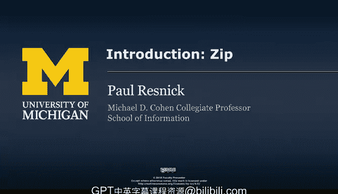

# 密歇根大学《Python3编程（课程3、4、5）》｜Python 3 Programming（Python for everyone进阶）（中英字幕） - P29：28_03_01_zip函数简介.zh_en - GPT中英字幕课程资源 - BV1gj41177yd

Welcome back。Python provides one more function that performs a common accumulation。 It's called zip。

It takes two sequences， and zips them together。Matching their first items together。

 their second items together， and so on。It makes it easy to do operations where you have to make pairwise comparisons or pairwise combinations。

At the end of this lesson， you should be able to read and write code using the zip function。

Bye for now， I'll see you at the end。

