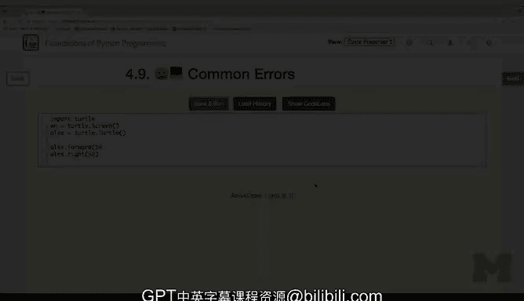
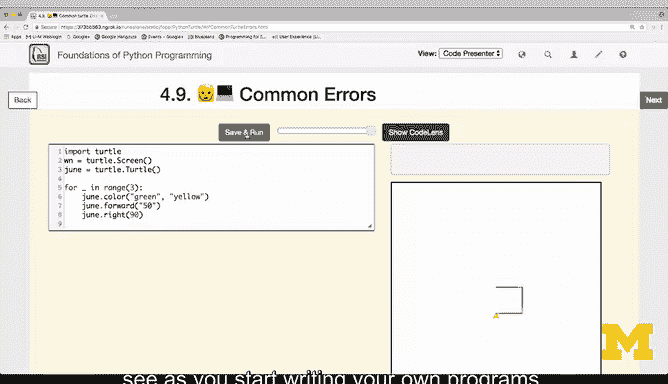

# 密歇根大学《Python3编程（课程1、2）》｜Python 3 Programming（Python for everyone进阶）（中英字幕） - P29：29_01_05_常见错误类型.zh_en - GPT中英字幕课程资源 - BV1CM411Z72u

Let's go through some common errors。These are typical mistakes that programmers make。

 so it' would be helpful just to have seen some of the error messages and how to recognize the problems and how to fix them。

So one that we've already seen is forgetting a parentheses。Here it tells us there's a syntax error。

 it doesn't really know exactly what's wrong， but it tells us there's a syntax error on line 6。

Whenever you see a syntax error， you should always look on the line number that it says。

If everything looks right there。You should really look on the lines above it。In this case。

We forgot to close the parenthesesis on line 5， so even though it says line6。

 it's line six where the Python interpreter realized there was a problem that it's on line five where you really have the problem and where you should correct it。

We should add that parenthesis。And now it works。Our next set of errors。involve variable names。

 the first thing to realize is that capitalization really matters。In this case， we got to line three。

And on line three。It tries to do。Capital tuurtle do small turtle。

First thing to know is that capital turtle and small turtle are two completely different variable names。

And。Small turtle is the name of this module。In that module， you can find the turtle class。

So we really needed to have。Small turtle dot capital turtle。

So another example of a variable naming problem。Occurs here。

And sometimes you got to watch out and we have a big window to draw in that there may be。

An error message down below。In this case。Name right。Is not defined on line 6。

AndYou might look at this and say。This is all just fine。

 We're telling June to go right by 90 degrees。That's not the correct way to say it。We first have to。

Mention the object and then the dot。And then。The method。So June should go right by 90。Not right June。

So let's fix that。And now we get it without the error message。Here's another variable naming problem。

We create a turtle named June。And then we tell June to move right by 90 again， the error messages。

Down off the screen， but it's saying June is not defined on line 6。So we're telling June to go right。

 there's no binding for the variable June。 There is a binding for the variable small J June。

So this is a situation where small J June， capital J June， not the same variable。

And so we got that error。Fix that。 no more error there。Another common type of error。

Is when we invoke a function but don't pass in the right values。

The right arguments that it's expecting。 So here we've got。A program。Where June is supposed to。

Move forward and turn right and do that repeatedly。But we didn't tell it。How many times to do it。

 So we invoked the range function， but we didn't pass in an argument saying how many times to do it？

We get an error。And it tells us that on line5。We tried to invoke the range function。

It wanted to have at least one argument， but we didn't give it any。

There are no values in the parentheses and it wants at least one。

So we should have said something like， do this three times。Let's give it an argument of three。

And now。It works just fine。You may also notice that on line7。

 we passed the string 50 instead of the number 50。In some situations， that would cause an error。

But the forward method for turtles was implemented in a way that allows us to pass either a number or a string that can be cast to a number。

 so it's okay。So those are some kinds of common errors that you're likely to see as you start writing your own programs。

We'll see you next time。

