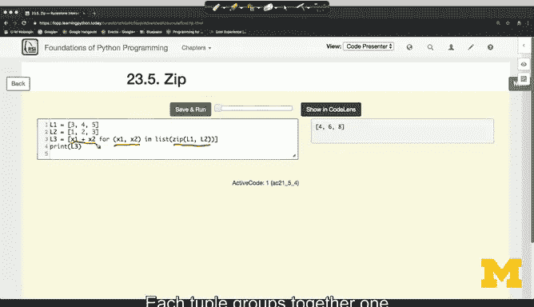
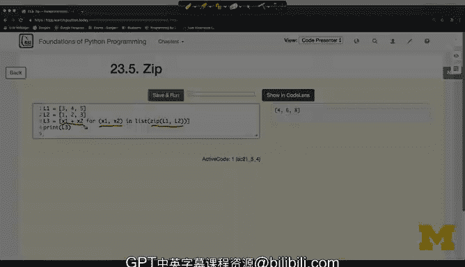

# 密歇根大学《Python3编程（课程3、4、5）》｜Python 3 Programming（Python for everyone进阶）（中英字幕） - P30：29_03_02_zip函数.zh_en - GPT中英字幕课程资源 - BV1gj41177yd

Zip lets you match up the items in multiple sequences positionally so that you can do something with all the first items。

Something with all the second items and so on。For example， suppose we wanted to add two vectors，3，4。

5， and1，2，3。At the end， we want to get a new vector。Where we've added the first two items together。

3 plus one gets you4。4 plus2 gets you 6 and5 plus 3 gives you 8。

We're sort of zipping these two things together。That we're combining the three and the one。

 we're combining the four and the two。 We're combining the five and the three。We can do that by。

Iterating through the indexes， the positions。Remember that the range function produces。A sequence。

And in this case， we're saying how many items should be in the sequence， it's the length of the list。

 so it should be the numbers beginning at 0 and going up to， but not including three。

So I is going to be bound to zero and then to1 and then to two。

And we're iterating through those indexes， or positions。

Let's run this in code lens and see what happens。So we create the first list。

 we create the second list。We have an accumulator that's going to。Accumulate things pairwise。

 and now we're going to iterate through those indexes 0，1，2， and 3。 The first time we get to line 6。

 the index is 0。So we're going to stick into our new list， something that combines。

The value at position 0 from the first list with the thing that's at position 0 in the second list。

So it combines the three and the one to get4。The next time we get to position 6。

 I is now bound to one。 And so we're going to combine the two things that are at position one in the two lists。

So you can sort of think of this as that we've zipped the two lists together and then combined the elements at the position zero。

 combine the elements at position 1， and so on。Now， iterating through。The indexes are positions。

Can be done in Python， but it's not really the Pythonic way of doing things。

It obscures the structure of what's going on， which is that we're matching the two lists together。

 position by position。Instead， Python provides the zip function。Which makes that structure clear。

So here's doing the same thing using the zip function。 The zip function takes two or more sequences。

And it makes a list of tuples。 Each tuple gathers together the items from the corresponding position in the list。

So you can see on line 3 that I have invoked the zip function passing it L 1 and L 2。

The zip function。Actually returns an iterator that list like object that we've seen before。

 that map and filter also return and seen it with the dictionary method dot keys。

If we're just going to iterate through the results that zip produces， we don't need to do anything。

 but if we actually want to see it as a list， we have to pass it to the list function。

So let's see this in code lens。 This isn't actually going to combine the values。

 It's not going to add up the3 and the one to get 4 and add up the4 and the two。

 It's going to produce a zip together list。So we start with our two lists。

 and then we make a list that zips the two together。 It's still going to have three elements。But now。

 each of those elements is a tuple that is。Stuck together。The three and the one。From position  zero。

 it stuck together the four and the two from position 1 and stuck together the five and the three from position 2。

Once we have this zip together list， then we can do an additional operation to combine the three and the one。

 to combine the four and the two。So let's see how that happens。So， here， I've created。

That zip together list。 and then on line 6 and 7。I'm going through each of those templeples and for each of them。

I'm adding the two elements together and appending that result into my accumulator list， L 3。

Let's see how that one looks in code lenss。We create our two lists。We zip them together。

 So now the first element is a coupleple of three and one。

And we're now going to iterate through those tuples。

And we're doing that clever little unpacking thing， so that。On our first iteration。

X1 is going to be bound to 3， and x2 is bound to1。So， we've。Unpacked this tuple。

Into two different variables， x1 and x2， x1 gets the value 3 and x2 gets the value 1。

Having done that。We're going to add the three and the one together to make four and append that into L3。

You can see there。The four is there。And we'll go on。The next time x 1 and x2 have the values 4 and 2。

 and we've appended the value 6 and L 3。And now， when x1 and X2 have five and 3。

 we end up appending 8。So we get to the end and we print out 4，6，8。Now， having developed this code。

We could combine it and simplify some things， so。I'm going to show you how we can do it with a list comprehension that puts it all together instead of doing that manual accumulation where we start L 3。

 having an empty list。 And each time we append to it， I'm going to use a list comprehension。

This was our L 4。Our zipped list。And we are iterating through it each time we're unpacking the tuple into the two variables x1 and x2。

And our transformer expression takes those variables X1 and x2， adds them together。

 and the sum is the thing that we accumulate into our final list。If I run this。

 I'll get the same result。This is the pythonic way of doing things。 We zip the two lists together。

Then we use a list comprehension to iterate through that zip list。With each tuple。

We transform the tuple by adding the two elements together。

 and we accumulate that set of sums into our final list。So that's the zip function。

 It takes multiple lists all of the same length and creates a new list of tuples。

 Each tuple groups together one element from each of the original lists。

We'll see you next time。

