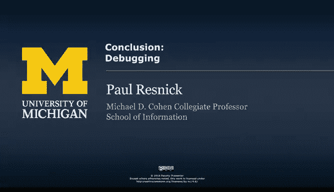

# 密歇根大学《Python3编程（课程1、2）》｜Python 3 Programming（Python for everyone进阶）（中英字幕） - P30：30_01_06_调试总结.zh_en - GPT中英字幕课程资源 - BV1CM411Z72u

Congratulations， you've picked up some valuable debugging the skills。Remember。

 your programs aren't going to work the first time， and you shouldn't expect it。

But with the debugging skills you've started to pick up， that won't be a problem for you。

At this point， you should be able to distinguish between syntax， runtime and semantic errors。

You should be well on your way to developing a habit of looking at the error messages and developing a skill of interpreting them。

Learn to love your error messages。You to be internalizing a mantra。

Get something working and keep it working。Celebrate the small wins。

 and in order to celebrate the small wins， you first have to have those small wins。And finally。

 you should now be recognizing some common errors and how to fix them。So today's joke。A manager。

 a mechanical engineer and a programmer， they're driving back from a convention。

 going over some mountain roads， and suddenly the brakes fail。

And they fly there careening down the mountain。They're scraping。

 scraping against the guard railils and。Fortunately。

 they finally stop in a ditch to their great relief。

 All three of them they get out and they start to assess the damage。 The manager says。

 let's collaborate。 Let's share our ideas， work together on this， and we can solve this issue。

The mechanical engineer says， well， let's disassemble the whole part the whole car and we'll analyze each part for failure and figure out what went wrong。

AndThe programmer says。Hey， why don't we just push the car back up the hill？

And go back down and see if it does it again。Now， don't be that kind of programmer。

 Be more like the mechanical engineer。 Read the error matches。 it is figure out what's wrong。

 Your life as a programmer will be a lot more pleasant。 We'll see you next time。😊。

