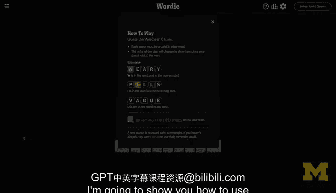
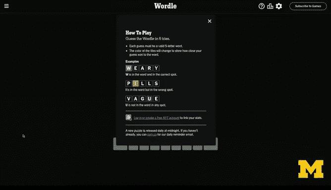
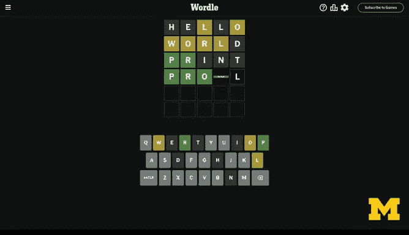
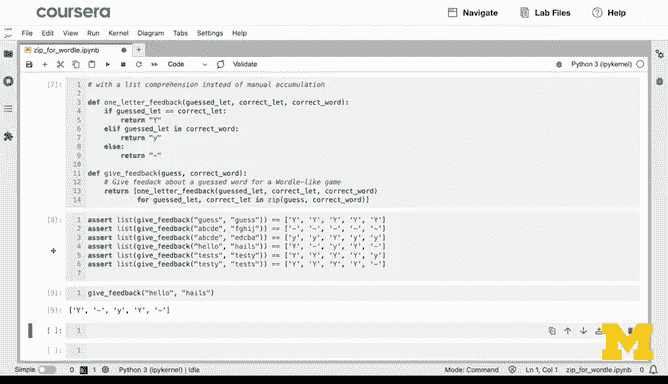

# 密歇根大学《Python3编程（课程3、4、5）》｜Python 3 Programming（Python for everyone进阶）（中英字幕） - P31：30_03_03_zip函数应用示例.zh_en - GPT中英字幕课程资源 - BV1gj41177yd

I'm going to show you how to use zipip and a list comprehension to perform one task for the popular online game Wle。

For those of you who don't know the game， let me start by demonstrating how it works using the New York Times website。

In Wordtle， you have to guess a five letter word， and you get up to six tries。

You get some feedback each time， for example， if we guess the word weary andW is actually in the word。

 then it colors the W green if we guess pills and I is in the word but not as the second letter。

 it would give us feedback that is' colored yellow。

And then letters that aren't in the word anywhere like you and Beg， those will be colored gray。

So let's try。Making some guesses。We're computer folks here， so let's try hello。

Turns out H is not in the word。 E's not in the word。 There is an L in the word。

 but it's not in the third position。And there is an O in the word， but it's not in the last position。

Well， let's try world。A prettyt good at four of the letters right。

 but none of them are in the correct position。And let's try another computer word， like print。

Now I got a green。So the hidden word has P as its first letter， it's got R is its second letter。

 and it doesn't have an I， an n or a T。Looking back at the previous guesses I made。

 I know that it does have a W somewhere。 It does have an O， and it does have an L。

So I'm going to guess PR OwlL。And that is all correct， W who？

Now let's say we want to write a Python function。It gives that same kind of feedback。

I'm going to call this give feedback， that's going to be the name of my function。

And it's going to take a guess。And the correct word， the hidden word。

But since we're just dealing with text instead of coloring squares in。

 we're going to provide text feedback。We're going to give a capital Y when a guest letter matches the corresponding letter in the hidden word。

 a small Y， if the letter is in the word， but in some other position and a dash when it's not in the correct word。

So I have a skeleton of this function。And then here's some things that it's supposed to do。

If we guess the word guess。And that's correct， then we should get back Y for everything。

 Every letter is in the correct position。If I make。The gas ABCDE， and its supposed to be FGHIJ。

 we get dashes everywhere。If it's supposed to be。EDCBA。And I guess ABC DE。So it's all reversed。

 well the A and the B and the D and the E there in the wrong positions。But the sea。

Is in the correct position， so I got a capital Y。For that， third， guess， the sea。

 And I got little wise for the other ones。A is in the word。It's in the word。

 but it's not in the first position， so it gets a small Y。And there's a few more like this。

 one thing I wanted to just illustrate for you is that this feedback it's not symmetric。

So if I guess tests and the correct word is testy。Then， this final S。Is in the word。

But it's not in the last position。 So we get a small Y。For that final gas of S。If I reverse those。

 the correct word is tests and I guess testy。That final guess that I make is nowhere in the word and so。

I get a dash。So when the correct word was testy， I get this result。If I reverse it。

 I get a different result， it's not symmetric。The guess in the correct word。All right。

 so those are our tests， now let's go about trying to write this function。

Here's a first version of the give feedback function。 This one does not use zip。So。

 let's say we have。As our guests。Hello。And as our。Correct word， hails。We're going to go through this。

 we kind of want to go through them。In a yoked way。

 we want to go through the first letter of guess and the first letter of correct word。

And then we want to look。At the next letter， so we're going to go through these by iterating through the indexes。

Zero， one， two， and so on。I'm going to iterate through those index values。Range of line of gas。

And at each step。I'm going to pull out the guest letter。And the correct letter。

So the first time I'll get H for both of them。And if they agree。

If the guest letter is the same as the correct letter。I get a capital Y。If they don't agree。

 let's say we get to the。The second time。We have the guess is E。And the correct letter is a。

Then we check iss E anywhere in the correct word， in this case it's not anywhere in the correct word。

 so we're going to have a dash。Our first result。Was a。Why。Our second result。

 he isn't anywhere in the word。 So we get a dash。And then， for our third。We've got。L and I。

And we find that L is not the same as I， but it is somewhere in the correct word。So therefore we get。

A small why。So those are the three。Possible。Results of of our checks。

So the structure of this is that we are。Going through these one by one。

By iterating through these index values， 0，1 and2。And at each iteration， we pull out。

The guest letter。 and the correct letter。Then we do it again this way and so on。So just to。

To prove to you that this works。I'm going to execute the definition。

 and I'm going to execute all of the assertions， all of the assertions passed， and so we good。

Just even to。If you've forgotten a little bit about what the assertions do。

 I'm just going to print out。What happens if we。We call this。And we get a why， a dash， a small why。

And so on。The Python zip function gives a slightly cleaner way to do that。

 It does exactly the same thing as the original version， but in a more pythonic way。

 So the zip version is， is down below that the first thing to notice is that lines 6 through 11。

They're exactly the same as Lyz。A through 13 up here。

What's different is that I in order to get the bindings of guest letter and correct letter。

We do something different Up above， we iterated through the indexes。And we。

 with any individual index， we pulled out the letter from the gas。

And the corresponding letter from the word。In the zip version。

 that's all going to be handled on line 5。With this iteration through。The result of calling zip。

So zip takes the guess in the correct word， let's say。Hello and Has。And when we zip them， we get。

An iterator think of it as a list where we have H and H as one pair and the second pair is E。And a。

 the third pair is L and I。And so on。And now we're iterating through this。

Which means the first and the first iteration。 we grab the first element， H， H。

And we're doing this clever unpacking。So that guest let。Is bound to the first stage。

Let's say there and the correct let。I is bound to the second age。

The next time through we're going to get。The second tuple and guest let will be the E and correct let will be the A。

Once you get used to reading a line like line 5 is actually easier to understand than lines 5 through 7 in the previous version because it says。

 oh， we're just zipping together the guess in the correct word， and then we're peeling them off。

One element at a time， but we're getting the corresponding elements from the two of them。

This will give us exactly the same results。If I run。This。

I've now redefined to give feedback and if I。Run the assertions they pass if I ask to give feedback。

 I get exactly the same feedback。Here's a third version that's even more Pythonic。So the zip version。

Is up here。 And now I've got a new version where instead of doing the manual accumulation where I started with。

An empty list。 And then I kept appending to it。Instead of that。

 I'm going to use a list comprehension。So to make that a little cleaner。

 I'm going to take those conditionals that decided whether。We're getting。

Return y or whether we're going to append Y or little Y or a dash。And I put that into a function。

So one。One letter of feedback with a guest letter。A correct letter。

And we need to be able to check if it's not， if they don't match。

 is the guest letter in the correct word。So lines four through nine。

Basically do what lines6 through 11 did in the previous versions the same conditional logic there。

And now I'm going to go through the same thing of zipping， guess and correct word。And then。

Unpacking the tuples。Each tuple。He comes a guest letter in a correct letter。

But I'm going to do that inside a list comprehension。So for each of these guest letter。

 correct letter pairs， I'm going to call the function one letter feedback， and I'm passing in。

The letter that was guests and the correct letter。So now。

 if we trust that this one letter feedback was correctly implemented。

 we get something down at the bottom that is actually pretty compact。

 We are getting one letter feedback。Or each。Gas。And that starts to be even easier to read。 Again。

 this is accomplishing exactly the same thing as as what we did before。If I execute。This cell。

And then。I execute my assertions。Everything still works still gives us the same answer。

That's how you can use zip and a list comprehension to give feedback in a worldlelike game。

I hope you found this example helpful。

See you next time。