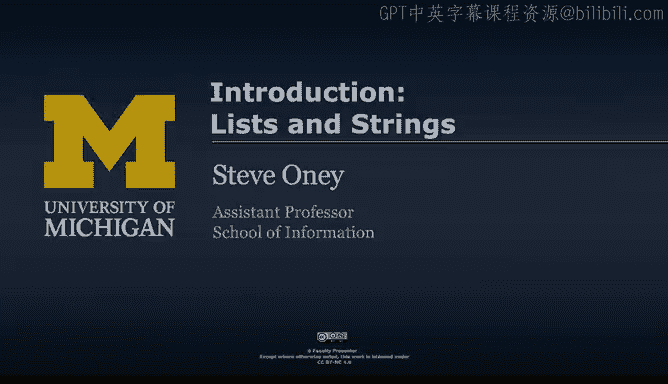
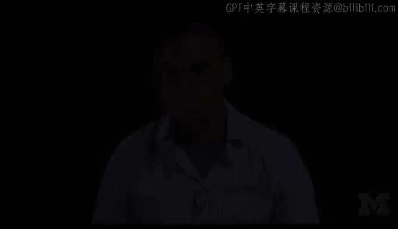

# 密歇根大学《Python3编程（课程1、2）》｜Python 3 Programming（Python for everyone进阶）（中英字幕） - P31：31_02_01_列表与字符串导论.zh_en - GPT中英字幕课程资源 - BV1CM411Z72u

In this lesson we're going to cover sequences sequences are ordered collections of items。

 so we'll cover strings which are ordered collections of characters that are good for representing text data like words。

 sentences， names or more， we'll also cover lists which are ordered collections of any kind of data for example。

 we might use a list of numbers to represent daily temperatures。

 or have a list of strings even to represent the users of an application。

These sequences also have what are called methods that allow us to extract and process data within the sequence。

By the end of this lesson， you'll learn how to create three kinds of sequences， strings， lists。

 and tuples。 you'll also be able to use indexing， slicing and sequence methods to analyze and manipulate these sequences See you at the end。

