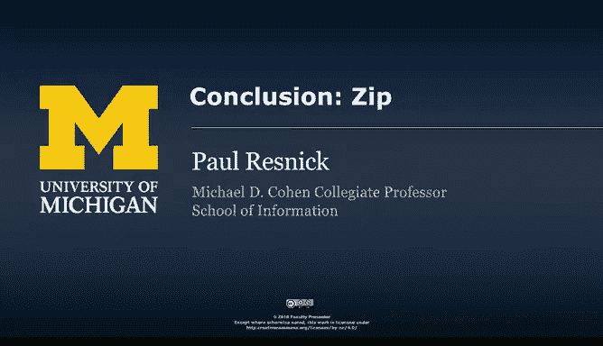

# 密歇根大学《Python3编程（课程3、4、5）》｜Python 3 Programming（Python for everyone进阶）（中英字幕） - P32：31_03_04_zip函数总结.zh_en - GPT中英字幕课程资源 - BV1gj41177yd

Welcome back。That was the zip function。You can use it whenever you want to do pairwise operations。

 For example， if you wanted to take three lists of words and generate a single list that had the longest of the three words in each position。

You could first zip all three lists together to generate a list of tuples。

 then you could write a list comprehension to do a mapping operation。

 transforming each tuple of three words into a single string， the longest of the three words。

I'll close with a little zipper joke。One day， I was picking up my son from preschool。 It was winter。

 Hey， this is Ann Arbor， and he was having trouble zipping up his coat。😊。

I explained it as I was showing him。 The secret is you have to get the left part of the zipper to fit in the other side before you try to zip it up。

He looked at me， quizzically， and said。Why does it have to be a secret。I'll see you next time。

