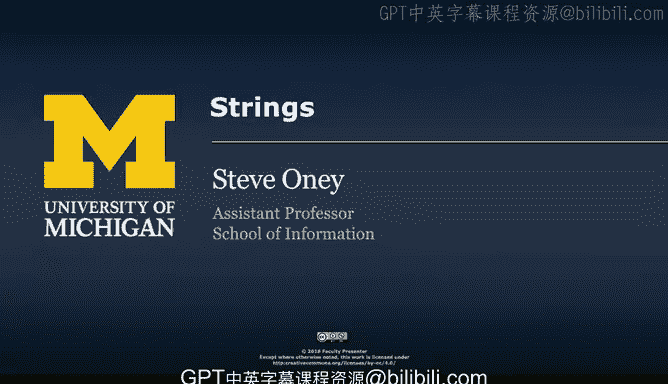
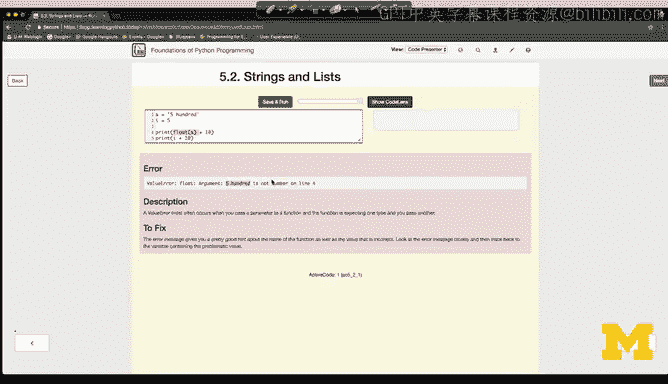

# 密歇根大学《Python3编程（课程1、2）》｜Python 3 Programming（Python for everyone进阶）（中英字幕） - P32：32_02_02_字符串操作.zh_en - GPT中英字幕课程资源 - BV1CM411Z72u

Welcome back。 Re that types are like categories of data and that different types are good for storing different kinds of things。

 So， for example， we've seen integers which are good for storing round numbers。

 and we've seen floats， which are good for storing floating points or decimals。In this lesson。

 we're going to learn three new kinds of types， strings， lists and tuples。

All three of these types are sequences， a sequence is an ordered collection。

 meaning that it's a collection of items and it has an order， meaning that it has a first item。

 a second item， a third item， and so on， and it also has a length。

So let's start by talking about strings。The simplest way to create a string is with a string literal expression。

So for example， here， we're creating a string and storing its value in the variable S。

I create a string by starting with either double quotes， or as I'll talk about in a little bit。

 single quotes。And then inside of those quotation marks， then I put the content of the string。

The content of this string is a sequence of characters， or letters。So in the case of this string。

 the first character is capital H。 The second character is lowercase E and so on。And in this string。

 we have exactly。1，2，3，4，5，6。 Yes， the space counts 7，8，9，10，11 characters。

 So I would say that the string S is 11 characters long。

We can also create strings using single quotes。So if I replace these double quotes with single quotes。

 then S is still a valid string。If we wanted to create a multi line string， we can use triple quotes。

So now if I print out the value of S。And I get hellello world。If I print out the value of M。

 then I get this multi line string。For multi line string。

 we can make these triple quotes either double quotes or。Single quote。Either is valid。

So we can use either double quotes or single quotes as long as we're consistent about which kind of quotation we're using。

 so for example， I can't start out this string s。With double quotes and end it with the single quote。

 if I try to do that， then I get a syntax error on line 1。 Instead。

 I need to either use double quotes for both the start and end so I could do this。

Or I need to use single quotes for both the start and end。

And the same is true for multi line strings。 We can either use three double quotes or three single quotes。

So I'm going to modify this string S a little bit。So first， here's another valid string。

 S equals capital M。And so if I print it out， then I get M。

So what this is doing is it's creating a string that's one character long。

 And that first character is capital M。Here's another slightly more confusing string。

So here S is a string that has zero characters in it。 So S has a length of 0。

And that's not to be confused with a string that has one character。

 but that character is a space here， the length of S is1。Whereas here， if I delete this space。

 the length of S is 0。One more note for strings。I can have a string that looks a lot like an integer。

 So， for example， I can say S equals 5。 And when I print out the value of S， then I get 5。To Python。

 this is entirely different than saying something like I equals the integer I。

So even though when I print these two things out， they look almost exactly the same in their representation。

 there are things that I can do with S or things that I can do with I that I can't do with the other because S is a string and I is an integer。

Just to show that these are different types， I'm going to print out the type。Of S。

And I'm going to print out the type of eye。So when I run this code。

 I see that I and S have different types。But this actually has consequences for what I can do with IMS。

So for example， let's suppose that I wanted to print out what 10 plus I was。

 I can say print out I plus 10。And now， when I print out S， then I get 5。

 And when I print out I plus 10， then I get 15。What if I tried to add 10 to S so that I printed out S plus 10？

Well， if I try to do this， then Python is actually going to give me a runtime error。

 And it's going to say that it can't concatenate string and intote your objects on line for。

 Just to break that down。 what it sank is that S is a string。

And I can't add an integer to a string because even though S is a string whose first character happens to be 5 to Python。

 that's still a string。 But even though to us， S looks like a number to Python。

 S is just a sequence of characters。 And so we can't add a number to a sequence of characters to Python。

 that doesn't make any sense to do。 And so we get a runtime error。

If we did want to add5 to something like us， then we would need to cast it first。

 so I could say print int。S。And this call to the function int。

Is going to cast the string S to be an integer。 So the value of this overall expression is the integer 5。

And so now when I run my code， then I can see that I can add 10 to the integer value of S。

Alternatively， I could cast it to be a floating point number so I could say floatat。S plus 10。

And then I would get 15。0 because the value of this expression。Is the string S or 5 cast to a float。

 And so the value of this overall expression is 5。0。And when we add 5。0 plus 10。

 then the value of this overall expression is 15。0。So one thing to note when we cast strings like s。

Into numbers by calling something like float S。Is that when we call float or int to cast the string。

 then the string needs to be a valid number。 What that means is that if I have something other than numbers in the string。

 So， for instance， let's suppose that I say 500。When I try to cast S。Into a float。

 Then I get a runtime error。 And what this is saying is that the string 500 is not a number。

 In other words， Python doesn't know how to convert this string into a float。

 And the same goes for integers。

