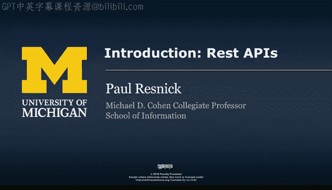

# 密歇根大学《Python3编程（课程3、4、5）》｜Python 3 Programming（Python for everyone进阶）（中英字幕） - P33：32_04_01_REST API简介.zh_en - GPT中英字幕课程资源 - BV1gj41177yd

Hey， everybody。Welcome back。 R APIs， this lesson。A P I。

 it's an acronym that stands for application programming Inter。

It's an interface that lets one computer program interact with another computer program。And rest。

Not rest as and take a deep breath and relax。It's another acronym。

 It stands for representational state transfer。Which actually isn't all that helpful either。

 Purris will be happy to explain you at length。 the more abstract meaning for representational state transfer。

But in everyday parlance， arrest API just means a website that produces data intended for another computer program to consume。

 rather than something intended to be displayed to people in a browser。

A rest API will respond to requests in a particular format。

 and some things are common across many APIs about the format。

 but some things are specific to the particular API。This week。

 you'll learn how to write programs in Python that interact with RE APIs。

You'll learn to read the documentation in order to figure out the specific format that the API is expecting。

And you'll learn how to use the Python request module to make the API of calls。Finally。

 you'll learn about caching as a way to reduce the total number of calls that you have to make to the APIs。

Before we dive into details of request APIs， though。

 we're going to take a little detour to give you some background on what goes on behind the scenes when two computers talk to each other over the Internet。

It'll give you a mental model of what's going on so that if things don't work perfectly the first time。

 and they never do。You'll know how to think about what might be going wrong and have a good path toward fixing it。

At the end of this lesson， you'll be able to parse a URL into its component parts。

 The protocol H TTP， or H TT P S。The host， typically a domain name and the path。

And you'll also be able to use the Python request module to fetch the contents of a URL。

Let's get started。 I'll see you， at the end。