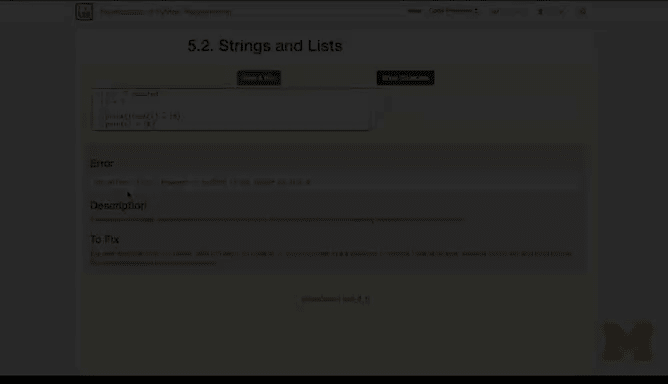
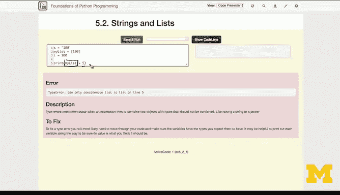

# 密歇根大学《Python3编程（课程1、2）》｜Python 3 Programming（Python for everyone进阶）（中英字幕） - P33：33_02_03_列表操作.zh_en - GPT中英字幕课程资源 - BV1CM411Z72u

Welcome back。So where strings like S are sequences of characters， lists are new kind of Python type。

 which are sequences of any type of value， which can include other strings or lists。

So lists are created。By using square brackets， so I start creating a list by using a left square bracket。

 and then I put my content separated by commas， so here I'll make the first item actually be a string。

I'll make the second item be an integer。And I'll make the third item be another string。

So when I print out my list。Then I get back the items that I actually put into the list。Now。

 just like strings， lists have an order and a length。 so in the case of this list my list。

 then I actually have three items。The first item is the string 1。

And then separating out every item is a comma。The second item is the integer， too。

Separated by a comma again。 And the third item is the string 3。

So I would say that this list has length three， the first item being one。

 the second item being the integer 2， the third item being the string  three。

So here are a few other examples of lists， so just like I can have an empty string。

 I can also have an empty list。So this is a list with length 0。I can also have a list with one item。

So， here。My list is a list with one item。 and that one item is the integer 100。Now。

 just like strings， this my list equals the list 100 is very different from creating an integer I equal to 100。

So even though these look similar to us to Python， these are entirely different and further。

 if I make S the string 100， then all three of these are entirely different things because S is a string。

 my list is a list， and I is an integer。So if I tried to do something like， say， my list plus5。

 then I would get a runtime error。Saying that we can only concatenate lists with other lists。

Because my list is a list， the only other thing that we can add to it is a list。

 as we'll talk about in a later lesson until next time。

