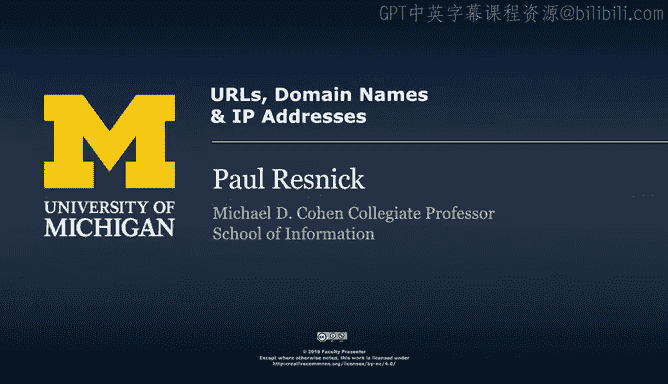
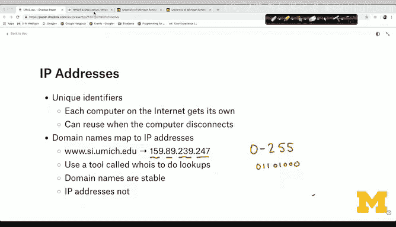
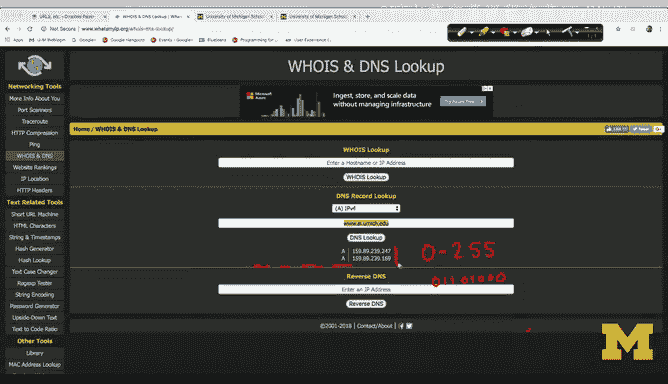
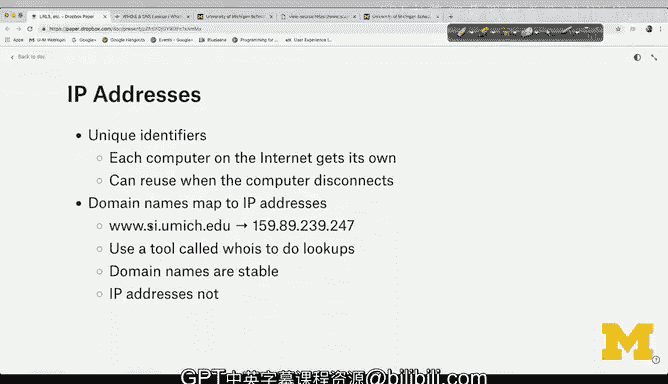

# 密歇根大学《Python3编程（课程3、4、5）》｜Python 3 Programming（Python for everyone进阶）（中英字幕） - P34：33_04_02_URL、域名与IP地址.zh_en - GPT中英字幕课程资源 - BV1gj41177yd

Welcome back before I show you how to write a program that will fetch data from a RE API。

From another website on the Internet， let's take a little time to figure out how the internet really works and what URLs are and all that kind of stuff。

So you're， I'm sure all' used to using a web browser， like we see here， this is。

A web browser where we're fetching a page from the Uish。 Eduu website。You see。In the URL bar。

That URL。H T T P， youish。Dady， do you slash about。you can think about parsing that as that theres a certain part before the colon。

And we'll call that。We'll call that the protocol。 In this case， H T TP is our protocol。

Then we have a colon slash slash。 That's just a separator。

 and then all the stuff until the next forward slash。Is called the domain or the the server。

Then we have another slash as a separator， and then we can have some other stuff。

Which well call the path。Or the arguments。So the server says where to fetch something from and the argument says what to fetch from that remote server。

The protocol says how to communicate with that remote server。Next， let's talk about those servers。

 Those servers are referred to by name。Usually you get a name like umi at E D U or S I doumish。

 E D U。Or。Www。gogle。 co。 Those are called domain names。And they say。

 what remote computer you're trying to talk to。Every computer that's attached to the Internet。

Has a unique identifier， an address it's called the IP P address IP stands Internet protocol。

And no two computers that are connected to the internet have the same IP address at the same time。

When the computer disconnects， you might get another computer getting to reuse that IP address。

When we have a domain name， like。Www。s。umedduu。That's sort of a more permanent name。

But the actual server that is responding to that name may change over time。

 and each server will have an IP address， so the internet has something called the DNS。

 the domain name system that is set up to resolve names like WwW。

 S Iummitdidu and turn them into these unique identifiers， the IP addresses。

An I P address will look something like。1，59 dot 89 dot2，39 dot 2，47。

The dots are just there to help us divide it up。And think about it as four chunks。

In each of those chunks， we have to have a number between0 and 255。

If you ever see an IP address that has a number bigger than 255， that's not really an IP address。

The numbers go from 0 to 255。 It turns out that you can represent that with 8 Bs，8 zeros and ones。

We're not going to go into the details of binary arithmetic here。

 but we get these four sets of 8 bits。And so we have a total of 32 Bs。

 Sometimes these are called 32 B addresses。And we have the decimal representations with the dots 159。

89 239。 247， just to make it a little easier for people to speak them and write them。

So how is it that www。site。umedduu gets converted into that number？

And how does every computer on the Internet？No to find that number whenever they're trying to communicate with www。

s。ish。duu。Turns out there's a distributed look up system， the domain name system。

 and you can go to various sites that will let you do this。 look up。

 Your computer has a way of doing that look up。 It has a server that it talks to in the background。

 But here's one that's public。 So I've gone to look。

I've already set this up here and you can see I've。Looked up www。s。youmiedidu。

 I actually got back two possible。IP addresses。The main IP address is the first one。

 so it's that 159。89。239。247。

That's the basics of URLs， domain names and IP addresses。 We'll see you next time。

