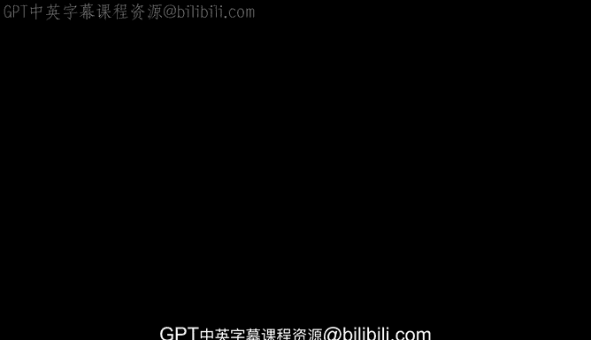
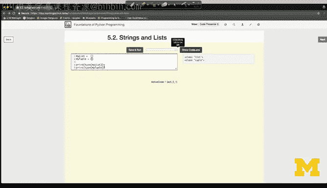

# 密歇根大学《Python3编程（课程1、2）》｜Python 3 Programming（Python for everyone进阶）（中英字幕） - P34：34_02_04_元组.zh_en - GPT中英字幕课程资源 - BV1CM411Z72u

Now， we said that we are going to cover three kinds of sequences。

 So we've already done strings and lists。But the third kind of sequence that I'm going to cover rather quickly are。

Tuples。The reason that I'm going to cover tuples relatively quickly are that tuples are just like lists。

 except the difference between a tuple and a list is that tuples are what are called immutable。

 meaning that after a tuple is created， it can't be changed。

 We're going to talk more about mutability later on。 But for now。

 I'm just going to cover how to create a tuple。So here I create a list with three items and to create a three item tuple。

 I would do something very similar。 so I would say my tuple equals。And basically。

 I would take almost the same syntax， except I would replace the square brackets。With parentheses。

 So the first item is the string 1。 The second item is the integer 2。 The third item is the string 3。

And I have to close parentheses to say that this is the end of the tuple。Now。

 if I print out the type of my tuple。And run it。 Then I'll see that list or my list。

Is a list in my tuple is a tuple。So for the most part， when creating tuples。

 then you can just use the same syntax that you use for lists。

 except replace these square brackets with parentheses。

There are just a few exceptions where creating tuples is slightly different from creating lists。

So let's suppose that I have a list。With。100 as its only item。

 and I want to create a couple with one item as well。 So I want that item to be 100。

When Python sees this expression， it actually thinks that this is an integer。 So when I run my code。

 then I can see that my tuple or this expression actually created an integer whose value is 100。

 And that's because Python was a little bit confused here。

 because it thought that I was putting 100 in parentheses。

To do something like change the order of operations。 So it thought that I meant to create an integer。

In order to specify that I want to create the Tuple 100， I just have to add an extra comma。

And with that extra comma， if I rerun my code， then I'll see that my tuple is a tuple again。

If i want to create a couple with zero items just like I can create a list with zero items。

Then I can just say open en close parentheses with nothing in it。

 And you'll see that my tuple is still a tuple。Until next time。

